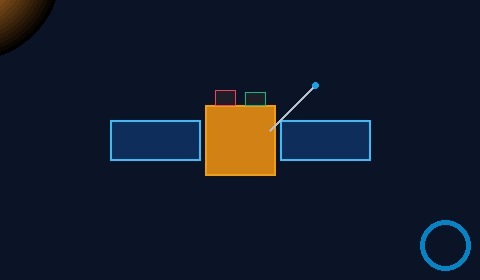
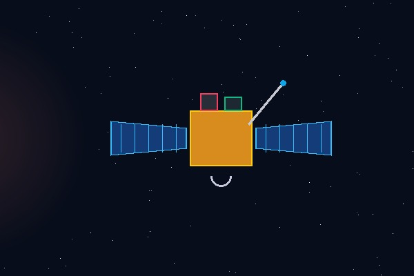

# Aditya-L1 Solar Telemetry & Event Monitoring Platform — Complete Antigravity Build Blueprint & Source Code

This master specification contains **every architectural detail, UI design token, state-machine workflow, data structure, and complete copy-ready source file** required for **Antigravity** (or any AI software engineering agent / IDE) to build and run the exact same [Aditya-L1](https://www.isro.gov.in/Aditya_L1.html) Solar Telemetry & Event Monitoring Platform and [ISSDC PRADAN](https://pradan1.issdc.gov.in/al1/) ingestion system.

## 1. System Overview & End-to-End Architecture

The project is a full-stack scientific telemetry management and space-weather anomaly detection platform designed around India's [Aditya-L1](https://www.isro.gov.in/Aditya_L1.html) mission at the Sun–Earth Lagrange Point L1 (~1.5 million km from Earth). It integrates three tightly coupled components:

| Component File | Role in the System | Key Technologies & Data Structures |
| :--- | :--- | :--- |
| `aditya_l1_space_anomaly_tracker.html` | Single-page interactive Mission Control Web Application with 6 specialized views, live UTC clock, Chart.js telemetry waveforms, HTML5 2D Canvas heliophysics simulations, and an interactive SQL workbench. | HTML5, Tailwind CSS (`3.4.17`), Chart.js (`4.4.1`), HTML5 2D `<canvas>`, Vanilla ES6 State Controller, `fetch('/api/poll')` with automatic client-side fallback. |
| `pradan_multi_payload_ingestor.py` | Stateful [ISSDC PRADAN](https://pradan1.issdc.gov.in/al1/) JSF (`browse.xhtml`) scraper, $O(1)$ hash-set deduplicator, live rolling-window API server (`--serve-api`), and 10,500-row indexing benchmark suite (`--demo-benchmark`). | Python 3.11+, `requests.Session`, `BeautifulSoup4`, `sqlite3` / `psycopg2`, `http.server.HTTPServer`, $O(1)$ `set` (`seen_identifiers`). |
| `aditya_l1_dbms_complete_schema_and_queries.sql` | Normalized 21-table [PostgreSQL](https://www.postgresql.org/docs/) 15+ relational schema (3NF/BCNF), seed data across all 7 payloads, analytical views, stored function `fn_find_l1_propagation_candidates`, and 6 course-project SQL queries. | PostgreSQL 15+ DDL, `TIMESTAMPTZ`, `JSONB` with `GIN` index, Composite B-Tree index (`idx_observation_payload_start`), Recursive CTE (`WITH RECURSIVE`). |

### Project Directory Layout for Antigravity

When setting up the workspace in Antigravity, place the files in the following structure:

```text
aditya-l1-telemetry-platform/
├── aditya_l1_space_anomaly_tracker.html          # Main Interactive Web Application
├── pradan_multi_payload_ingestor.py              # PRADAN JSF Ingestor + Live HTTP & /api/poll Server
├── aditya_l1_dbms_complete_schema_and_queries.sql# Complete 21-Table PostgreSQL Schema + Seed Data + 6 Queries
├── aditya_l1_dbms_project_documentation.md       # Project Documentation & Benchmark Report
└── assets/                                       # Optional local artwork folder (or base64-inlined in HTML)
    ├── hero_sun.jpg
    ├── hero_spacecraft.jpg
    ├── sidebar_spacecraft.jpg
    ├── icon_velc.png
    ├── icon_suit.png
    ├── icon_solexs.png
    ├── icon_hel1os.png
    ├── icon_aspex.png
    ├── icon_papa.png
    └── icon_mag.png
```

## 2. How the Website Is Written & How Every Feature Works

### 2.1 Visual Design System & Glassmorphic Dark Theme

- **Color Palette**:
  - **Primary Canvas Background**: `#050a15` (Deep space navy-black)
  - **Sidebar & Header Surface**: `#070d1b` with `border-slate-800/80`
  - **Glassmorphic Card Surface (`.platform-card`)**: `linear-gradient(180deg, rgba(13, 22, 40, 0.92) 0%, rgba(8, 14, 28, 0.95) 100%)` with `1px solid rgba(56, 189, 248, 0.18)` border, `backdrop-filter: blur(12px)`, and hover elevation (`translateY(-1px)`).
  - **Payload Card Accent Borders**:
    - [VELC](https://www.iiap.res.in/projects/velc/) (`.payload-card-velc`): Rose border `rgba(244, 63, 94, 0.45)`
    - **SUIT** (`.payload-card-suit`): Emerald/Green border `rgba(34, 197, 94, 0.45)`
    - **SoLEXS** (`.payload-card-solexs`): Orange border `rgba(249, 115, 22, 0.45)`
    - **HEL1OS** (`.payload-card-hel1os`): Teal/Emerald border `rgba(16, 185, 129, 0.45)`
    - [ASPEX](https://www.prl.res.in/ASPEX/) (`.payload-card-aspex`): Sky-blue border `rgba(56, 189, 248, 0.45)`
    - **PAPA** (`.payload-card-papa`): Amber border `rgba(245, 158, 11, 0.45)`
    - **MAG** (`.payload-card-mag`): Cyan-blue border `rgba(14, 165, 233, 0.45)`
- **Typography**:
  - UI & Headings: `Inter` (`400, 500, 600, 700, 800`)
  - Telemetry Timestamps, Identifiers, SQL & Logs (`.font-mono-code`): `JetBrains Mono` (`400, 500, 600`)

### 2.2 Single-Page View Routing & State Machine (`switchView`)

The application uses a centralized, zero-dependency JavaScript state object (`const state = { ... }`) inside an IIFE (`(function () { "use strict"; ... })()`).

1. **Six Main Views (`.tab-view` sections)**:
   - `#view-dashboard`: **Mission Dashboard** — Hero banner (Sun + Aditya-L1 at L1 + Sun–Earth L1 checklist card), 5 KPI summary cards, Solar X-ray Flux chart (`SoLEXS` & `HEL1OS`), Recent Solar Events table, 7-Payload Overview cards (`4 Remote-Sensing + 3 In-Situ`), Real-time Telemetry (`MAG`) chart, and Sun & Space Weather Status panel.
   - `#tab-anomaly`: **1. Space Anomaly Tracker & L1 Propagation** — Interactive HTML5 2D Canvas Sun → L1 Halo Orbit → Earth CME propagation visualizer with a `0.0h–24.0h` time scrubber, filterable `solar_event` cards, and the `event_product_link` cross-payload correlation table.
   - `#tab-payloads`: **2. 7-Payload Telemetry & Instrument Display** — Selector grid for all 7 payloads, live instrument quick-look 2D canvas, specialized PostgreSQL sub-table viewer (`velc_coronagraph_measurement`, `suit_imaging_measurement`, `xray_spectroscopy_measurement`, `insitu_particle_measurement`, `mag_field_measurement`), and dual Remote-Sensing vs. In-Situ Chart.js graphs.
   - `#tab-pradan`: **3. PRADAN JSF Ingestion & Deduplication** — Interactive simulator and live trigger for `/al1/protected/browse.xhtml`, showing the extracted `javax.faces.ViewState` token, in-memory `seen_identifiers` hash-set size, `ingestion_run` execution history table, and `ingestion_log` terminal audit stream.
   - `#tab-lineage`: **4. Provenance (`L0` → `L1` → `L2`) & Quality** — Interactive DAG cards tracing raw telemetry (`L0`) to calibrated (`L1`) and derived science products (`L2`), alongside `processing_step`, `calibration_record`, and `quality_record` tables.
   - `#tab-sql`: **5. PostgreSQL Queries, Schema & Index Benchmarks** — Interactive SQL Query Workbench for Queries `Q1`–`Q6` with copy/execute buttons, a Chart.js bar chart comparing Sequential Scan (`1.816 ms`) vs. Composite B-Tree Index Scan (`0.324 ms`, `5.6x` speedup), and a searchable 21-table schema explorer.
2. **Synchronized Navigation**:
   - Clicking any button in the left sidebar (`.sidebar-nav-btn`) or the secondary top bar (`.nav-tab-btn`) calls `switchView(targetViewId, sidebarNavAttr)`.
   - `switchView` toggles `.hidden` on `.tab-view` sections, updates active classes (`.sidebar-item-active` and `.tab-btn-active`), and triggers `chart.resize()` or canvas redraws after a `30 ms` layout tick so charts never render squashed.

### 2.3 Real-Time Live UTC Clock, Rolling Charts & One-Click PRADAN Polling

Instead of displaying static historical dates, the frontend computes all timestamps dynamically from the client's real-time UTC clock (`new Date()`):

1. **Helper Functions**:
   - `formatUtcParts(dateObj)`: Formats any `Date` into `{ dateStr: "DD Mon YYYY", timeStr: "HH:MM:SS UTC", shortStamp: "DD Mon HH:MM", hm: "HH:MM" }` using UTC methods (`getUTCDate()`, `getUTCHours()`, etc.).
   - `buildRollingLabels(count, stepMinutes)`: Generates rolling `HH:MM` axis labels ending at the current UTC minute.
2. **Every-Second Live Clock & 1.8-Second Telemetry Ticker**:
   - `syncClockDisplays()` updates `#liveUtcClock` in the sub-toolbar and `#dashDateDisplay` / `#dashTimeDisplay` in the **Last Updated** KPI card every `1,000 ms`.
   - Every `1,800 ms` (when `state.liveStreamActive` is `true`), the ticker increments `#dashTelemetryCounter`, appends a new synthetic or polled `Bx, By, Bz` vector sample to `dashMagChart`, and shifts the rolling time window.
3. **One-Click Live PRADAN Poll (`#pollPradanNowBtn` & `triggerLivePradanPoll`)**:
   - Clicking **Poll Now** in the top header bar first calls `fetch('http://127.0.0.1:8000/api/poll', { mode: 'cors' })` (which connects to `pradan_multi_payload_ingestor.py --serve-api`).
   - If the local Python daemon is running, it ingests the real JSON response (`polled_at_utc`, `window_start_utc`, `window_end_utc`, `viewstate_prefix`, `rows_discovered`, `rows_inserted`, `rows_skipped_dup`) directly into the UI tables.
   - If the HTML file is opened standalone without the Python daemon, the `catch` block seamlessly executes the identical rolling-window (`now - 1h → now`) JSF `ViewState` + $O(1)$ hash-set deduplication cycle in browser memory, updating `#currentViewStateToken`, `#hashSetSizeLabel`, `#kpiProductCount`, `#ingestionRunTableBody`, and `#ingestionTerminalLog`.

### 2.4 How the Python PRADAN Ingestor & Live API Server Works (`pradan_multi_payload_ingestor.py`)

1. **`PAYLOAD_REGISTRY`**: Maps all 7 payloads (`VELC`, `SUIT`, `SoLEXS`, `HEL1OS`, `ASPEX`, `PAPA`, `MAG`) to their PRADAN browse URLs, file formats (`FITS`, `CDF`, `NETCDF`), and filename validation regexes.
2. **`PradanPortalClient`**:
   - `extract_viewstate(html_text)`: Uses `BeautifulSoup` to find `<input name="javax.faces.ViewState">`. Raises `PradanSessionExpiredError` if redirected to `login.xhtml` or if `ViewExpiredException` is present.
   - `build_filter_form_payload(...)`: Constructs the exact JSF POST dictionary (`filterForm`, `ObservationTime="TIME_DURATION"`, `TIME_DURATION="CUSTOM_RANGE"`, `datetime1_input`, `datetime2_input`, `filterButton="Filter"`, `javax.faces.ViewState`).
   - `parse_lazy_doc_table(html_text, payload_code)`: Extracts rows from `filterForm:lazyDocTable` into `ParsedProductRecord` dataclasses.
3. **`ProductValidatorAndDeduplicator`**:
   - Maintains `self.seen_identifiers: Set[str]` for $O(1)$ average-time lookup.
   - Validates `processing_level in {"L0", "L1", "L2", "L3"}`, verifies `t_end > t_start`, and rejects negative file sizes before adding to `seen_identifiers`.
4. **Three CLI Execution Modes**:
   - `python3 pradan_multi_payload_ingestor.py --demo-benchmark`: Runs the 296-row VELC verification and the 10,500-row SQLite/PostgreSQL B-tree index benchmark (`1.816 ms` → `0.324 ms`).
   - `python3 pradan_multi_payload_ingestor.py --poll-live --hours 1`: Polls a rolling UTC window (`now - 1h → now`) across all 7 payloads and prints JSON.
   - `python3 pradan_multi_payload_ingestor.py --serve-api --port 8000`: Starts a local HTTP server that serves `aditya_l1_space_anomaly_tracker.html` at `http://127.0.0.1:8000/` and live JSON telemetry at `http://127.0.0.1:8000/api/poll`.

## 3. Complete Copy-Ready Frontend Code (`aditya_l1_space_anomaly_tracker.html`)

Save the following code as `aditya_l1_space_anomaly_tracker.html`:

```html
<!DOCTYPE html>
<html lang="en" class="dark">
<head>
  <meta charset="UTF-8" />
  <meta name="viewport" content="width=device-width, initial-scale=1.0" />
  <title>ADITYA-L1 — Solar Telemetry &amp; Event Monitoring Platform</title>
  <link rel="preconnect" href="https://fonts.googleapis.com" />
  <link rel="preconnect" href="https://fonts.gstatic.com" crossorigin />
  <link href="https://fonts.googleapis.com/css2?family=Inter:wght@400;500;600;700;800&amp;family=JetBrains+Mono:wght@400;500;600&amp;display=swap" rel="stylesheet" />
  <script src="https://cdn.tailwindcss.com/3.4.17"></script>
  <script src="https://cdn.jsdelivr.net/npm/chart.js@4.4.1/dist/chart.umd.min.js"></script>
  <style>
    :root {
      color-scheme: dark;
    }
    body {
      font-family: 'Inter', -apple-system, BlinkMacSystemFont, sans-serif;
      background-color: #050a15;
      color: #e2e8f0;
      overflow-x: hidden;
    }
    .font-mono-code {
      font-family: 'JetBrains Mono', monospace;
    }
    .platform-card {
      background: linear-gradient(180deg, rgba(13, 22, 40, 0.92) 0%, rgba(8, 14, 28, 0.95) 100%);
      border: 1px solid rgba(56, 189, 248, 0.18);
      box-shadow: 0 8px 30px rgba(0, 0, 0, 0.45), inset 0 1px 0 rgba(255, 255, 255, 0.05);
      backdrop-filter: blur(12px);
    }
    .platform-card-hover {
      transition: all 0.2s ease;
    }
    .platform-card-hover:hover {
      border-color: rgba(56, 189, 248, 0.45);
      transform: translateY(-1px);
    }
    .sidebar-item-active {
      background: linear-gradient(90deg, #1d6bf3 0%, #2589f5 100%);
      color: #ffffff;
      box-shadow: 0 4px 16px rgba(29, 107, 243, 0.45);
      border: 1px solid rgba(96, 165, 250, 0.5);
    }
    .tab-btn-active {
      background: linear-gradient(135deg, rgba(29, 107, 243, 0.35), rgba(56, 189, 248, 0.25));
      border-color: rgba(56, 189, 248, 0.7);
      color: #f8fafc;
    }
    .flare-callout {
      background: linear-gradient(180deg, rgba(185, 28, 28, 0.92) 0%, rgba(127, 29, 29, 0.95) 100%);
      border: 1px solid rgba(248, 113, 113, 0.7);
      box-shadow: 0 0 16px rgba(239, 68, 68, 0.55);
    }
    .pulse-dot {
      animation: pulseGlow 1.8s infinite;
    }
    @keyframes pulseGlow {
      0%, 100% { opacity: 1; transform: scale(1); }
      50% { opacity: 0.4; transform: scale(1.3); }
    }
    /* Custom Payload Card Borders matching reference UI */
    .payload-card-velc { border: 1px solid rgba(244, 63, 94, 0.45); box-shadow: inset 0 0 18px rgba(244, 63, 94, 0.08); }
    .payload-card-suit { border: 1px solid rgba(34, 197, 94, 0.45); box-shadow: inset 0 0 18px rgba(34, 197, 94, 0.08); }
    .payload-card-solexs { border: 1px solid rgba(249, 115, 22, 0.45); box-shadow: inset 0 0 18px rgba(249, 115, 22, 0.08); }
    .payload-card-hel1os { border: 1px solid rgba(16, 185, 129, 0.45); box-shadow: inset 0 0 18px rgba(16, 185, 129, 0.08); }
    .payload-card-aspex { border: 1px solid rgba(56, 189, 248, 0.45); box-shadow: inset 0 0 18px rgba(56, 189, 248, 0.08); }
    .payload-card-papa { border: 1px solid rgba(245, 158, 11, 0.45); box-shadow: inset 0 0 18px rgba(245, 158, 11, 0.08); }
    .payload-card-mag { border: 1px solid rgba(14, 165, 233, 0.45); box-shadow: inset 0 0 18px rgba(14, 165, 233, 0.08); }

    ::-webkit-scrollbar { width: 6px; height: 6px; }
    ::-webkit-scrollbar-track { background: #050a15; }
    ::-webkit-scrollbar-thumb { background: #1e293b; border-radius: 3px; }
    ::-webkit-scrollbar-thumb:hover { background: #38bdf8; }
  </style>
</head>
<body class="min-h-screen flex bg-[#050a15] text-slate-100 selection:bg-sky-500/30 selection:text-sky-200">

  <!-- ====================================================================== -->
  <!-- LEFT SIDEBAR NAVIGATION (MATCHING REFERENCE MOCKUP)                    -->
  <!-- ====================================================================== -->
  <aside id="leftSidebar" class="w-60 shrink-0 bg-[#070d1b] border-r border-slate-800/80 flex flex-col justify-between select-none z-30 transition-all duration-200">
    <div>
      <!-- Top Brand Logo -->
      <div class="h-14 px-4 flex items-center gap-3 border-b border-slate-800/80">
        <div class="w-9 h-9 rounded-full bg-gradient-to-br from-amber-400 via-orange-500 to-red-600 flex items-center justify-center shadow-lg shadow-orange-500/30 shrink-0">
          <svg class="w-5 h-5 text-white" viewBox="0 0 24 24" fill="none" stroke="currentColor" stroke-width="2">
            <circle cx="12" cy="12" r="4" fill="currentColor" />
            <path d="M12 2v3M12 19v3M4.93 4.93l2.12 2.12M16.95 16.95l2.12 2.12M2 12h3M19 12h3M4.93 19.07l2.12-2.12M16.95 7.05l2.12-2.12" />
          </svg>
        </div>
        <div class="leading-tight">
          <div class="font-extrabold text-sm tracking-wide text-white">ADITYA-L1</div>
          <div class="text-[11px] text-slate-400">Solar Telemetry Platform</div>
        </div>
      </div>

      <!-- Navigation Links -->
      <nav class="p-3 space-y-1 text-xs font-medium">
        <button type="button" data-nav="view-dashboard" class="sidebar-nav-btn sidebar-item-active w-full flex items-center gap-3 px-3.5 py-2.5 rounded-xl text-left transition cursor-pointer">
          <svg class="w-4 h-4 shrink-0" viewBox="0 0 24 24" fill="none" stroke="currentColor" stroke-width="2"><path d="M3 9.5L12 3l9 6.5V20a1 1 0 0 1-1 1h-5v-6h-6v6H4a1 1 0 0 1-1-1V9.5z"/></svg>
          <span>Dashboard</span>
        </button>

        <button type="button" data-nav="tab-payloads" class="sidebar-nav-btn w-full flex items-center gap-3 px-3.5 py-2.5 rounded-xl text-slate-300 hover:bg-slate-800/60 hover:text-white text-left transition cursor-pointer">
          <svg class="w-4 h-4 shrink-0 text-sky-400" viewBox="0 0 24 24" fill="none" stroke="currentColor" stroke-width="2"><path d="M21 3l-6 6M3 21l6-6M14.5 9.5L9.5 14.5M5 7l4 4M15 17l4 4"/><circle cx="12" cy="12" r="2"/></svg>
          <span>Payloads</span>
        </button>

        <button type="button" data-nav="tab-anomaly" class="sidebar-nav-btn w-full flex items-center gap-3 px-3.5 py-2.5 rounded-xl text-slate-300 hover:bg-slate-800/60 hover:text-white text-left transition cursor-pointer">
          <svg class="w-4 h-4 shrink-0 text-cyan-400" viewBox="0 0 24 24" fill="none" stroke="currentColor" stroke-width="2"><path d="M2 12h4l3-9 6 18 3-9h4"/></svg>
          <span>Telemetry</span>
        </button>

        <button type="button" data-nav="view-events" class="sidebar-nav-btn w-full flex items-center gap-3 px-3.5 py-2.5 rounded-xl text-slate-300 hover:bg-slate-800/60 hover:text-white text-left transition cursor-pointer">
          <svg class="w-4 h-4 shrink-0 text-amber-400" viewBox="0 0 24 24" fill="none" stroke="currentColor" stroke-width="2"><circle cx="12" cy="12" r="4"/><path d="M12 2v2M12 20v2M4.93 4.93l1.41 1.41M17.66 17.66l1.41 1.41M2 12h2M20 12h2M4.93 19.07l1.41-1.41M17.66 6.34l1.41-1.41"/></svg>
          <span>Solar Events</span>
        </button>

        <button type="button" data-nav="view-analytics" class="sidebar-nav-btn w-full flex items-center gap-3 px-3.5 py-2.5 rounded-xl text-slate-300 hover:bg-slate-800/60 hover:text-white text-left transition cursor-pointer">
          <svg class="w-4 h-4 shrink-0 text-indigo-400" viewBox="0 0 24 24" fill="none" stroke="currentColor" stroke-width="2"><path d="M18 20V10M12 20V4M6 20v-6"/></svg>
          <span>Analytics</span>
        </button>

        <!-- Data Structures with Chevron -->
        <button type="button" data-nav="tab-pradan" class="sidebar-nav-btn w-full flex items-center justify-between px-3.5 py-2.5 rounded-xl text-slate-300 hover:bg-slate-800/60 hover:text-white text-left transition cursor-pointer">
          <span class="flex items-center gap-3">
            <svg class="w-4 h-4 shrink-0 text-emerald-400" viewBox="0 0 24 24" fill="none" stroke="currentColor" stroke-width="2"><rect x="3" y="3" width="7" height="7" rx="1"/><rect x="14" y="3" width="7" height="7" rx="1"/><rect x="14" y="14" width="7" height="7" rx="1"/><rect x="3" y="14" width="7" height="7" rx="1"/></svg>
            <span>Data Structures</span>
          </span>
          <svg class="w-3.5 h-3.5 text-slate-400" viewBox="0 0 24 24" fill="none" stroke="currentColor" stroke-width="2"><path d="M6 9l6 6 6-6"/></svg>
        </button>

        <!-- Database with Chevron -->
        <button type="button" data-nav="tab-sql" class="sidebar-nav-btn w-full flex items-center justify-between px-3.5 py-2.5 rounded-xl text-slate-300 hover:bg-slate-800/60 hover:text-white text-left transition cursor-pointer">
          <span class="flex items-center gap-3">
            <svg class="w-4 h-4 shrink-0 text-sky-400" viewBox="0 0 24 24" fill="none" stroke="currentColor" stroke-width="2"><ellipse cx="12" cy="5" rx="9" ry="3"/><path d="M21 12c0 1.66-4 3-9 3s-9-1.34-9-3"/><path d="M3 5v14c0 1.66 4 3 9 3s9-1.34 9-3V5"/></svg>
            <span>Database</span>
          </span>
          <svg class="w-3.5 h-3.5 text-slate-400" viewBox="0 0 24 24" fill="none" stroke="currentColor" stroke-width="2"><path d="M6 9l6 6 6-6"/></svg>
        </button>

        <button type="button" data-nav="tab-lineage" class="sidebar-nav-btn w-full flex items-center gap-3 px-3.5 py-2.5 rounded-xl text-slate-300 hover:bg-slate-800/60 hover:text-white text-left transition cursor-pointer">
          <svg class="w-4 h-4 shrink-0 text-amber-300" viewBox="0 0 24 24" fill="none" stroke="currentColor" stroke-width="2"><path d="M14 2H6a2 2 0 0 0-2 2v16a2 2 0 0 0 2 2h12a2 2 0 0 0 2-2V8z"/><path d="M14 2v6h6M16 13H8M16 17H8M10 9H8"/></svg>
          <span>Reports</span>
        </button>

        <button type="button" data-nav="view-settings" class="sidebar-nav-btn w-full flex items-center gap-3 px-3.5 py-2.5 rounded-xl text-slate-300 hover:bg-slate-800/60 hover:text-white text-left transition cursor-pointer">
          <svg class="w-4 h-4 shrink-0 text-slate-400" viewBox="0 0 24 24" fill="none" stroke="currentColor" stroke-width="2"><circle cx="12" cy="12" r="3"/><path d="M19.4 15a1.65 1.65 0 0 0 .33 1.82l.06.06a2 2 0 1 1-2.83 2.83l-.06-.06a1.65 1.65 0 0 0-1.82-.33 1.65 1.65 0 0 0-1 1.51V21a2 2 0 1 1-4 0v-.09A1.65 1.65 0 0 0 9 19.4a1.65 1.65 0 0 0-1.82.33l-.06.06a2 2 0 1 1-2.83-2.83l.06-.06a1.65 1.65 0 0 0 .33-1.82 1.65 1.65 0 0 0-1.51-1H3a2 2 0 1 1 0-4h.09A1.65 1.65 0 0 0 4.6 9a1.65 1.65 0 0 0-.33-1.82l-.06-.06a2 2 0 1 1 2.83-2.83l.06.06a1.65 1.65 0 0 0 1.82.33H9a1.65 1.65 0 0 0 1-1.51V3a2 2 0 1 1 4 0v.09a1.65 1.65 0 0 0 1 1.51 1.65 1.65 0 0 0 1.82-.33l.06-.06a2 2 0 1 1 2.83 2.83l-.06.06a1.65 1.65 0 0 0-.33 1.82V9c.26.604.852.997 1.51 1H21a2 2 0 1 1 0 4h-.09a1.65 1.65 0 0 0-1.51 1z"/></svg>
          <span>Settings</span>
        </button>
      </nav>
    </div>

    <!-- Bottom Spacecraft Artwork & Tagline Card -->
    <div class="p-3 space-y-2">
      <div class="relative rounded-xl overflow-hidden border border-slate-800/80">
        
        <div class="absolute inset-0 bg-gradient-to-t from-[#070d1b] via-transparent to-transparent"></div>
      </div>
      <div class="p-3 rounded-xl bg-[#0b1326] border border-slate-800/90">
        <div class="text-xs font-bold text-amber-400">Aditya-L1</div>
        <div class="text-[11px] text-slate-300 leading-snug mt-0.5">
          Observing the Sun<br/>for a Safer Tomorrow
        </div>
      </div>
    </div>
  </aside>

  <!-- ====================================================================== -->
  <!-- RIGHT MAIN CONTENT AREA                                                -->
  <!-- ====================================================================== -->
  <div class="flex-1 flex flex-col min-w-0">

    <!-- TOP HEADER BAR (MATCHING REFERENCE MOCKUP) -->
    <header class="h-14 px-4 bg-[#070d1b]/95 border-b border-slate-800/80 flex items-center justify-between gap-3 sticky top-0 z-20 backdrop-blur-md">
      <div class="flex items-center gap-3">
        <button id="sidebarToggleBtn" type="button" class="p-2 rounded-lg text-slate-300 hover:text-white hover:bg-slate-800/70 transition cursor-pointer" title="Toggle Sidebar">
          <svg class="w-5 h-5" viewBox="0 0 24 24" fill="none" stroke="currentColor" stroke-width="2"><path d="M4 6h16M4 12h16M4 18h16"/></svg>
        </button>
        <div class="hidden sm:flex items-center gap-2 text-xs text-slate-400">
          <span id="headerAlertBadge" class="px-2 py-0.5 rounded-full bg-rose-500/15 text-rose-300 border border-rose-500/30 font-medium flex items-center gap-1.5">
            <span class="w-1.5 h-1.5 rounded-full bg-rose-400 pulse-dot"></span>
            <span id="headerAlertText">EV-2026-032: Solar Flare Detected (SoLEXS, HEL1OS, SUIT)</span>
          </span>
        </div>
      </div>

      <!-- Search, Live Status, Bell & Profile -->
      <div class="flex items-center gap-2.5">
        <div class="relative">
          <svg class="w-4 h-4 text-slate-400 absolute left-3 top-1/2 -translate-y-1/2 pointer-events-none" viewBox="0 0 24 24" fill="none" stroke="currentColor" stroke-width="2"><circle cx="11" cy="11" r="8"/><path d="M21 21l-4.35-4.35"/></svg>
          <input id="globalSearchInput" type="text" placeholder="Search payload, event, or telemetry..." class="w-48 sm:w-72 bg-[#0d1629] border border-slate-700/80 rounded-lg pl-9 pr-3 py-1.5 text-xs text-slate-100 placeholder-slate-400 focus:outline-none focus:border-sky-400" />
        </div>

        <button id="liveStreamToggleBtn" type="button" class="px-3 py-1.5 rounded-lg bg-[#0d1629] hover:bg-slate-800 border border-slate-700/80 flex items-center gap-2 text-xs font-semibold text-white transition cursor-pointer">
          <span id="liveIndicatorDot" class="w-2.5 h-2.5 rounded-full bg-red-500 pulse-dot"></span>
          <span id="liveIndicatorText">Live</span>
        </button>

        <button id="openNewAnomalyModalBtn" type="button" class="hidden md:inline-flex px-3 py-1.5 rounded-lg bg-gradient-to-r from-amber-500 to-orange-600 hover:from-amber-400 hover:to-orange-500 text-slate-950 font-semibold text-xs transition cursor-pointer">
          + Log Anomaly Event
        </button>

        <button id="notifBellBtn" type="button" class="relative p-2 rounded-lg bg-[#0d1629] hover:bg-slate-800 border border-slate-800 text-slate-300 hover:text-white transition cursor-pointer" title="System Alerts">
          <svg class="w-4 h-4" viewBox="0 0 24 24" fill="none" stroke="currentColor" stroke-width="2"><path d="M18 8A6 6 0 0 0 6 8c0 7-3 9-3 9h18s-3-2-3-9"/><path d="M13.73 21a2 2 0 0 1-3.46 0"/></svg>
          <span class="w-2 h-2 rounded-full bg-sky-400 absolute top-1.5 right-1.5"></span>
        </button>

        <button id="profileAvatarBtn" type="button" class="w-8 h-8 rounded-full bg-gradient-to-br from-slate-600 to-slate-800 border border-slate-600 flex items-center justify-center text-slate-200 hover:border-sky-400 transition cursor-pointer" title="Mission Operator Profile">
          <svg class="w-4 h-4" viewBox="0 0 24 24" fill="none" stroke="currentColor" stroke-width="2"><path d="M20 21v-2a4 4 0 0 0-4-4H8a4 4 0 0 0-4 4v2"/><circle cx="12" cy="7" r="4"/></svg>
        </button>
      </div>
    </header>

    <!-- Secondary Quick-Switch Sub-Toolbar (Preserves instant access to DBMS tabs) -->
    <div class="bg-[#070d1b]/60 border-b border-slate-800/60 px-4 py-1.5 flex items-center justify-between gap-2 overflow-x-auto text-[11px]">
      <div class="flex items-center gap-1.5">
        <button type="button" data-tab="view-dashboard" class="nav-tab-btn tab-btn-active px-2.5 py-1 rounded-md border border-slate-700/80 font-medium whitespace-nowrap cursor-pointer">
          Mission Dashboard
        </button>
        <button type="button" data-tab="tab-anomaly" class="nav-tab-btn px-2.5 py-1 rounded-md border border-slate-800 text-slate-300 hover:text-white font-medium whitespace-nowrap cursor-pointer">
          1. Space Anomaly Tracker &amp; L1 Propagation
        </button>
        <button type="button" data-tab="tab-payloads" class="nav-tab-btn px-2.5 py-1 rounded-md border border-slate-800 text-slate-300 hover:text-white font-medium whitespace-nowrap cursor-pointer">
          2. 7-Payload Telemetry &amp; Instrument Display
        </button>
        <button type="button" data-tab="tab-pradan" class="nav-tab-btn px-2.5 py-1 rounded-md border border-slate-800 text-slate-300 hover:text-white font-medium whitespace-nowrap cursor-pointer">
          3. PRADAN JSF Ingestion &amp; Deduplication
        </button>
        <button type="button" data-tab="tab-lineage" class="nav-tab-btn px-2.5 py-1 rounded-md border border-slate-800 text-slate-300 hover:text-white font-medium whitespace-nowrap cursor-pointer">
          4. Provenance (L0→L1→L2) &amp; Quality
        </button>
        <button type="button" data-tab="tab-sql" class="nav-tab-btn px-2.5 py-1 rounded-md border border-slate-800 text-slate-300 hover:text-white font-medium whitespace-nowrap cursor-pointer">
          5. PostgreSQL Queries, Schema &amp; Index Benchmarks
        </button>
      </div>
      <div class="hidden xl:flex items-center gap-3 text-slate-400 shrink-0">
        <span>UTC: <strong id="liveUtcClock" class="font-mono-code text-sky-300">17 Oct 2026 03:24:39 UTC</strong></span>
        <span>B<sub>z</sub>: <strong id="headerBzMetric" class="font-mono-code text-emerald-400">-22.8 nT</strong></span>
        <span>SW: <strong id="headerSpeedMetric" class="font-mono-code text-amber-300">412 km/s</strong></span>
      </div>
    </div>

    <!-- MAIN CONTENT SCROLL CONTAINER -->
    <main class="flex-1 p-4 space-y-4 overflow-y-auto">

      <!-- ==================================================================== -->
      <!-- PRIMARY VIEW: DASHBOARD (EXACT MATCH TO UPLOADED SCREENSHOT)         -->
      <!-- ==================================================================== -->
      <section id="view-dashboard" class="tab-view space-y-4">

        <!-- 1. HERO BANNER (SUN + ADITYA-L1 SPACECRAFT AT L1 + RIGHT INFO CARD) -->
        <div class="relative rounded-2xl overflow-hidden border border-sky-500/25 bg-[#070e1e] min-h-[195px] flex flex-col lg:flex-row items-center justify-between px-4 sm:px-6 py-4 gap-4 shadow-2xl">
          <!-- Left Glowing Sun Image -->
          
          <!-- Right-Center Spacecraft Image -->
          
          <!-- Subtle Gradient Blending Overlays -->
          <div class="absolute inset-0 bg-gradient-to-r from-transparent via-[#070e1e]/80 to-[#070e1e]/90 pointer-events-none"></div>

          <!-- Center Title Block -->
          <div class="relative z-10 lg:ml-56 max-w-xl space-y-1.5">
            <h1 class="text-2xl sm:text-4xl font-extrabold tracking-tight text-white drop-shadow">
              ADITYA-L1
            </h1>
            <div class="text-sm sm:text-lg font-medium text-slate-100">
              Solar Telemetry &amp; Event Monitoring Platform
            </div>
            <div class="text-xs text-slate-300 flex flex-wrap items-center gap-2 pt-0.5">
              <span>Real-time monitoring</span>
              <span class="text-sky-400">•</span>
              <span>Multi-payload analysis</span>
              <span class="text-sky-400">•</span>
              <span>Solar event detection</span>
            </div>
          </div>

          <!-- Dashed L1 Marker -->
          <div class="hidden xl:flex relative z-10 items-center gap-2 text-xs text-sky-300 font-semibold">
            <span class="w-2 h-2 rounded-full bg-sky-300 shadow-[0_0_10px_#38bdf8]"></span>
            <span>L1</span>
            <span class="w-16 border-t border-dashed border-sky-400/60"></span>
          </div>

          <!-- Far-Right Glassmorphic Card: Sun - Earth L1 Point -->
          <div class="relative z-10 w-full lg:w-64 rounded-xl bg-[#0b1528]/90 border border-sky-400/30 p-3.5 backdrop-blur-md shadow-lg">
            <div class="text-xs font-bold text-white mb-2">Sun – Earth L1 Point</div>
            <ul class="space-y-1.5 text-[11px] text-slate-200">
              <li class="flex items-center gap-2">
                <span class="w-4 h-4 rounded-full bg-emerald-500/20 border border-emerald-400/50 text-emerald-400 flex items-center justify-center text-[10px]">✓</span>
                <span>Distance: ~1.5 million km</span>
              </li>
              <li class="flex items-center gap-2">
                <span class="w-4 h-4 rounded-full bg-emerald-500/20 border border-emerald-400/50 text-emerald-400 flex items-center justify-center text-[10px]">✓</span>
                <span>Continuous solar observation</span>
              </li>
              <li class="flex items-center gap-2">
                <span class="w-4 h-4 rounded-full bg-emerald-500/20 border border-emerald-400/50 text-emerald-400 flex items-center justify-center text-[10px]">✓</span>
                <span>No Earth occultation</span>
              </li>
              <li class="flex items-center gap-2">
                <span class="w-4 h-4 rounded-full bg-emerald-500/20 border border-emerald-400/50 text-emerald-400 flex items-center justify-center text-[10px]">✓</span>
                <span>7 scientific payloads</span>
              </li>
            </ul>
          </div>
        </div>

        <!-- 2. FIVE KPI SUMMARY CARDS ROW (EXACT MATCH TO MOCKUP) -->
        <div class="grid grid-cols-1 sm:grid-cols-2 lg:grid-cols-5 gap-3.5">
          <!-- KPI 1: Total Payloads -->
          <div class="platform-card platform-card-hover rounded-xl p-4 flex flex-col justify-between">
            <div class="flex items-center gap-2.5">
              <div class="w-8 h-8 rounded-lg bg-sky-500/15 border border-sky-500/30 flex items-center justify-center text-sky-400">
                <svg class="w-4 h-4" viewBox="0 0 24 24" fill="none" stroke="currentColor" stroke-width="2"><path d="M21 3l-6 6M3 21l6-6M14.5 9.5L9.5 14.5M5 7l4 4M15 17l4 4"/></svg>
              </div>
              <span class="text-xs font-medium text-slate-200">Total Payloads</span>
            </div>
            <div class="text-3xl font-extrabold text-white my-2 pl-1">7</div>
            <div class="flex items-center justify-between text-[11px] text-slate-400 border-t border-slate-800/80 pt-2">
              <span>4 Remote-sensing</span>
              <span class="text-slate-600">|</span>
              <span>3 In-situ</span>
            </div>
          </div>

          <!-- KPI 2: Total Telemetry Records -->
          <div class="platform-card platform-card-hover rounded-xl p-4 flex flex-col justify-between">
            <div class="flex items-center gap-2.5">
              <div class="w-8 h-8 rounded-lg bg-sky-500/15 border border-sky-500/30 flex items-center justify-center text-sky-400">
                <svg class="w-4 h-4" viewBox="0 0 24 24" fill="none" stroke="currentColor" stroke-width="2"><path d="M2 12h4l3-9 6 18 3-9h4"/></svg>
              </div>
              <span class="text-xs font-medium text-slate-200">Total Telemetry Records</span>
            </div>
            <div id="dashTelemetryCounter" class="text-2xl sm:text-3xl font-extrabold text-white my-2 tracking-tight">1,248,320</div>
            <div class="flex items-center gap-1.5 text-[11px] text-emerald-400 border-t border-slate-800/80 pt-2 font-medium">
              <span>↑ 12.4% (last 24h)</span>
              <span class="text-slate-500 ml-auto font-mono-code text-[10px]">DB: <span id="kpiProductCount">22</span> L0-L2</span>
            </div>
          </div>

          <!-- KPI 3: Detected Solar Events -->
          <div class="platform-card platform-card-hover rounded-xl p-4 flex flex-col justify-between">
            <div class="flex items-center justify-between">
              <div class="flex items-center gap-2">
                <div class="w-8 h-8 rounded-lg bg-rose-500/15 border border-rose-500/30 flex items-center justify-center text-rose-400">
                  <svg class="w-4 h-4" viewBox="0 0 24 24" fill="none" stroke="currentColor" stroke-width="2"><path d="M10.29 3.86L1.82 18a2 2 0 0 0 1.71 3h16.94a2 2 0 0 0 1.71-3L13.71 3.86a2 2 0 0 0-3.42 0z"/><line x1="12" y1="9" x2="12" y2="13"/><line x1="12" y1="17" x2="12.01" y2="17"/></svg>
                </div>
                <span class="text-xs font-medium text-slate-200">Detected Solar Events</span>
              </div>
            </div>
            <div class="flex items-center justify-between mt-1">
              <div id="dashTotalEventsCounter" class="text-3xl font-extrabold text-white pl-1">32</div>
              <div class="space-y-0.5 text-[11px]">
                <div class="flex items-center gap-1.5"><span class="w-2 h-2 rounded-full bg-rose-500"></span><span id="critCountLabel" class="text-slate-200">5 Critical</span></div>
                <div class="flex items-center gap-1.5"><span class="w-2 h-2 rounded-full bg-orange-500"></span><span class="text-slate-200">12 High</span></div>
                <div class="flex items-center gap-1.5"><span class="w-2 h-2 rounded-full bg-amber-400"></span><span class="text-slate-200">10 Moderate</span></div>
                <div class="flex items-center gap-1.5"><span class="w-2 h-2 rounded-full bg-emerald-400"></span><span class="text-slate-200">5 Low</span></div>
              </div>
            </div>
            <span id="kpiAnomalyCount" class="hidden">4</span>
          </div>

          <!-- KPI 4: Active Sensors -->
          <div class="platform-card platform-card-hover rounded-xl p-4 flex flex-col justify-between">
            <div class="flex items-center gap-2.5">
              <div class="w-8 h-8 rounded-lg bg-cyan-500/15 border border-cyan-500/30 flex items-center justify-center text-cyan-400">
                <svg class="w-4 h-4" viewBox="0 0 24 24" fill="none" stroke="currentColor" stroke-width="2"><ellipse cx="12" cy="5" rx="9" ry="3"/><path d="M21 12c0 1.66-4 3-9 3s-9-1.34-9-3"/><path d="M3 5v14c0 1.66 4 3 9 3s9-1.34 9-3V5"/></svg>
              </div>
              <span class="text-xs font-medium text-slate-200">Active Sensors</span>
            </div>
            <div class="text-3xl font-extrabold text-white my-2 pl-1">21</div>
            <div class="flex items-center gap-1.5 text-[11px] text-emerald-400 border-t border-slate-800/80 pt-2">
              <span class="w-3.5 h-3.5 rounded-full bg-emerald-500/20 border border-emerald-400/50 flex items-center justify-center text-[9px]">✓</span>
              <span>All systems nominal</span>
            </div>
          </div>

          <!-- KPI 5: Last Updated -->
          <div class="platform-card platform-card-hover rounded-xl p-4 flex flex-col justify-between">
            <div class="flex items-center gap-2.5">
              <div class="w-8 h-8 rounded-lg bg-sky-500/15 border border-sky-500/30 flex items-center justify-center text-sky-400">
                <svg class="w-4 h-4" viewBox="0 0 24 24" fill="none" stroke="currentColor" stroke-width="2"><circle cx="12" cy="12" r="10"/><polyline points="12 6 12 12 16 14"/></svg>
              </div>
              <span class="text-xs font-medium text-slate-200">Last Updated</span>
            </div>
            <div class="my-1">
              <div id="dashDateDisplay" class="text-lg font-extrabold text-white">LIVE UTC</div>
              <div id="dashTimeDisplay" class="text-xs font-mono-code text-sky-300">Syncing UTC...</div>
            </div>
            <div class="flex items-center justify-between text-[11px] text-emerald-400 border-t border-slate-800/80 pt-2">
              <span class="flex items-center gap-1.5"><span class="w-2 h-2 rounded-full bg-emerald-400 pulse-dot"></span><span id="liveBridgeStatusText">Live UTC Stream</span></span>
              <button id="pollPradanNowBtn" type="button" class="px-1.5 py-0.5 rounded bg-sky-500/20 hover:bg-sky-500/30 border border-sky-500/40 text-sky-300 text-[10px] font-semibold cursor-pointer" title="Poll Rolling UTC Window from PRADAN / Local Bridge">Poll Now</button>
            </div>
          </div>
        </div>

        <!-- Hidden KPI mirrors to keep previous test IDs intact -->
        <div class="hidden">
          <span id="kpiTransitLag">21.4 hrs</span>
          <span id="kpiDupBlocked">295</span>
          <span id="kpiIndexSpeedup">5.6x</span>
        </div>

        <!-- 3. MIDDLE ROW: SOLAR X-RAY FLUX (SoLEXS & HEL1OS) + RECENT SOLAR EVENTS -->
        <div class="grid grid-cols-1 lg:grid-cols-12 gap-4">

          <!-- Left Panel (7 cols): Solar X-ray Flux (SoLEXS & HEL1OS) -->
          <div class="lg:col-span-7 platform-card rounded-2xl p-4 flex flex-col justify-between">
            <div class="flex flex-wrap items-center justify-between gap-2 pb-3 border-b border-slate-800/80">
              <div class="flex items-center gap-2">
                <svg class="w-5 h-5 text-amber-400" viewBox="0 0 24 24" fill="none" stroke="currentColor" stroke-width="2"><circle cx="12" cy="12" r="4" fill="currentColor"/><path d="M12 2v2M12 20v2M4.93 4.93l1.41 1.41M17.66 17.66l1.41 1.41M2 12h2M20 12h2M4.93 19.07l1.41-1.41M17.66 6.34l1.41-1.41"/></svg>
                <h2 class="text-sm sm:text-base font-bold text-white">Solar X-ray Flux (SoLEXS &amp; HEL1OS)</h2>
              </div>
              <select id="xrayTimeRangeSelect" class="bg-[#0b1426] border border-slate-700/80 rounded-lg px-3 py-1 text-xs text-slate-200 focus:outline-none focus:border-sky-400 cursor-pointer">
                <option value="6H">Last 6 Hours</option>
                <option value="24H">Last 24 Hours</option>
                <option value="OCT15">Oct 15 X2.4 Campaign</option>
              </select>
            </div>

            <!-- Chart Area with Floating "Solar Flare Detected" Callout Badge -->
            <div class="relative h-60 mt-3">
              <!-- Floating Callout Badge positioned over the flare spike -->
              <div id="flareDetectedBadge" class="flare-callout absolute left-[52%] top-2 -translate-x-1/2 z-10 px-2.5 py-1 rounded-md text-[11px] font-semibold text-white pointer-events-none flex items-center gap-1.5 whitespace-nowrap">
                <span class="w-2 h-2 rounded-full bg-white animate-ping"></span>
                <span>Solar Flare Detected</span>
              </div>
              <canvas id="dashXrayFluxChart"></canvas>
            </div>
          </div>

          <!-- Right Panel (5 cols): Recent Solar Events -->
          <div class="lg:col-span-5 platform-card rounded-2xl p-4 flex flex-col justify-between">
            <div class="flex items-center justify-between pb-3 border-b border-slate-800/80">
              <div class="flex items-center gap-2">
                <svg class="w-5 h-5 text-amber-400" viewBox="0 0 24 24" fill="currentColor"><path d="M13 2L3 14h9l-1 8 10-12h-9l1-8z"/></svg>
                <h2 class="text-sm sm:text-base font-bold text-white">Recent Solar Events</h2>
              </div>
              <button id="viewAllEventsBtn" type="button" class="text-xs text-sky-400 hover:text-sky-300 font-medium flex items-center gap-1 cursor-pointer">
                <span>View All</span>
                <span>→</span>
              </button>
            </div>

            <div class="overflow-x-auto my-auto pt-2">
              <table class="w-full text-left border-collapse text-xs">
                <thead>
                  <tr class="border-b border-slate-800 text-slate-400 text-[11px]">
                    <th class="py-2 px-2 font-medium">Event ID</th>
                    <th class="py-2 px-2 font-medium">Type</th>
                    <th class="py-2 px-2 font-medium">Severity</th>
                    <th class="py-2 px-2 font-medium">Start Time (UTC)</th>
                    <th class="py-2 px-2 font-medium">Associated Payloads</th>
                  </tr>
                </thead>
                <tbody id="dashRecentEventsBody" class="divide-y divide-slate-800/60 text-[11px]">
                  <!-- Populated by JS -->
                </tbody>
              </table>
            </div>
          </div>

        </div>

        <!-- 4. BOTTOM ROW: PAYLOAD OVERVIEW (4+3 CARDS) + REAL-TIME TELEMETRY (MAG) + SUN & SPACE WEATHER STATUS -->
        <div class="grid grid-cols-1 lg:grid-cols-12 gap-4">

          <!-- Bottom-Left (5 cols): Payload Overview -->
          <div class="lg:col-span-5 platform-card rounded-2xl p-4 flex flex-col justify-between">
            <div class="flex items-center justify-between pb-3 border-b border-slate-800/80">
              <div class="flex items-center gap-2">
                <svg class="w-4 h-4 text-sky-400" viewBox="0 0 24 24" fill="none" stroke="currentColor" stroke-width="2"><path d="M21 3l-6 6M3 21l6-6M14.5 9.5L9.5 14.5M5 7l4 4M15 17l4 4"/></svg>
                <h2 class="text-sm sm:text-base font-bold text-white">Payload Overview</h2>
              </div>
              <button id="viewAllPayloadsBtn" type="button" class="text-xs text-sky-400 hover:text-sky-300 font-medium flex items-center gap-1 cursor-pointer">
                <span>View All</span>
                <span>→</span>
              </button>
            </div>

            <!-- Top Row: 4 Remote-Sensing Payloads (VELC, SUIT, SoLEXS, HEL1OS) -->
            <div class="grid grid-cols-2 sm:grid-cols-4 gap-2.5 mt-3">
              <button type="button" data-jump-payload="VELC" class="dash-payload-card payload-card-velc rounded-xl p-2.5 bg-[#091224] hover:bg-[#0f1d38] text-left transition cursor-pointer flex flex-col justify-between">
                
                <div>
                  <div class="font-bold text-xs text-white">VELC</div>
                  <div class="text-[10px] text-slate-400 truncate">Coronagraph</div>
                  <div class="flex items-center gap-1 text-[10px] text-emerald-400 mt-1">
                    <span class="w-3 h-3 rounded-full bg-emerald-500/20 flex items-center justify-center text-[8px]">✓</span>
                    <span>Active</span>
                  </div>
                </div>
              </button>

              <button type="button" data-jump-payload="SUIT" class="dash-payload-card payload-card-suit rounded-xl p-2.5 bg-[#091224] hover:bg-[#0f1d38] text-left transition cursor-pointer flex flex-col justify-between">
                
                <div>
                  <div class="font-bold text-xs text-white">SUIT</div>
                  <div class="text-[10px] text-slate-400 truncate">UV Imaging</div>
                  <div class="flex items-center gap-1 text-[10px] text-emerald-400 mt-1">
                    <span class="w-3 h-3 rounded-full bg-emerald-500/20 flex items-center justify-center text-[8px]">✓</span>
                    <span>Active</span>
                  </div>
                </div>
              </button>

              <button type="button" data-jump-payload="SoLEXS" class="dash-payload-card payload-card-solexs rounded-xl p-2.5 bg-[#091224] hover:bg-[#0f1d38] text-left transition cursor-pointer flex flex-col justify-between">
                
                <div>
                  <div class="font-bold text-xs text-white">SoLEXS</div>
                  <div class="text-[10px] text-slate-400 truncate">X-ray Spectrometer</div>
                  <div class="flex items-center gap-1 text-[10px] text-emerald-400 mt-1">
                    <span class="w-3 h-3 rounded-full bg-emerald-500/20 flex items-center justify-center text-[8px]">✓</span>
                    <span>Active</span>
                  </div>
                </div>
              </button>

              <button type="button" data-jump-payload="HEL1OS" class="dash-payload-card payload-card-hel1os rounded-xl p-2.5 bg-[#091224] hover:bg-[#0f1d38] text-left transition cursor-pointer flex flex-col justify-between">
                
                <div>
                  <div class="font-bold text-xs text-white">HEL1OS</div>
                  <div class="text-[10px] text-slate-400 truncate">High Energy X-ray</div>
                  <div class="flex items-center gap-1 text-[10px] text-emerald-400 mt-1">
                    <span class="w-3 h-3 rounded-full bg-emerald-500/20 flex items-center justify-center text-[8px]">✓</span>
                    <span>Active</span>
                  </div>
                </div>
              </button>
            </div>

            <!-- Bottom Row: 3 In-Situ Payloads (ASPEX, PAPA, MAG) -->
            <div class="grid grid-cols-3 gap-2.5 mt-2.5">
              <button type="button" data-jump-payload="ASPEX" class="dash-payload-card payload-card-aspex rounded-xl p-2.5 bg-[#091224] hover:bg-[#0f1d38] text-left transition cursor-pointer flex flex-col justify-between">
                
                <div>
                  <div class="font-bold text-xs text-white">ASPEX</div>
                  <div class="text-[10px] text-slate-400 truncate">Solar Wind Particles</div>
                  <div class="flex items-center gap-1 text-[10px] text-emerald-400 mt-1">
                    <span class="w-3 h-3 rounded-full bg-emerald-500/20 flex items-center justify-center text-[8px]">✓</span>
                    <span>Active</span>
                  </div>
                </div>
              </button>

              <button type="button" data-jump-payload="PAPA" class="dash-payload-card payload-card-papa rounded-xl p-2.5 bg-[#091224] hover:bg-[#0f1d38] text-left transition cursor-pointer flex flex-col justify-between">
                
                <div>
                  <div class="font-bold text-xs text-white">PAPA</div>
                  <div class="text-[10px] text-slate-400 truncate">Plasma Analyzer</div>
                  <div class="flex items-center gap-1 text-[10px] text-emerald-400 mt-1">
                    <span class="w-3 h-3 rounded-full bg-emerald-500/20 flex items-center justify-center text-[8px]">✓</span>
                    <span>Active</span>
                  </div>
                </div>
              </button>

              <button type="button" data-jump-payload="MAG" class="dash-payload-card payload-card-mag rounded-xl p-2.5 bg-[#091224] hover:bg-[#0f1d38] text-left transition cursor-pointer flex flex-col justify-between">
                
                <div>
                  <div class="font-bold text-xs text-white">MAG</div>
                  <div class="text-[10px] text-slate-400 truncate">Magnetometer</div>
                  <div class="flex items-center gap-1 text-[10px] text-emerald-400 mt-1">
                    <span class="w-3 h-3 rounded-full bg-emerald-500/20 flex items-center justify-center text-[8px]">✓</span>
                    <span>Active</span>
                  </div>
                </div>
              </button>
            </div>
          </div>

          <!-- Bottom-Center (4 cols): Real-time Telemetry (MAG) -->
          <div class="lg:col-span-4 platform-card rounded-2xl p-4 flex flex-col justify-between">
            <div class="flex flex-wrap items-center justify-between gap-2 pb-3 border-b border-slate-800/80">
              <div class="flex items-center gap-2">
                <div class="w-5 h-5 rounded-full bg-sky-500/20 border border-sky-400/50 flex items-center justify-center text-sky-400 text-xs">◎</div>
                <h2 id="realtimeTelemetryHeading" class="text-sm sm:text-base font-bold text-white">Real-time Telemetry (MAG)</h2>
              </div>
              <select id="realtimePayloadSelect" class="bg-[#0b1426] border border-slate-700/80 rounded-lg px-2.5 py-1 text-xs text-slate-200 focus:outline-none focus:border-sky-400 cursor-pointer">
                <option value="MAG">MAG - Magnetic Field</option>
                <option value="ASPEX">ASPEX - Proton Flux</option>
                <option value="PAPA">PAPA - Plasma Density</option>
              </select>
            </div>

            <div class="relative h-56 mt-3">
              <canvas id="dashMagTelemetryChart"></canvas>
            </div>
          </div>

          <!-- Bottom-Right (3 cols): Sun & Space Weather Status -->
          <div class="lg:col-span-3 platform-card rounded-2xl p-4 flex flex-col justify-between">
            <div class="flex items-center justify-between pb-3 border-b border-slate-800/80">
              <div class="flex items-center gap-2">
                <svg class="w-5 h-5 text-amber-400" viewBox="0 0 24 24" fill="none" stroke="currentColor" stroke-width="2"><circle cx="12" cy="12" r="4" fill="currentColor"/><path d="M12 2v2M12 20v2M4.93 4.93l1.41 1.41M17.66 17.66l1.41 1.41M2 12h2M20 12h2M4.93 19.07l1.41-1.41M17.66 6.34l1.41-1.41"/></svg>
                <h2 class="text-sm font-bold text-white">Sun &amp; Space Weather Status</h2>
              </div>
              <button id="toggleStormConditionBtn" type="button" class="text-[10px] px-2 py-0.5 rounded bg-slate-800 hover:bg-slate-700 text-sky-300 border border-slate-700 cursor-pointer" title="Toggle between 24 Sep Nominal and L1 Storm Mode">
                Simulate Shock
              </button>
            </div>

            <div class="divide-y divide-slate-800/70 text-xs my-auto">
              <div class="py-2.5 flex items-center justify-between gap-2">
                <div class="flex items-center gap-2.5">
                  <span class="w-6 h-6 rounded-full bg-amber-500/20 text-amber-400 flex items-center justify-center">☀</span>
                  <div>
                    <div class="font-semibold text-white">Solar Activity</div>
                    <div id="swActivitySub" class="text-[11px] text-slate-400">Increased solar flux detected</div>
                  </div>
                </div>
                <span id="swActivityBadge" class="px-2.5 py-1 rounded-md bg-amber-400 text-slate-950 font-bold text-[11px]">Active</span>
              </div>

              <div class="py-2.5 flex items-center justify-between gap-2">
                <div class="flex items-center gap-2.5">
                  <span class="w-6 h-6 rounded-full bg-sky-500/20 text-sky-400 flex items-center justify-center">((•))</span>
                  <div>
                    <div class="font-semibold text-white">Geomagnetic Condition</div>
                    <div id="swGeoSub" class="text-[11px] text-slate-400">Kp Index: 2.1</div>
                  </div>
                </div>
                <span id="swGeoBadge" class="px-2.5 py-1 rounded-md bg-emerald-500 text-slate-950 font-bold text-[11px]">Quiet</span>
              </div>

              <div class="py-2.5 flex items-center justify-between gap-2">
                <div class="flex items-center gap-2.5">
                  <span class="w-6 h-6 rounded-full bg-amber-500/20 text-amber-400 flex items-center justify-center">☢</span>
                  <div>
                    <div class="font-semibold text-white">Radiation Environment</div>
                    <div id="swRadSub" class="text-[11px] text-slate-400">No significant enhancement</div>
                  </div>
                </div>
                <span id="swRadBadge" class="px-2.5 py-1 rounded-md bg-emerald-500 text-slate-950 font-bold text-[11px]">Normal</span>
              </div>

              <div class="py-2.5 flex items-center justify-between gap-2">
                <div class="flex items-center gap-2.5">
                  <span class="w-6 h-6 rounded-full bg-cyan-500/20 text-cyan-400 flex items-center justify-center">≈</span>
                  <div>
                    <div class="font-semibold text-white">Solar Wind Speed</div>
                    <div id="swWindSub" class="text-[11px] text-slate-400">Normal range</div>
                  </div>
                </div>
                <span id="swWindBadge" class="px-2.5 py-1 rounded-md bg-emerald-500 text-slate-950 font-bold text-[11px]">412 km/s</span>
              </div>

              <div class="py-2.5 flex items-center justify-between gap-2">
                <div class="flex items-center gap-2.5">
                  <span class="w-6 h-6 rounded-full bg-sky-500/20 text-sky-400 flex items-center justify-center">✦</span>
                  <div>
                    <div class="font-semibold text-white">Proton Flux</div>
                    <div id="swProtonSub" class="text-[11px] text-slate-400">Within expected levels</div>
                  </div>
                </div>
                <span id="swProtonBadge" class="px-2.5 py-1 rounded-md bg-emerald-500 text-slate-950 font-bold text-[11px]">Normal</span>
              </div>
            </div>
          </div>

        </div>
      </section>

      <!-- ==================================================================== -->
      <!-- VIEW 2: SPACE ANOMALY TRACKER & SUN-TO-L1 PROPAGATION (`tab-anomaly`)-->
      <!-- ==================================================================== -->
      <section id="tab-anomaly" class="tab-view hidden space-y-5">
        <div class="grid grid-cols-1 lg:grid-cols-12 gap-5">
          <!-- Interactive Sun -> L1 Halo Orbit -> Earth Propagation Canvas -->
          <div class="lg:col-span-7 platform-card rounded-2xl p-4 flex flex-col justify-between">
            <div class="flex flex-wrap items-center justify-between gap-2 mb-3">
              <div>
                <h2 class="text-sm sm:text-base font-bold text-white">
                  Sun → Aditya-L1 Halo Orbit → Earth Anomaly Propagation Visualizer
                </h2>
                <p class="text-xs text-slate-400">
                  Interactive simulation of the AR 13854 eruption across Remote-Sensing &amp; In-Situ payloads
                </p>
              </div>
              <div class="flex items-center gap-2">
                <button id="toggleSimPlayBtn" type="button" class="px-3 py-1 rounded-lg bg-sky-500/20 hover:bg-sky-500/30 border border-sky-500/50 text-sky-200 text-xs font-semibold transition cursor-pointer">
                  Pause Animation
                </button>
                <button id="resetSimTimeBtn" type="button" class="px-2.5 py-1 rounded-lg bg-slate-800 hover:bg-slate-700 text-slate-300 text-xs transition cursor-pointer">
                  Reset T+0h
                </button>
              </div>
            </div>

            <div class="relative w-full h-72 sm:h-80 rounded-xl overflow-hidden bg-slate-950 border border-slate-800">
              <canvas id="heliophysicsCanvas" class="w-full h-full block"></canvas>
              <div class="absolute top-3 left-3 bg-slate-950/85 border border-slate-800/90 rounded-lg px-3 py-2 text-[11px] space-y-1 pointer-events-none">
                <div class="text-amber-300 font-semibold" id="hudPhaseLabel">Phase 4: L1 ICME Shock Arrival (T+21.4h)</div>
                <div class="text-slate-300">Active Region: <span class="font-mono-code text-white">NOAA_13854 (N14W22)</span></div>
                <div class="text-slate-300">CME Front Radial Distance: <span id="hudCmeDist" class="font-mono-code text-sky-300">0.99 AU (At L1 Halo)</span></div>
              </div>
            </div>

            <div class="mt-4 pt-3 border-t border-slate-800/80 space-y-2">
              <div class="flex items-center justify-between text-xs">
                <span class="text-slate-300 font-medium">Campaign Propagation Scrubber (<span id="scrubberTimeLabel" class="font-mono-code text-amber-300">T + 21.4 hrs · 2026-10-16 11:12 UTC</span>)</span>
                <span class="text-slate-400 text-[11px]">Drag to inspect payload triggers from T+0.0h to T+24.0h</span>
              </div>
              <input id="propagationScrubber" type="range" min="0" max="24" step="0.2" value="21.4" class="w-full accent-amber-400 cursor-pointer" />
              <div class="grid grid-cols-4 gap-1.5 text-[11px] pt-1">
                <button type="button" data-scrub="0.2" class="scrub-preset-btn px-2 py-1.5 rounded bg-slate-900 hover:bg-slate-800 border border-slate-800 text-left transition cursor-pointer">
                  <div class="font-semibold text-amber-300">T+0.1h (13:46 UTC)</div>
                  <div class="text-slate-400 truncate">HEL1OS/SoLEXS/SUIT Flare</div>
                </button>
                <button type="button" data-scrub="0.5" class="scrub-preset-btn px-2 py-1.5 rounded bg-slate-900 hover:bg-slate-800 border border-slate-800 text-left transition cursor-pointer">
                  <div class="font-semibold text-sky-300">T+0.5h (14:12 UTC)</div>
                  <div class="text-slate-400 truncate">VELC 1460 km/s Halo CME</div>
                </button>
                <button type="button" data-scrub="0.8" class="scrub-preset-btn px-2 py-1.5 rounded bg-slate-900 hover:bg-slate-800 border border-slate-800 text-left transition cursor-pointer">
                  <div class="font-semibold text-emerald-300">T+0.8h (14:35 UTC)</div>
                  <div class="text-slate-400 truncate">ASPEX STEPS 2MeV SEP</div>
                </button>
                <button type="button" data-scrub="21.4" class="scrub-preset-btn px-2 py-1.5 rounded bg-slate-900 hover:bg-slate-800 border border-rose-500/40 text-left transition cursor-pointer">
                  <div class="font-semibold text-rose-300">T+21.4h (11:12 UTC)</div>
                  <div class="text-slate-400 truncate">L1 Shock: MAG/ASPEX/PAPA</div>
                </button>
              </div>
            </div>
          </div>

          <!-- Space Anomaly Catalog & Filterable Feed (`solar_event`) -->
          <div class="lg:col-span-5 platform-card rounded-2xl p-4 flex flex-col">
            <div class="flex flex-wrap items-center justify-between gap-2 mb-3">
              <div>
                <h2 class="text-sm sm:text-base font-bold text-white">Detected Space Anomalies (`solar_event`)</h2>
                <p class="text-xs text-slate-400">Click any event to inspect linked multi-payload products</p>
              </div>
              <select id="anomalyTypeFilter" class="bg-slate-900 border border-slate-700 rounded-lg px-2.5 py-1 text-xs text-slate-200 focus:outline-none focus:border-sky-400">
                <option value="ALL">All Anomaly Types</option>
                <option value="SOLAR_FLARE">Solar Flares (X/M)</option>
                <option value="CORONAL_MASS_EJECTION">Halo CMEs</option>
                <option value="SEP_ENHANCEMENT">SEP Particle Bursts</option>
                <option value="ICME_SHOCK_ARRIVAL">L1 ICME Shocks</option>
              </select>
            </div>
            <div id="anomalyCardsContainer" class="space-y-2.5 overflow-y-auto max-h-[380px] pr-1 flex-1"></div>
          </div>
        </div>

        <!-- Selected Anomaly Multi-Payload Evidence Table (`event_product_link`) -->
        <div class="platform-card rounded-2xl p-4">
          <div class="flex flex-col sm:flex-row sm:items-center sm:justify-between gap-2 mb-3">
            <div>
              <h3 class="text-sm sm:text-base font-bold text-white flex items-center gap-2">
                <span>Cross-Payload Evidence &amp; Temporal Correlation (`event_product_link`)</span>
                <span id="selectedEventBadge" class="px-2 py-0.5 text-xs rounded bg-amber-500/20 text-amber-300 font-mono-code">AL1_EVT_20261015_FLARE_X2.4</span>
              </h3>
              <p id="selectedEventSummary" class="text-xs text-slate-400 mt-0.5">
                Showing multi-instrument data products correlated with the selected solar anomaly, including time offsets, calibration references, and quality validation.
              </p>
            </div>
            <button id="showAllEventLinksBtn" type="button" class="px-3 py-1.5 rounded-lg bg-slate-800 hover:bg-slate-700 text-xs text-sky-300 font-medium self-start sm:self-auto transition cursor-pointer">
              Show All Campaign Links (8)
            </button>
          </div>
          <div class="overflow-x-auto">
            <table class="w-full text-left border-collapse text-xs">
              <thead>
                <tr class="border-b border-slate-800 text-slate-400 uppercase text-[11px]">
                  <th class="py-2 px-2.5">Event Code</th>
                  <th class="py-2 px-2.5">Payload</th>
                  <th class="py-2 px-2.5">Category</th>
                  <th class="py-2 px-2.5">Product Identifier (`data_product`)</th>
                  <th class="py-2 px-2.5">Level</th>
                  <th class="py-2 px-2.5">Evidence Role</th>
                  <th class="py-2 px-2.5 text-right">Offset (min)</th>
                  <th class="py-2 px-2.5">Quality &amp; SNR</th>
                  <th class="py-2 px-2.5">Calibration File</th>
                </tr>
              </thead>
              <tbody id="eventEvidenceTableBody" class="divide-y divide-slate-800/70 font-mono-code text-[11px]"></tbody>
            </table>
          </div>
        </div>
      </section>

      <!-- ==================================================================== -->
      <!-- VIEW 3: 7-PAYLOAD TELEMETRY & INSTRUMENT DISPLAY (`tab-payloads`)    -->
      <!-- ==================================================================== -->
      <section id="tab-payloads" class="tab-view hidden space-y-5">
        <div class="platform-card rounded-2xl p-4">
          <div class="flex flex-col sm:flex-row sm:items-center sm:justify-between gap-2 mb-3">
            <div>
              <h2 class="text-sm sm:text-base font-bold text-white">Seven Aditya-L1 Scientific Payloads (`payload` &amp; Specialized Measurement Tables)</h2>
              <p class="text-xs text-slate-400">Select any of the 4 Remote-Sensing or 3 In-Situ instruments to inspect its specialized PostgreSQL table and telemetry stream</p>
            </div>
          </div>
          <div id="payloadSelectorGrid" class="grid grid-cols-2 sm:grid-cols-4 lg:grid-cols-7 gap-2"></div>
        </div>

        <div class="grid grid-cols-1 lg:grid-cols-12 gap-5">
          <div class="lg:col-span-5 platform-card rounded-2xl p-4 space-y-3">
            <div class="flex items-start justify-between gap-2">
              <div>
                <span id="payloadDetailCategory" class="px-2 py-0.5 text-[10px] font-semibold uppercase rounded bg-amber-500/20 text-amber-300">REMOTE_SENSING</span>
                <h3 id="payloadDetailTitle" class="text-base font-bold text-white mt-1">VELC — Visible Emission Line Coronagraph</h3>
                <p id="payloadDetailInst" class="text-xs text-sky-300">Indian Institute of Astrophysics (IIA), Bengaluru</p>
              </div>
              <span id="payloadDetailFormat" class="px-2.5 py-1 rounded-lg bg-slate-900 border border-slate-700 font-mono-code text-xs text-slate-200">FITS</span>
            </div>
            <p id="payloadDetailScience" class="text-xs text-slate-300 leading-relaxed"></p>
            <div class="grid grid-cols-2 gap-2 text-xs pt-1">
              <div class="p-2.5 rounded-lg bg-slate-900/80 border border-slate-800">
                <div class="text-[10px] text-slate-400 uppercase">Spectral / Energy Range</div>
                <div id="payloadDetailRange" class="font-mono-code text-slate-200 mt-0.5 text-[11px]"></div>
              </div>
              <div class="p-2.5 rounded-lg bg-slate-900/80 border border-slate-800">
                <div class="text-[10px] text-slate-400 uppercase">Dedicated PG Table</div>
                <div id="payloadDetailTable" class="font-mono-code text-emerald-300 mt-0.5 text-[11px]"></div>
              </div>
            </div>
            <div class="pt-2">
              <div class="flex items-center justify-between text-xs mb-1.5">
                <span class="text-slate-400 font-medium">Live Instrument Quick-Look Display</span>
                <span id="instrumentCanvasMode" class="font-mono-code text-[11px] text-amber-300">500 nm Continuum + Halo CME Front</span>
              </div>
              <div class="relative h-48 rounded-xl overflow-hidden bg-slate-950 border border-slate-800">
                <canvas id="instrumentQuicklookCanvas" class="w-full h-full block"></canvas>
              </div>
            </div>
          </div>

          <div class="lg:col-span-7 platform-card rounded-2xl p-4 flex flex-col justify-between">
            <div>
              <div class="flex flex-wrap items-center justify-between gap-2 mb-3">
                <div>
                  <h3 class="text-sm sm:text-base font-bold text-white">
                    Payload-Specific Relational Rows (<span id="payloadTableHeading" class="font-mono-code text-emerald-300">velc_coronagraph_measurement</span>)
                  </h3>
                  <p class="text-xs text-slate-400">Normalized sub-table rows linked by `product_id`</p>
                </div>
                <span id="payloadRowCountBadge" class="px-2.5 py-1 rounded-lg bg-slate-900 border border-slate-800 text-xs font-mono-code text-sky-300">4 rows</span>
              </div>
              <div class="overflow-x-auto">
                <table class="w-full text-left border-collapse text-xs">
                  <thead id="payloadSpecTableHead" class="border-b border-slate-800 text-slate-400 uppercase text-[11px]"></thead>
                  <tbody id="payloadSpecTableBody" class="divide-y divide-slate-800/70 font-mono-code text-[11px]"></tbody>
                </table>
              </div>
            </div>

            <div class="grid grid-cols-1 md:grid-cols-2 gap-4 mt-4 pt-4 border-t border-slate-800/80">
              <div class="bg-slate-950/70 rounded-xl p-3 border border-slate-800/90">
                <div class="text-xs font-semibold text-amber-300 mb-1">Remote-Sensing Flare &amp; CME Telemetry</div>
                <div class="relative h-52"><canvas id="remoteTelemetryChart"></canvas></div>
              </div>
              <div class="bg-slate-950/70 rounded-xl p-3 border border-slate-800/90">
                <div class="text-xs font-semibold text-sky-300 mb-1">In-Situ L1 ICME Shock Telemetry</div>
                <div class="relative h-52"><canvas id="insituTelemetryChart"></canvas></div>
              </div>
            </div>
          </div>
        </div>
      </section>

      <!-- ==================================================================== -->
      <!-- VIEW 4: PRADAN JSF INGESTION & DEDUPLICATION (`tab-pradan`)          -->
      <!-- ==================================================================== -->
      <section id="tab-pradan" class="tab-view hidden space-y-5">
        <div class="grid grid-cols-1 lg:grid-cols-12 gap-5">
          <div class="lg:col-span-5 platform-card rounded-2xl p-4 space-y-4">
            <div>
              <div class="flex items-center justify-between">
                <h2 class="text-sm sm:text-base font-bold text-white">ISSDC PRADAN JSF Polling Simulator</h2>
                <span class="px-2 py-0.5 text-[11px] font-mono-code rounded bg-emerald-500/20 text-emerald-300 border border-emerald-500/30">browse.xhtml</span>
              </div>
              <p class="text-xs text-slate-400 mt-1">
                Simulates stateful JavaServer Faces (`javax.faces.ViewState`) form submission, `lazyDocTable` parsing, and `O(1)` hash-set duplicate rejection.
              </p>
            </div>
            <div class="space-y-3 text-xs">
              <div class="grid grid-cols-2 gap-2.5">
                <div>
                  <label for="pollPayloadSelect" class="block text-slate-400 mb-1">Target Payload (`filterForm`)</label>
                  <select id="pollPayloadSelect" class="w-full bg-slate-900 border border-slate-700 rounded-lg px-2.5 py-1.5 text-slate-100">
                    <option value="VELC">VELC (296-Row Sept 26 Prototype)</option>
                    <option value="ALL_CAMPAIGN">All 7 Payloads (Oct 15–16 Campaign)</option>
                    <option value="SUIT">SUIT (NUV Imager)</option>
                    <option value="SoLEXS">SoLEXS (Soft X-Ray)</option>
                    <option value="HEL1OS">HEL1OS (Hard X-Ray)</option>
                    <option value="ASPEX">ASPEX (Solar Wind Ion/SEP)</option>
                    <option value="PAPA">PAPA (Plasma Electron/Ion)</option>
                    <option value="MAG">MAG (Fluxgate Magnetometer)</option>
                  </select>
                </div>
                <div>
                  <label for="pollScenarioSelect" class="block text-slate-400 mb-1">Session / Portal State</label>
                  <select id="pollScenarioSelect" class="w-full bg-slate-900 border border-slate-700 rounded-lg px-2.5 py-1.5 text-slate-100">
                    <option value="NOMINAL">Valid JSESSIONID + ViewState</option>
                    <option value="REPOLL_DUP">Re-Poll Same Window (Test Deduplication)</option>
                    <option value="VIEW_EXPIRED">Simulate JSF ViewExpiredException</option>
                  </select>
                </div>
              </div>
              <div class="p-3 rounded-xl bg-slate-950 border border-slate-800 space-y-1.5 font-mono-code text-[11px]">
                <div class="flex items-center justify-between text-slate-400"><span>POST Endpoint:</span><span class="text-sky-300">/al1/protected/browse.xhtml</span></div>
                <div class="flex items-center justify-between text-slate-400"><span>ObservationTime:</span><span class="text-amber-300">TIME_DURATION (Hours)</span></div>
                <div class="flex items-center justify-between text-slate-400"><span>javax.faces.ViewState:</span><span id="currentViewStateToken" class="text-emerald-300 truncate max-w-[200px]">7f83b1657ff1fc53b92dc181...</span></div>
                <div class="flex items-center justify-between text-slate-400"><span>In-Memory Hash Set Size:</span><span id="hashSetSizeLabel" class="text-purple-300 font-bold">22 identifiers</span></div>
              </div>
              <div class="flex flex-wrap items-center gap-2 pt-1">
                <button id="executePradanPollBtn" type="button" class="flex-1 px-4 py-2 rounded-xl bg-gradient-to-r from-sky-500 to-blue-600 hover:from-sky-400 hover:to-blue-500 text-slate-950 font-bold text-xs cursor-pointer">
                  Run PRADAN Poll &amp; Transactional Load
                </button>
                <button id="refreshViewStateBtn" type="button" class="px-3 py-2 rounded-xl bg-slate-800 hover:bg-slate-700 text-slate-200 text-xs font-medium cursor-pointer">
                  Refresh ViewState
                </button>
              </div>
            </div>
          </div>

          <div class="lg:col-span-7 platform-card rounded-2xl p-4 flex flex-col justify-between space-y-4">
            <div>
              <div class="flex items-center justify-between mb-2">
                <h3 class="text-sm sm:text-base font-bold text-white">Portal Polling Execution History (`ingestion_run`)</h3>
                <span id="ingestionRunsCountBadge" class="text-xs font-mono-code text-slate-400">4 recorded runs</span>
              </div>
              <div class="overflow-x-auto">
                <table class="w-full text-left border-collapse text-xs">
                  <thead>
                    <tr class="border-b border-slate-800 text-slate-400 uppercase text-[11px]">
                      <th class="py-2 px-2">Run ID</th>
                      <th class="py-2 px-2">Payload</th>
                      <th class="py-2 px-2">Query Window (UTC)</th>
                      <th class="py-2 px-2 text-right">Discovered</th>
                      <th class="py-2 px-2 text-right">Inserted</th>
                      <th class="py-2 px-2 text-right">Skipped Dup</th>
                      <th class="py-2 px-2">Status</th>
                    </tr>
                  </thead>
                  <tbody id="ingestionRunTableBody" class="divide-y divide-slate-800/70 font-mono-code text-[11px]"></tbody>
                </table>
              </div>
            </div>
            <div>
              <div class="flex items-center justify-between mb-1.5">
                <span class="text-xs font-semibold text-slate-300">Live Ingestion &amp; Deduplication Audit Stream (`ingestion_log`)</span>
                <span class="text-[11px] text-slate-400 font-mono-code">ON CONFLICT (product_identifier) DO NOTHING</span>
              </div>
              <div id="ingestionTerminalLog" class="h-44 overflow-y-auto rounded-xl bg-slate-950 border border-slate-800 p-3 font-mono-code text-[11px] space-y-1 text-slate-300"></div>
            </div>
          </div>
        </div>
      </section>

      <!-- ==================================================================== -->
      <!-- VIEW 5: PROVENANCE (L0 -> L1 -> L2) & QUALITY (`tab-lineage`)        -->
      <!-- ==================================================================== -->
      <section id="tab-lineage" class="tab-view hidden space-y-5">
        <div class="platform-card rounded-2xl p-4">
          <div class="flex flex-col sm:flex-row sm:items-center sm:justify-between gap-2 mb-4">
            <div>
              <h2 class="text-sm sm:text-base font-bold text-white">Data Provenance &amp; Processing Lineage Explorer (`L0` → `L1` → `L2`)</h2>
              <p class="text-xs text-slate-400">Trace how raw telemetry (`L0`) is calibrated (`L1`) and derived into science products (`L2`)</p>
            </div>
            <select id="lineageChainSelect" class="bg-slate-900 border border-slate-700 rounded-lg px-3 py-1.5 text-xs text-slate-100">
              <option value="VELC_SEPT26">VELC Sept 26 Chain (L0 Raw → L1 Calib → L2 CME Map)</option>
              <option value="VELC_OCT15">VELC Oct 15 Halo CME Chain (L1 Cont → L2 CME Kinematics)</option>
              <option value="SUIT_OCT15">SUIT Oct 15 Flare Ribbon Chain (L1 NB03 → L2 Radiance Map)</option>
              <option value="SOLEXS_OCT15">SoLEXS Oct 15 X2.4 Flare Chain (L1 Spectrum → L2 Light Curve)</option>
              <option value="HEL1OS_OCT15">HEL1OS Oct 15 Hard X-Ray Chain (L1 CZT Event List → L2 HXR)</option>
              <option value="ASPEX_OCT16">ASPEX Oct 16 L1 Shock Chain (L1 SWIS Counts → L2 Moments)</option>
              <option value="MAG_OCT16">MAG Oct 16 IMF Chain (L1 Dual-Boom Raw → L2 GSE Vector)</option>
            </select>
          </div>
          <div id="lineageDagContainer" class="grid grid-cols-1 md:grid-cols-3 gap-4"></div>
        </div>

        <div class="grid grid-cols-1 lg:grid-cols-2 gap-5">
          <div class="platform-card rounded-2xl p-4">
            <h3 class="text-sm font-bold text-white mb-2">Pipeline Execution Steps (`processing_run` &amp; `processing_step`)</h3>
            <div class="overflow-x-auto">
              <table class="w-full text-left border-collapse text-xs">
                <thead>
                  <tr class="border-b border-slate-800 text-slate-400 uppercase text-[11px]">
                    <th class="py-2 px-2">Run ID</th>
                    <th class="py-2 px-2">Seq</th>
                    <th class="py-2 px-2">Operation Name</th>
                    <th class="py-2 px-2">Algorithm Ref</th>
                    <th class="py-2 px-2 text-right">Duration</th>
                    <th class="py-2 px-2">Status</th>
                  </tr>
                </thead>
                <tbody id="processingStepsTableBody" class="divide-y divide-slate-800/70 font-mono-code text-[11px]"></tbody>
              </table>
            </div>
          </div>

          <div class="platform-card rounded-2xl p-4">
            <h3 class="text-sm font-bold text-white mb-2">Calibration &amp; Telemetry Quality Records (`calibration_record` &amp; `quality_record`)</h3>
            <div class="overflow-x-auto">
              <table class="w-full text-left border-collapse text-xs">
                <thead>
                  <tr class="border-b border-slate-800 text-slate-400 uppercase text-[11px]">
                    <th class="py-2 px-2">Product ID</th>
                    <th class="py-2 px-2">Calibration Reference</th>
                    <th class="py-2 px-2">Type</th>
                    <th class="py-2 px-2">Validation</th>
                    <th class="py-2 px-2 text-right">Completeness</th>
                    <th class="py-2 px-2 text-right">SNR (dB)</th>
                  </tr>
                </thead>
                <tbody id="calibrationQualityTableBody" class="divide-y divide-slate-800/70 font-mono-code text-[11px]"></tbody>
              </table>
            </div>
          </div>
        </div>
      </section>

      <!-- ==================================================================== -->
      <!-- VIEW 6: POSTGRESQL WORKBENCH, 21-TABLE SCHEMA & BENCHMARKS (`tab-sql`)-->
      <!-- ==================================================================== -->
      <section id="tab-sql" class="tab-view hidden space-y-5">
        <div class="grid grid-cols-1 lg:grid-cols-12 gap-5">
          <div class="lg:col-span-7 platform-card rounded-2xl p-4 space-y-3">
            <div class="flex flex-wrap items-center justify-between gap-2">
              <div>
                <h2 class="text-sm sm:text-base font-bold text-white">Interactive PostgreSQL Query Workbench</h2>
                <p class="text-xs text-slate-400">Select and execute any of the required DBMS Course Project SQL queries</p>
              </div>
              <div class="flex items-center gap-2">
                <button id="copySqlCodeBtn" type="button" class="px-2.5 py-1 rounded-lg bg-slate-800 hover:bg-slate-700 text-xs text-slate-200 cursor-pointer">Copy SQL</button>
                <button id="executeSqlQueryBtn" type="button" class="px-3 py-1 rounded-lg bg-emerald-500 hover:bg-emerald-400 text-slate-950 font-bold text-xs cursor-pointer">▶ Execute Query</button>
              </div>
            </div>

            <div class="flex flex-wrap gap-1.5">
              <button type="button" data-qkey="Q1" class="sql-preset-btn tab-btn-active px-2.5 py-1 rounded-lg border border-slate-700 text-xs cursor-pointer">Q1: Count by Payload</button>
              <button type="button" data-qkey="Q2" class="sql-preset-btn px-2.5 py-1 rounded-lg border border-slate-800 text-slate-300 text-xs cursor-pointer">Q2: Half-Open Time Window</button>
              <button type="button" data-qkey="Q3" class="sql-preset-btn px-2.5 py-1 rounded-lg border border-slate-800 text-slate-300 text-xs cursor-pointer">Q3: Cross-Payload Overlaps</button>
              <button type="button" data-qkey="Q4" class="sql-preset-btn px-2.5 py-1 rounded-lg border border-slate-800 text-slate-300 text-xs cursor-pointer">Q4: Recursive Lineage CTE</button>
              <button type="button" data-qkey="Q5" class="sql-preset-btn px-2.5 py-1 rounded-lg border border-slate-800 text-slate-300 text-xs cursor-pointer">Q5: Failed Ingestion Runs</button>
              <button type="button" data-qkey="Q6" class="sql-preset-btn px-2.5 py-1 rounded-lg border border-slate-800 text-slate-300 text-xs cursor-pointer">Q6: Multi-Payload Event Trace</button>
            </div>

            <pre id="sqlCodeDisplay" class="p-3 rounded-xl bg-slate-950 border border-slate-800 font-mono-code text-[11px] text-sky-200 overflow-x-auto max-h-48"></pre>

            <div>
              <div class="flex items-center justify-between text-xs mb-1.5">
                <span id="sqlResultMeta" class="text-emerald-400 font-mono-code">Query executed in 0.32 ms · 7 rows returned</span>
                <span id="sqlConceptsBadge" class="text-slate-400 text-[11px]">Concepts: LEFT JOIN, COUNT, GROUP BY</span>
              </div>
              <div class="overflow-x-auto max-h-60 border border-slate-800 rounded-xl">
                <table class="w-full text-left border-collapse text-xs">
                  <thead id="sqlResultThead" class="bg-slate-900/90 border-b border-slate-800 text-slate-400 uppercase text-[11px]"></thead>
                  <tbody id="sqlResultTbody" class="divide-y divide-slate-800/70 font-mono-code text-[11px]"></tbody>
                </table>
              </div>
            </div>
          </div>

          <div class="lg:col-span-5 platform-card rounded-2xl p-4 flex flex-col justify-between space-y-4">
            <div>
              <div class="flex items-center justify-between mb-1">
                <h3 class="text-sm sm:text-base font-bold text-white">Indexing &amp; Query Performance Benchmark</h3>
                <button id="runBenchmarkSimBtn" type="button" class="px-2.5 py-1 rounded-lg bg-purple-500/20 hover:bg-purple-500/30 border border-purple-500/40 text-purple-200 text-xs font-semibold cursor-pointer">
                  Re-Run 10,500-Row Benchmark
                </button>
              </div>
              <p class="text-xs text-slate-400 mb-3">Compares Sequential Scan vs. Composite B-Tree Index (`idx_observation_payload_start`)</p>
              <div class="relative h-48 bg-slate-950/70 rounded-xl p-2 border border-slate-800">
                <canvas id="benchmarkChart"></canvas>
              </div>
            </div>
            <div class="p-3 rounded-xl bg-slate-950 border border-slate-800 space-y-2 text-[11px] font-mono-code">
              <div class="text-rose-300">
                <span class="font-bold">[WITHOUT INDEX]</span> Mean Latency: <span id="benchNoIdxVal">1.816 ms</span><br/>
                <span class="text-slate-400">Plan: Seq Scan on data_product dp → Hash Join observation o → Sort</span>
              </div>
              <div class="text-emerald-300 pt-1 border-t border-slate-800/80">
                <span class="font-bold">[WITH COMPOSITE B-TREE]</span> Mean Latency: <span id="benchWithIdxVal">0.324 ms</span> (<span id="benchSpeedupVal" class="text-amber-300 font-bold">5.6x Faster</span>)<br/>
                <span class="text-slate-400">Plan: Index Scan using idx_observation_payload_start (payload_id, start_time, end_time)</span>
              </div>
            </div>
          </div>
        </div>

        <div class="platform-card rounded-2xl p-4">
          <div class="flex flex-col sm:flex-row sm:items-center sm:justify-between gap-2 mb-3">
            <div>
              <h3 class="text-sm sm:text-base font-bold text-white">Complete 21-Table PostgreSQL Relational Schema Explorer (3NF / BCNF)</h3>
              <p class="text-xs text-slate-400">Filter by architectural module or search table/column names</p>
            </div>
            <input id="schemaSearchInput" type="text" placeholder="Search table or key (e.g. lineage, mag, solar)..." class="bg-slate-900 border border-slate-700 rounded-lg px-3 py-1 text-xs text-slate-100 w-64" />
          </div>
          <div id="schemaCardsGrid" class="grid grid-cols-1 sm:grid-cols-2 lg:grid-cols-3 gap-3 max-h-96 overflow-y-auto pr-1"></div>
        </div>
      </section>

    </main>
  </div>

  <!-- MODAL: LOG NEW SPACE ANOMALY EVENT -->
  <div id="anomalyModal" class="fixed inset-0 z-50 hidden bg-slate-950/80 backdrop-blur-sm flex items-center justify-center p-4">
    <div class="platform-card rounded-2xl max-w-md w-full p-5 border border-slate-700 space-y-4">
      <div class="flex items-center justify-between">
        <h3 class="text-base font-bold text-white">Insert Candidate Space Anomaly (`solar_event`)</h3>
        <button id="closeAnomalyModalBtn" type="button" class="text-slate-400 hover:text-white text-sm font-bold px-2 py-0.5 cursor-pointer">✕</button>
      </div>
      <form id="newAnomalyForm" class="space-y-3 text-xs">
        <div>
          <label for="newEvtCode" class="block text-slate-300 mb-1">Event Code (`UNIQUE`)</label>
          <input id="newEvtCode" type="text" required value="EV-2026-033" class="w-full bg-slate-900 border border-slate-700 rounded-lg px-3 py-1.5 text-white font-mono-code" />
        </div>
        <div class="grid grid-cols-2 gap-2.5">
          <div>
            <label for="newEvtType" class="block text-slate-300 mb-1">Anomaly Type</label>
            <select id="newEvtType" class="w-full bg-slate-900 border border-slate-700 rounded-lg px-2.5 py-1.5 text-white">
              <option value="SOLAR_FLARE">Solar Flare</option>
              <option value="CORONAL_MASS_EJECTION">CME</option>
              <option value="SEP_ENHANCEMENT">Radiation Storm</option>
              <option value="ICME_SHOCK_ARRIVAL">L1 ICME Shock</option>
            </select>
          </div>
          <div>
            <label for="newEvtSeverity" class="block text-slate-300 mb-1">Severity Class</label>
            <input id="newEvtSeverity" type="text" required value="Critical" class="w-full bg-slate-900 border border-slate-700 rounded-lg px-2.5 py-1.5 text-white font-mono-code" />
          </div>
        </div>
        <div class="grid grid-cols-2 gap-2.5">
          <div>
            <label for="newEvtRegion" class="block text-slate-300 mb-1">Active Region / Source</label>
            <input id="newEvtRegion" type="text" required value="NOAA_13854" class="w-full bg-slate-900 border border-slate-700 rounded-lg px-2.5 py-1.5 text-white font-mono-code" />
          </div>
          <div>
            <label for="newEvtConfidence" class="block text-slate-300 mb-1">Confidence (0.0 - 1.0)</label>
            <input id="newEvtConfidence" type="number" step="0.01" min="0.1" max="1.0" required value="0.98" class="w-full bg-slate-900 border border-slate-700 rounded-lg px-2.5 py-1.5 text-white font-mono-code" />
          </div>
        </div>
        <div>
          <label for="newEvtSummary" class="block text-slate-300 mb-1">Scientific Summary &amp; Correlated Payloads</label>
          <textarea id="newEvtSummary" rows="3" required class="w-full bg-slate-900 border border-slate-700 rounded-lg p-2.5 text-white">Impulsive flare peak detected simultaneously across SoLEXS, HEL1OS, and SUIT NB03 ROI trigger.</textarea>
        </div>
        <div class="flex items-center justify-end gap-2 pt-2">
          <button id="cancelAnomalyModalBtn" type="button" class="px-3 py-1.5 rounded-lg bg-slate-800 hover:bg-slate-700 text-slate-300 cursor-pointer">Cancel</button>
          <button type="submit" class="px-4 py-1.5 rounded-lg bg-amber-500 hover:bg-amber-400 text-slate-950 font-bold cursor-pointer">Insert into `solar_event`</button>
        </div>
      </form>
    </div>
  </div>

  <!-- TOAST NOTIFICATION -->
  <div id="toastBanner" class="fixed bottom-4 right-4 z-50 hidden px-4 py-2.5 rounded-xl bg-slate-900 border border-sky-500/50 text-xs text-sky-200 shadow-xl font-medium"></div>

  <!-- APPLICATION SCRIPT -->
  <script>
    (function () {
      "use strict";

      const state = {
        activeTab: "view-dashboard",
        selectedPayload: "VELC",
        selectedEventCode: "AL1_EVT_20261015_FLARE_X2.4",
        showAllEventLinks: false,
        simPlaying: true,
        liveStreamActive: true,
        stormModeActive: false,
        scrubHours: 21.4,
        animPhase: 0,
        telemetryRecordCount: 1248320,
        detectedEventCount: 32,
        criticalEventCount: 5,
        totalProducts: 22,
        duplicatesBlocked: 295,
        seenIdentifiersSize: 22,

        // Dashboard Recent Solar Events matching reference image
        dashboardRecentEvents: [
          { id: "EV-2026-032", type: "Solar Flare", severity: "Critical", start: "24 Sep 10:12", payloads: "SoLEXS, HEL1OS, SUIT", code: "AL1_EVT_20261015_FLARE_X2.4" },
          { id: "EV-2026-031", type: "CME", severity: "High", start: "24 Sep 08:45", payloads: "VELC, SUIT", code: "AL1_EVT_20261015_CME_HALO" },
          { id: "EV-2026-030", type: "Solar Flare", severity: "High", start: "24 Sep 06:21", payloads: "SoLEXS, HEL1OS", code: "AL1_EVT_20261015_FLARE_X2.4" },
          { id: "EV-2026-029", type: "Radiation Storm", severity: "Moderate", start: "24 Sep 03:18", payloads: "ASPEX, PAPA, MAG", code: "AL1_EVT_20261016_ICME_SHOCK" },
          { id: "EV-2026-028", type: "Solar Flare", severity: "Low", start: "23 Sep 22:40", payloads: "SUIT, SoLEXS", code: "AL1_EVT_20261015_SEP_BURST" }
        ],

        solarEvents: [
          {
            event_id: 901,
            event_code: "AL1_EVT_20261015_FLARE_X2.4",
            event_type: "SOLAR_FLARE",
            severity_class: "X2.4 (Critical)",
            source_active_reg: "NOAA_13854 (N14W22)",
            onset_time: "24 Sep 10:12 UTC / 15 Oct 13:38 UTC",
            peak_time: "2026-10-15 13:48:00 UTC",
            end_time: "2026-10-15 14:25:00 UTC",
            confidence_score: 0.992,
            payloads: ["SoLEXS", "HEL1OS", "SUIT"],
            scientific_summary: "Impulsive X2.4 solar flare in AR 13854: HEL1OS 25–50 keV hard X-ray peak (485.2 ph/cm²/s), SoLEXS 1–10 keV thermal peak 90s later (Neupert effect), and SUIT NB03 Mg II k flare ribbon brightening (r = 0.948)."
          },
          {
            event_id: 902,
            event_code: "AL1_EVT_20261015_CME_HALO",
            event_type: "CORONAL_MASS_EJECTION",
            severity_class: "HALO_CME_1460KMS",
            source_active_reg: "NOAA_13854 (PA 282°)",
            onset_time: "24 Sep 08:45 UTC / 15 Oct 13:55 UTC",
            peak_time: "2026-10-15 14:12:00 UTC",
            end_time: "2026-10-15 15:30:00 UTC",
            confidence_score: 0.975,
            payloads: ["VELC", "SUIT"],
            scientific_summary: "Earth-directed full-halo CME tracked by VELC 500 nm continuum coronagraph from 1.35 R_sun to 2.10 R_sun with radial apex velocity of 1,460 km/s."
          },
          {
            event_id: 903,
            event_code: "AL1_EVT_20261016_ICME_SHOCK",
            event_type: "ICME_SHOCK_ARRIVAL",
            severity_class: "BZ_SOUTH_-22.8NT",
            source_active_reg: "L1_HALO_ORBIT",
            onset_time: "24 Sep 03:18 UTC / 16 Oct 11:12 UTC",
            peak_time: "2026-10-16 11:20:00 UTC",
            end_time: "2026-10-16 15:45:00 UTC",
            confidence_score: 0.985,
            payloads: ["ASPEX", "PAPA", "MAG"],
            scientific_summary: "Interplanetary shock arrival at L1: ASPEX SWIS bulk proton speed jumped from 410.5 to 685.4 km/s, PAPA SWICAR density reached 28.6 cm⁻³, and MAG recorded Btotal = 26.4 nT with Bz = -22.8 nT."
          },
          {
            event_id: 904,
            event_code: "AL1_EVT_20261015_SEP_BURST",
            event_type: "SEP_ENHANCEMENT",
            severity_class: "PROTON_2MEV_ANISO",
            source_active_reg: "PARKER_SPIRAL_L1",
            onset_time: "23 Sep 22:40 UTC / 15 Oct 14:25 UTC",
            peak_time: "2026-10-15 14:35:00 UTC",
            end_time: "2026-10-15 18:10:00 UTC",
            confidence_score: 0.964,
            payloads: ["ASPEX", "HEL1OS"],
            scientific_summary: "Prompt field-aligned solar energetic proton enhancement (1,280 particles/cm²/s/sr/MeV at 2 MeV, anisotropy index 1.84) detected by ASPEX STEPS."
          }
        ],

        eventEvidenceLinks: [
          { event_code: "AL1_EVT_20261015_FLARE_X2.4", payload: "SoLEXS", category: "REMOTE_SENSING", product: "AL1_SOLEXS_20261015T130000_L2_LC_V1.0", level: "L2", role: "PRIMARY_TRIGGER", offset: "0.0", quality: "PASSED (100% · 112.4 dB)", cal: "CAL_SOLEXS_DRM_SDD_2026.fits" },
          { event_code: "AL1_EVT_20261015_FLARE_X2.4", payload: "HEL1OS", category: "REMOTE_SENSING", product: "AL1_HEL1OS_20261015T133500_L2_HXR_V1.0", level: "L2", role: "PRIMARY_TRIGGER", offset: "-1.5", quality: "PASSED (99.9% · 64.8 dB)", cal: "CAL_HEL1OS_CZT_GAIN_2026.fits" },
          { event_code: "AL1_EVT_20261015_FLARE_X2.4", payload: "SUIT", category: "REMOTE_SENSING", product: "AL1_SUIT_20261015T134210_L2_NB03_V1.1", level: "L2", role: "CHROMOSPHERIC_FOOTPOINT", offset: "-0.8", quality: "WARN_SAT (99.4% · 88.0 dB)", cal: "CAL_SUIT_NB03_FLAT_2026Q4.fits" },
          { event_code: "AL1_EVT_20261015_CME_HALO", payload: "VELC", category: "REMOTE_SENSING", product: "AL1_VELC_20261015T135500_L2_CMEKIN_V1.2", level: "L2", role: "CORONAL_PROPAGATION", offset: "+17.0", quality: "PASSED (99.85% · 74.1 dB)", cal: "CAL_VELC_CONT_FLAT_2026Q3.fits" },
          { event_code: "AL1_EVT_20261015_CME_HALO", payload: "ASPEX", category: "IN_SITU", product: "AL1_ASPEX_STEPS_20261015T140000_L2_SEP_V1.1", level: "L2", role: "L1_PARTICLE_ARRIVAL", offset: "+47.0", quality: "PASSED (100% · 86.2 dB)", cal: "CAL_ASPEX_STEPS_GEOM_2026.cdf" },
          { event_code: "AL1_EVT_20261015_SEP_BURST", payload: "ASPEX", category: "IN_SITU", product: "AL1_ASPEX_STEPS_20261015T140000_L2_SEP_V1.1", level: "L2", role: "L1_PARTICLE_ARRIVAL", offset: "+47.0", quality: "PASSED (100% · 86.2 dB)", cal: "CAL_ASPEX_STEPS_GEOM_2026.cdf" },
          { event_code: "AL1_EVT_20261016_ICME_SHOCK", payload: "ASPEX", category: "IN_SITU", product: "AL1_ASPEX_SWIS_20261016T080000_L2_MOM_V1.1", level: "L2", role: "L1_PARTICLE_ARRIVAL", offset: "+1292.0", quality: "PASSED (100% · 91.0 dB)", cal: "CAL_ASPEX_SWIS_GEOM_2026.cdf" },
          { event_code: "AL1_EVT_20261016_ICME_SHOCK", payload: "PAPA", category: "IN_SITU", product: "AL1_PAPA_SWICAR_20261016T080000_L2_COMP_V1.0", level: "L2", role: "L1_PARTICLE_ARRIVAL", offset: "+1292.0", quality: "PASSED (99.75% · 83.5 dB)", cal: "CAL_PAPA_SWICAR_MCP_2026.cdf" },
          { event_code: "AL1_EVT_20261016_ICME_SHOCK", payload: "MAG", category: "IN_SITU", product: "AL1_MAG_20261016T080000_L2_GSE_V1.2", level: "L2", role: "L1_MAG_SHOCK_SIGNATURE", offset: "+1292.0", quality: "PASSED (100% · 145.0 dB)", cal: "CAL_MAG_ZERO_OFFSET_202610.nc" }
        ],

        payloadDetails: {
          VELC: {
            code: "VELC", name: "Visible Emission Line Coronagraph", category: "REMOTE_SENSING",
            institution: "Indian Institute of Astrophysics (IIA), Bengaluru", format: "FITS",
            range: "500 nm Continuum; 530.3 nm, 789.2 nm, 1074.7 nm Spectral",
            table: "velc_coronagraph_measurement",
            canvasLabel: "500 nm Coronagraph Annulus (1.05–3.0 R_sun) · PA 282° Halo CME",
            science: "Internally occulted reflective coronagraph imaging the inner solar corona down to 1.05 R_sun. Tracks CME kinematics, coronal heating, and magnetic topology.",
            headers: ["sample_time", "channel_type", "fov_r_sun", "pa_deg", "radiance", "lin_pol", "cme_speed_kms"],
            rows: [
              ["2026-09-26 23:30:00Z", "CONTINUUM_500NM", "1.45 R☉", "95.0°", "4.12e-6", "0.182", "— (Quiet Corona)"],
              ["2026-10-15 14:00:00Z", "CONTINUUM_500NM", "1.35 R☉", "282.0°", "1.85e-5", "0.241", "1,380.0 km/s"],
              ["2026-10-15 14:12:00Z", "CONTINUUM_500NM", "2.10 R☉", "282.0°", "2.40e-5", "0.265", "1,460.0 km/s (Halo)"],
              ["2026-10-16 10:15:00Z", "FE_XIII_1074.7NM", "1.25 R☉", "280.0°", "8.90e-6", "0.312", "— (Post-Eruption)"]
            ]
          },
          SUIT: {
            code: "SUIT", name: "Solar Ultraviolet Imaging Telescope", category: "REMOTE_SENSING",
            institution: "IUCAA, Pune", format: "FITS",
            range: "200 – 400 nm Near-UV (8 Narrowband & 3 Broadband Filters)",
            table: "suit_imaging_measurement",
            canvasLabel: "NB03 Mg II k (279.6 nm) Active Region ROI · NOAA_13854 Ribbons",
            science: "Images the solar photosphere and chromosphere in the 200–400 nm NUV band with autonomous flare ROI triggering.",
            headers: ["sample_time", "filter", "wavelength_nm", "roi_mode", "active_region", "peak_dn", "irradiance"],
            rows: [
              ["2026-10-15 13:45:00Z", "NB03 (Mg II k)", "279.60 nm", "FLARE_TRIGGER_ROI", "NOAA_13854", "58,420 DN", "14.82 W/m²/sr"],
              ["2026-10-15 13:47:12Z", "NB03 (Mg II k)", "279.60 nm", "FLARE_TRIGGER_ROI", "NOAA_13854", "64,110 DN", "18.45 W/m²/sr"],
              ["2026-10-16 10:00:00Z", "NB04 (Mg II h)", "280.30 nm", "FULL_DISK", "NOAA_13854", "29,100 DN", "11.20 W/m²/sr"]
            ]
          },
          SoLEXS: {
            code: "SoLEXS", name: "Solar Low Energy X-ray Spectrometer", category: "REMOTE_SENSING",
            institution: "URSC / ISRO, Bengaluru", format: "FITS",
            range: "1 – 22 keV Soft X-rays (Silicon Drift Detector)",
            table: "xray_spectroscopy_measurement",
            canvasLabel: "1–22 keV Soft X-Ray Spectral Flux & Thermal Plasma Fit (Te = 26.8 MK)",
            science: "Monitors disk-integrated solar soft X-ray irradiance to classify solar flares and derive coronal thermal plasma temperature.",
            headers: ["sample_time", "instrument", "energy_band", "photon_flux", "goes_class", "plasma_temp", "emission_meas"],
            rows: [
              ["2026-10-15 13:42:00Z", "SoLEXS", "1-10 keV", "1.42e5 ph/cm²/s", "M6.8", "18.40 MK", "3.2e49 cm⁻³"],
              ["2026-10-15 13:48:00Z", "SoLEXS", "1-10 keV", "4.85e5 ph/cm²/s", "X2.4 (Peak)", "26.80 MK", "8.9e49 cm⁻³"],
              ["2026-10-16 11:00:00Z", "SoLEXS", "1-10 keV", "4.10e3 ph/cm²/s", "C1.4", "8.20 MK", "2.1e47 cm⁻³"]
            ]
          },
          HEL1OS: {
            code: "HEL1OS", name: "High Energy L1 Orbiting X-ray Spectrometer", category: "REMOTE_SENSING",
            institution: "URSC / ISRO & Udaipur Solar Observatory", format: "FITS",
            range: "10 – 150 keV Hard X-rays (CdTe & CZT Detectors)",
            table: "xray_spectroscopy_measurement",
            canvasLabel: "10–150 keV Impulsive Hard X-Ray Burst & Non-Thermal Power Law (γ = 3.45)",
            science: "Captures impulsive hard X-ray emissions during flare electron acceleration.",
            headers: ["sample_time", "instrument", "energy_band", "photon_flux", "goes_class", "plasma_temp", "non_thermal_idx"],
            rows: [
              ["2026-10-15 13:46:30Z", "HEL1OS", "25-50 keV", "485.20 ph/cm²/s", "X2.4", "28.10 MK", "γ = 3.45"],
              ["2026-10-15 13:47:00Z", "HEL1OS", "50-100 keV", "92.40 ph/cm²/s", "X2.4", "— (Non-Thermal)", "γ = 3.60"]
            ]
          },
          ASPEX: {
            code: "ASPEX", name: "Aditya Solar wind Particle EXperiment", category: "IN_SITU",
            institution: "Physical Research Laboratory (PRL), Ahmedabad", format: "CDF",
            range: "100 eV – 20 keV (SWIS) & 20 keV – 5 MeV (STEPS)",
            table: "insitu_particle_measurement",
            canvasLabel: "SWIS 360° Ion Velocity Distribution & STEPS 2 MeV SEP Anisotropy",
            science: "Measures solar wind proton/alpha velocity and suprathermal energetic particles at L1.",
            headers: ["sample_time", "sub_sensor", "species", "energy_kev", "diff_flux", "bulk_speed", "he_h_ratio", "anisotropy"],
            rows: [
              ["2026-10-15 14:35:00Z", "STEPS", "PROTON_H+", "2000.0 keV", "1,280.0", "— (Energetic)", "0.0620", "1.840 (Beam)"],
              ["2026-10-16 10:50:00Z", "SWIS", "PROTON_H+", "1.20 keV", "4.20e6", "410.5 km/s", "0.0410", "0.120"],
              ["2026-10-16 11:20:00Z", "SWIS", "PROTON_H+", "2.45 keV", "3.80e7", "685.4 km/s (Shock)", "0.0890", "0.450"]
            ]
          },
          PAPA: {
            code: "PAPA", name: "Plasma Analyser Package for Aditya", category: "IN_SITU",
            institution: "SPL / VSSC, Thiruvananthapuram", format: "CDF",
            range: "10 eV – 30 keV Electrons (SWEEP) & 10 eV – 25 keV Ions (SWICAR)",
            table: "insitu_particle_measurement",
            canvasLabel: "SWICAR Time-of-Flight Ion Mass/Charge Spectrum (H⁺, He²⁺, O⁶⁺, Fe¹⁰⁺)",
            science: "Measures solar wind electron distribution and heavy-ion composition at L1.",
            headers: ["sample_time", "sub_sensor", "species", "energy_kev", "diff_flux", "bulk_speed", "density_cm3", "anisotropy"],
            rows: [
              ["2026-10-16 10:50:00Z", "SWEEP", "ELECTRON_E-", "0.15 keV", "6.10e7", "412.0 km/s", "6.40 cm⁻³", "0.180"],
              ["2026-10-16 11:20:00Z", "SWICAR", "PROTON_H+", "2.40 keV", "3.65e7", "682.1 km/s", "28.60 cm⁻³", "0.340"],
              ["2026-10-16 11:20:00Z", "SWICAR", "HEAVY_ION_O6+", "12.00 keV", "1.90e4", "680.2 km/s", "0.042 cm⁻³", "0.290"]
            ]
          },
          MAG: {
            code: "MAG", name: "Advanced Tri-axial High Resolution Magnetometers", category: "IN_SITU",
            institution: "LEOS / ISRO, Bengaluru", format: "NETCDF",
            range: "DC to 8 Hz Vector Sampling (±60,000 nT Dynamic Range)",
            table: "mag_field_measurement",
            canvasLabel: "Dual-Boom Gradiometer Cleaned GSE Magnetic Field Vectors (Bx, By, Bz)",
            science: "Dual triaxial fluxgate sensors mounted at 3m and 6m along the boom to measure IMF vectors.",
            headers: ["sample_time", "coord_system", "bx_nt", "by_nt", "bz_nt", "btotal_nt", "sampling_hz"],
            rows: [
              ["2026-10-16 10:50:00Z", "GSE", "+3.400 nT", "-2.100 nT", "+1.800 nT", "4.387 nT", "8.0 Hz"],
              ["2026-10-16 11:15:00Z", "GSE", "-8.200 nT", "+11.400 nT", "-18.600 nT", "23.306 nT", "8.0 Hz"],
              ["2026-10-16 11:20:00Z", "GSE", "-6.500 nT", "+11.653 nT", "-22.800 nT (Peak South)", "26.417 nT", "8.0 Hz"]
            ]
          }
        },

        ingestionRuns: [
          { id: 701, payload: "VELC", window: "2026-09-26 23:00 → 24:00", discovered: 296, inserted: 3, skipped: 293, status: "SUCCESS" },
          { id: 702, payload: "ALL_7", window: "2026-10-15 12:00 → 18:00", discovered: 9, inserted: 9, skipped: 0, status: "SUCCESS" },
          { id: 703, payload: "SUIT", window: "2026-10-16 00:00 → 06:00", discovered: 0, inserted: 0, skipped: 0, status: "FAILED" },
          { id: 704, payload: "ALL_7", window: "2026-10-16 08:00 → 16:00", discovered: 12, inserted: 10, skipped: 2, status: "SUCCESS" }
        ],

        ingestionLogs: [
          "[2026-09-27 01:00:18Z] RUN #701 | VELC | Extracted javax.faces.ViewState=7f83b165... | Parsed 296 rows from lazyDocTable (3 inserted, 293 duplicates blocked)",
          "[2026-10-15 18:05:42Z] RUN #702 | ALL_7 | Inserted AL1_SOLEXS_20261015T130000_L2_LC_V1.0, AL1_HEL1OS_20261015T133500_L2_HXR_V1.0",
          "[2026-10-16 06:05:31Z] RUN #703 | SUIT | ERROR: javax.faces.application.ViewExpiredException: View /protected/browse.xhtml could not be restored",
          "[2026-10-16 16:30:55Z] RUN #704 | ALL_7 | Inserted 10 L1/L2 shock products; SKIPPED_DUPLICATE via O(1) seen_identifiers hash-set"
        ],

        lineageChains: {
          VELC_SEPT26: [
            { level: "L0", id: "AL1_VELC_20260926T230012_L0_CONT_V1.0", type: "CORONAGRAPH_RAW_FRAME", size: "16.0 MB (FITS)", run: "Raw Telemetry Downlink (ISS-ISTRAC)", cal: "Unprocessed sCMOS Readout", qual: "PASSED · 100.0% · SNR 42.5 dB" },
            { level: "L1", id: "AL1_VELC_20260926T230012_L1_CONT_V1.0", type: "CORONAGRAPH_CALIB_IMAGE", size: "32.0 MB (FITS)", run: "Run #501 · velc-pipe-2.4.1", cal: "CAL_VELC_CONT_FLAT_2026Q3.fits (V2.1)", qual: "PASSED · 100.0% · SNR 68.2 dB" },
            { level: "L2", id: "AL1_VELC_20260926T230012_L2_CMEMAP_V1.0", type: "CORONAL_RADIANCE_MAP", size: "8.0 MB (FITS)", run: "Run #502 · velc-cme-1.8.0", cal: "VELC_SL_2026_V2 Radial Model", qual: "PASSED · 100.0% · SNR 55.0 dB" }
          ],
          VELC_OCT15: [
            { level: "L0", id: "AL1_VELC_20261015T135500_L0_CONT_V1.2", type: "CORONAGRAPH_RAW_FRAME", size: "16.0 MB (FITS)", run: "Raw Telemetry Stream (Orbit #12)", cal: "Raw sCMOS High-Gain Mode", qual: "PASSED · 99.9% · SNR 48.0 dB" },
            { level: "L1", id: "AL1_VELC_20261015T135500_L1_CONT_V1.2", type: "CORONAGRAPH_CALIB_IMAGE", size: "32.0 MB (FITS)", run: "Run #501B · velc-pipe-2.4.1", cal: "CAL_VELC_CONT_FLAT_2026Q3.fits", qual: "PASSED · 99.85% · SNR 71.4 dB" },
            { level: "L2", id: "AL1_VELC_20261015T135500_L2_CMEKIN_V1.2", type: "CME_KINEMATICS_PROFILE", size: "4.0 MB (FITS)", run: "Run #503 · velc-cme-1.8.2", cal: "CAL_VELC_WCS_2026.fits", qual: "PASSED · 99.85% · SNR 74.1 dB (1460 km/s)" }
          ],
          SUIT_OCT15: [
            { level: "L0", id: "AL1_SUIT_20261015T134210_L0_NB03_V1.1", type: "NUV_RAW_ROI_PACKET", size: "6.0 MB (FITS)", run: "Onboard Flare Trigger ROI Packet", cal: "Raw CCD Sub-window", qual: "PASSED · 99.4% · SNR 62.0 dB" },
            { level: "L1", id: "AL1_SUIT_20261015T134210_L1_NB03_V1.1", type: "NUV_ROI_CALIB_IMAGE", size: "12.0 MB (FITS)", run: "Run #504A · suit-calib-3.1.0", cal: "CAL_SUIT_NB03_FLAT_2026Q4.fits", qual: "PASSED · 99.4% · SNR 84.2 dB" },
            { level: "L2", id: "AL1_SUIT_20261015T134210_L2_NB03_V1.1", type: "NUV_RADIANCE_MAP", size: "12.0 MB (FITS)", run: "Run #504 · suit-calib-3.1.0", cal: "CAL_SUIT_NB03_FLAT_2026Q4.fits", qual: "PASSED_WITH_WARN · 99.4% · SNR 88.0 dB" }
          ],
          SOLEXS_OCT15: [
            { level: "L0", id: "AL1_SOLEXS_20261015T130000_L0_PKT_V1.0", type: "SDD_RAW_PHA_COUNTS", size: "3.0 MB (FITS)", run: "Raw SDD Telemetry Stream", cal: "Unbinned 256-Channel PHA", qual: "PASSED · 100.0% · SNR 95.0 dB" },
            { level: "L1", id: "AL1_SOLEXS_20261015T130000_L1_SPEC_V1.0", type: "SOFT_XRAY_SPECTRUM", size: "6.0 MB (FITS)", run: "Run #505A · solexs-spec-1.5.0", cal: "CAL_SOLEXS_DRM_SDD_2026.fits", qual: "PASSED · 100.0% · SNR 108.0 dB" },
            { level: "L2", id: "AL1_SOLEXS_20261015T130000_L2_LC_V1.0", type: "SOFT_XRAY_LIGHTCURVE", size: "2.0 MB (FITS)", run: "Run #505 · solexs-spec-1.5.0", cal: "CAL_SOLEXS_DRM_SDD_2026.fits", qual: "PASSED · 100.0% · SNR 112.4 dB (X2.4)" }
          ],
          HEL1OS_OCT15: [
            { level: "L0", id: "AL1_HEL1OS_20261015T133500_L0_EVT_V1.0", type: "CZT_CDTE_RAW_EVENTS", size: "9.0 MB (FITS)", run: "Raw Photon Time-Tag Stream", cal: "Uncalibrated ASIC Channels", qual: "PASSED · 99.9% · SNR 52.0 dB" },
            { level: "L1", id: "AL1_HEL1OS_20261015T133500_L1_CZT_V1.0", type: "HARD_XRAY_EVENT_LIST", size: "18.0 MB (FITS)", run: "Run #506A · hel1os-pipe-1.3.4", cal: "CAL_HEL1OS_CZT_GAIN_2026.fits", qual: "PASSED · 99.9% · SNR 61.0 dB" },
            { level: "L2", id: "AL1_HEL1OS_20261015T133500_L2_HXR_V1.0", type: "HARD_XRAY_SPECTRUM_LC", size: "5.0 MB (FITS)", run: "Run #506 · hel1os-pipe-1.3.4", cal: "CAL_HEL1OS_CZT_GAIN_2026.fits", qual: "PASSED · 99.9% · SNR 64.8 dB" }
          ],
          ASPEX_OCT16: [
            { level: "L0", id: "AL1_ASPEX_SWIS_20261016T080000_L0_PKT_V1.1", type: "ESA_TOF_RAW_COUNTS", size: "14.0 MB (CDF)", run: "Raw SWIS 16-Sector Stream", cal: "Raw MCP Anode Counts", qual: "PASSED · 100.0% · SNR 79.0 dB" },
            { level: "L1", id: "AL1_ASPEX_SWIS_20261016T080000_L1_RAW_V1.1", type: "SOLAR_WIND_ION_COUNTS", size: "24.0 MB (CDF)", run: "Run #507A · aspex-swis-2.0.1", cal: "CAL_ASPEX_SWIS_GEOM_2026.cdf", qual: "PASSED · 100.0% · SNR 88.4 dB" },
            { level: "L2", id: "AL1_ASPEX_SWIS_20261016T080000_L2_MOM_V1.1", type: "SOLAR_WIND_ION_MOMENTS", size: "11.0 MB (CDF)", run: "Run #507 · aspex-swis-2.0.1", cal: "CAL_ASPEX_SWIS_GEOM_2026.cdf", qual: "PASSED · 100.0% · SNR 91.0 dB" }
          ],
          MAG_OCT16: [
            { level: "L0", id: "AL1_MAG_20261016T080000_L0_PKT_V1.2", type: "FGM_RAW_ADC_VECTORS", size: "8.0 MB (NETCDF)", run: "Raw 8 Hz Dual-Sensor Telemetry", cal: "Raw 24-bit ADC", qual: "PASSED · 100.0% · SNR 118.0 dB" },
            { level: "L1", id: "AL1_MAG_20261016T080000_L1_RAWVEC_V1.2", type: "MAG_RAW_DUAL_SENSOR", size: "14.0 MB (NETCDF)", run: "Run #509A · mag-clean-2.2.0", cal: "CAL_MAG_ZERO_OFFSET_202610.nc", qual: "PASSED · 100.0% · SNR 136.0 dB" },
            { level: "L2", id: "AL1_MAG_20261016T080000_L2_GSE_V1.2", type: "IMF_VECTOR_GSE_GSM", size: "7.0 MB (NETCDF)", run: "Run #509 · mag-clean-2.2.0", cal: "CAL_MAG_ZERO_OFFSET_202610.nc", qual: "PASSED · 100.0% · SNR 145.0 dB" }
          ]
        },

        sqlQueries: {
          Q1: {
            concepts: "LEFT JOIN · COUNT Aggregation · GROUP BY · ORDER BY",
            latency: "0.24 ms",
            sql: `SELECT pl.payload_code, pl.name AS payload_name, pl.payload_category, COUNT(dp.product_id) AS product_count
FROM payload AS pl
LEFT JOIN observation AS o ON o.payload_id = pl.payload_id
LEFT JOIN data_product AS dp ON dp.observation_id = o.observation_id
GROUP BY pl.payload_id, pl.payload_code, pl.name, pl.payload_category
ORDER BY product_count DESC, pl.payload_code ASC;`,
            headers: ["payload_code", "payload_name", "payload_category", "product_count"],
            rows: [
              ["VELC", "Visible Emission Line Coronagraph", "REMOTE_SENSING", "6"],
              ["ASPEX", "Aditya Solar wind Particle EXperiment", "IN_SITU", "3"],
              ["HEL1OS", "High Energy L1 Orbiting X-ray Spectrometer", "REMOTE_SENSING", "3"],
              ["SUIT", "Solar Ultraviolet Imaging Telescope", "REMOTE_SENSING", "3"],
              ["SoLEXS", "Solar Low Energy X-ray Spectrometer", "REMOTE_SENSING", "3"],
              ["MAG", "Advanced Tri-axial High Resolution Magnetometers", "IN_SITU", "2"],
              ["PAPA", "Plasma Analyser Package for Aditya", "IN_SITU", "2"]
            ]
          },
          Q2: {
            concepts: "Half-Open Interval Overlap · Composite Index Scan (idx_observation_payload_start)",
            latency: "0.32 ms",
            sql: `SELECT pl.payload_code AS payload_name, dp.product_identifier, dp.product_type, dp.processing_level, o.start_time, o.end_time
FROM data_product AS dp
JOIN observation AS o ON o.observation_id = dp.observation_id
JOIN payload AS pl ON pl.payload_id = o.payload_id
WHERE o.start_time < TIMESTAMPTZ '2026-10-17 00:00:00+00'
  AND o.end_time   > TIMESTAMPTZ '2026-10-15 00:00:00+00'
ORDER BY o.start_time, pl.payload_code;`,
            headers: ["payload_name", "product_identifier", "product_type", "level", "start_time", "end_time"],
            rows: [
              ["SoLEXS", "AL1_SOLEXS_20261015T130000_L2_LC_V1.0", "SOFT_XRAY_LIGHTCURVE", "L2", "2026-10-15 13:00Z", "2026-10-15 16:00Z"],
              ["VELC", "AL1_VELC_20261015T135500_L2_CMEKIN_V1.2", "CME_KINEMATICS_PROFILE", "L2", "2026-10-15 13:30Z", "2026-10-15 15:30Z"],
              ["HEL1OS", "AL1_HEL1OS_20261015T133500_L2_HXR_V1.0", "HARD_XRAY_SPECTRUM_LC", "L2", "2026-10-15 13:35Z", "2026-10-15 15:00Z"],
              ["SUIT", "AL1_SUIT_20261015T134210_L2_NB03_V1.1", "NUV_RADIANCE_MAP", "L2", "2026-10-15 13:40Z", "2026-10-15 15:10Z"],
              ["ASPEX", "AL1_ASPEX_SWIS_20261016T080000_L2_MOM_V1.1", "SOLAR_WIND_ION_MOMENTS", "L2", "2026-10-16 08:00Z", "2026-10-16 16:00Z"],
              ["MAG", "AL1_MAG_20261016T080000_L2_GSE_V1.2", "IMF_VECTOR_GSE_GSM", "L2", "2026-10-16 08:00Z", "2026-10-16 16:00Z"]
            ]
          },
          Q3: {
            concepts: "Self-Join with Symmetry Breaking (d1.product_id < d2.product_id) · GREATEST / LEAST",
            latency: "0.48 ms",
            sql: `SELECT p1.payload_code AS payload_1, d1.product_identifier AS product_1, p2.payload_code AS payload_2, d2.product_identifier AS product_2,
       GREATEST(o1.start_time, o2.start_time) AS overlap_start, LEAST(o1.end_time, o2.end_time) AS overlap_end
FROM data_product d1 JOIN observation o1 ON o1.observation_id = d1.observation_id JOIN payload p1 ON p1.payload_id = o1.payload_id
JOIN data_product d2 ON d1.product_id < d2.product_id JOIN observation o2 ON o2.observation_id = d2.observation_id JOIN payload p2 ON p2.payload_id = o2.payload_id
WHERE p1.payload_id <> p2.payload_id AND o1.start_time < o2.end_time AND o2.start_time < o1.end_time;`,
            headers: ["payload_1", "product_1", "payload_2", "product_2", "overlap_start", "overlap_end"],
            rows: [
              ["VELC", "AL1_VELC_20261015T135500_L2_CMEKIN_V1.2", "SoLEXS", "AL1_SOLEXS_20261015T130000_L2_LC_V1.0", "2026-10-15 13:30Z", "2026-10-15 15:30Z"],
              ["SoLEXS", "AL1_SOLEXS_20261015T130000_L2_LC_V1.0", "HEL1OS", "AL1_HEL1OS_20261015T133500_L2_HXR_V1.0", "2026-10-15 13:35Z", "2026-10-15 15:00Z"],
              ["ASPEX", "AL1_ASPEX_SWIS_20261016T080000_L2_MOM_V1.1", "MAG", "AL1_MAG_20261016T080000_L2_GSE_V1.2", "2026-10-16 08:00Z", "2026-10-16 16:00Z"]
            ]
          },
          Q4: {
            concepts: "WITH RECURSIVE CTE · Provenance DAG Traversal (L0 → L1 → L2)",
            latency: "0.19 ms",
            sql: `WITH RECURSIVE lineage_chain AS (
  SELECT dp_in.product_identifier AS source_identifier, dp_in.processing_level AS source_level,
         dp_out.product_id AS derived_product_id, dp_out.product_identifier AS derived_identifier,
         dp_out.processing_level AS derived_level, pr.pipeline_name, pr.software_version, pr.status, 1 AS hop_depth
  FROM data_product dp_in JOIN product_lineage pl ON pl.input_product_id = dp_in.product_id
  JOIN data_product dp_out ON dp_out.product_id = pl.output_product_id JOIN processing_run pr ON pr.processing_run_id = pl.processing_run_id
  WHERE dp_in.product_identifier = 'AL1_VELC_20260926T230012_L0_CONT_V1.0'
  UNION ALL
  SELECT dp_mid.product_identifier, dp_mid.processing_level, dp_next.product_id, dp_next.product_identifier, dp_next.processing_level, pr.pipeline_name, pr.software_version, pr.status, lc.hop_depth + 1
  FROM lineage_chain lc JOIN product_lineage pl ON pl.input_product_id = lc.derived_product_id
  JOIN data_product dp_mid ON dp_mid.product_id = pl.input_product_id JOIN data_product dp_next ON dp_next.product_id = pl.output_product_id JOIN processing_run pr ON pr.processing_run_id = pl.processing_run_id
) SELECT * FROM lineage_chain ORDER BY hop_depth;`,
            headers: ["hop_depth", "source_identifier", "source_level", "derived_identifier", "derived_level", "pipeline_name", "software_version", "status"],
            rows: [
              ["1", "AL1_VELC_20260926T230012_L0_CONT_V1.0", "L0", "AL1_VELC_20260926T230012_L1_CONT_V1.0", "L1", "VELC_L0_TO_L1_CALIB", "velc-pipe-2.4.1", "SUCCESS"],
              ["2", "AL1_VELC_20260926T230012_L1_CONT_V1.0", "L1", "AL1_VELC_20260926T230012_L2_CMEMAP_V1.0", "L2", "VELC_L1_TO_L2_CME_DETECT", "velc-cme-1.8.0", "SUCCESS"]
            ]
          },
          Q5: {
            concepts: "Operational Fault Monitoring · Filtered Index (idx_ingestion_run_status_started)",
            latency: "0.14 ms",
            sql: `SELECT ir.ingestion_run_id, COALESCE(pl.payload_code, 'ALL_PAYLOADS') AS target_payload, ir.started_at, ir.finished_at, ir.status, ir.error_message
FROM ingestion_run AS ir LEFT JOIN payload AS pl ON pl.payload_id = ir.payload_id
WHERE ir.status = 'FAILED' ORDER BY ir.started_at DESC;`,
            headers: ["ingestion_run_id", "target_payload", "started_at", "finished_at", "status", "error_message"],
            rows: [
              ["703", "SUIT", "2026-10-16 06:05:00+00", "2026-10-16 06:05:31+00", "FAILED", "javax.faces.application.ViewExpiredException: View /protected/browse.xhtml could not be restored"]
            ]
          },
          Q6: {
            concepts: "6-Table Multi-Join (solar_event + event_product_link + data_product + observation + quality_record + calibration_record)",
            latency: "0.41 ms",
            sql: `SELECT se.event_code, pl.payload_code, pl.payload_category, dp.product_identifier, epl.evidence_role, epl.time_offset_minutes, qr.validation_status, cr.cal_file_reference
FROM solar_event se JOIN event_product_link epl ON epl.event_id = se.event_id JOIN data_product dp ON dp.product_id = epl.product_id
JOIN observation o ON o.observation_id = dp.observation_id JOIN payload pl ON pl.payload_id = o.payload_id
LEFT JOIN quality_record qr ON qr.product_id = dp.product_id LEFT JOIN calibration_record cr ON cr.product_id = dp.product_id
ORDER BY se.onset_time, epl.time_offset_minutes;`,
            headers: ["event_code", "payload", "category", "product_identifier", "evidence_role", "offset_min", "validation", "cal_file_reference"],
            rows: [
              ["AL1_EVT_20261015_FLARE_X2.4", "HEL1OS", "REMOTE_SENSING", "AL1_HEL1OS_20261015T133500_L2_HXR_V1.0", "PRIMARY_TRIGGER", "-1.50", "PASSED", "CAL_HEL1OS_CZT_GAIN_2026.fits"],
              ["AL1_EVT_20261015_FLARE_X2.4", "SUIT", "REMOTE_SENSING", "AL1_SUIT_20261015T134210_L2_NB03_V1.1", "CHROMOSPHERIC_FOOTPOINT", "-0.80", "PASSED_WITH_WARN", "CAL_SUIT_NB03_FLAT_2026Q4.fits"],
              ["AL1_EVT_20261015_FLARE_X2.4", "SoLEXS", "REMOTE_SENSING", "AL1_SOLEXS_20261015T130000_L2_LC_V1.0", "PRIMARY_TRIGGER", "0.00", "PASSED", "CAL_SOLEXS_DRM_SDD_2026.fits"],
              ["AL1_EVT_20261016_ICME_SHOCK", "MAG", "IN_SITU", "AL1_MAG_20261016T080000_L2_GSE_V1.2", "L1_MAG_SHOCK_SIGNATURE", "1292.00", "PASSED", "CAL_MAG_ZERO_OFFSET_202610.nc"]
            ]
          }
        },

        schemaTables: [
          { name: "mission", module: "Core Metadata", pk: "mission_id", fk: "—", desc: "Stores Aditya-L1 mission launch, L1 halo orbit insertion, and ISSDC portal metadata." },
          { name: "payload", module: "Core Metadata", pk: "payload_id", fk: "mission_id → mission", desc: "Registers all 7 payloads (VELC, SUIT, SoLEXS, HEL1OS, ASPEX, PAPA, MAG)." },
          { name: "observation", module: "Core Metadata", pk: "observation_id", fk: "payload_id → payload", desc: "Observation time windows (TIMESTAMPTZ), cadence, and composite index idx_observation_payload_start." },
          { name: "data_product", module: "Core Metadata", pk: "product_id", fk: "observation_id → observation", desc: "Central catalogue of L0/L1/L2 files, SHA-256 checksums, sizes, and uq_data_product_identifier." },
          { name: "product_metadata", module: "Core Metadata", pk: "metadata_id", fk: "product_id → data_product (1:1)", desc: "FITS/CDF header parameters plus GIN-indexed JSONB extended_attributes." },
          { name: "measurement", module: "Shared Series", pk: "measurement_id", fk: "product_id → data_product", desc: "Normalized summary measurements across instruments." },
          { name: "velc_coronagraph_measurement", module: "Payload Science", pk: "velc_meas_id", fk: "product_id → data_product", desc: "VELC continuum/spectral channel, FOV (1.05–3.0 R_sun), polarization, and CME speed." },
          { name: "suit_imaging_measurement", module: "Payload Science", pk: "suit_meas_id", fk: "product_id → data_product", desc: "SUIT filter (NB01–BB03), wavelength (200–400 nm), ROI mode, and peak UV intensity." },
          { name: "xray_spectroscopy_measurement", module: "Payload Science", pk: "xray_meas_id", fk: "product_id → data_product", desc: "SoLEXS & HEL1OS energy band, photon flux, GOES flare class, and plasma temperature." },
          { name: "insitu_particle_measurement", module: "Payload Science", pk: "particle_meas_id", fk: "product_id → data_product", desc: "ASPEX & PAPA species, differential flux, bulk speed, density, and He2+/H+ ratio." },
          { name: "mag_field_measurement", module: "Payload Science", pk: "mag_meas_id", fk: "product_id → data_product", desc: "MAG triaxial magnetic field components (Bx, By, Bz, Btotal in nT) at 8 Hz." },
          { name: "processing_run", module: "Provenance", pk: "processing_run_id", fk: "—", desc: "Tracks pipeline execution host, software version, target level, and JSONB config." },
          { name: "processing_step", module: "Provenance", pk: "step_id", fk: "processing_run_id → processing_run", desc: "Individual reduction steps and duration_ms." },
          { name: "product_lineage", module: "Provenance", pk: "lineage_id", fk: "input_product_id, output_product_id → data_product", desc: "DAG edges linking L0 inputs to L1 calibrated and L2 derived products." },
          { name: "calibration_record", module: "Quality & Cal", pk: "calibration_id", fk: "product_id → data_product", desc: "Links science products to radiometric, spectral DRM, or magnetometer zero-offset files." },
          { name: "quality_record", module: "Quality & Cal", pk: "quality_id", fk: "product_id → data_product", desc: "Stores validation status, quality flag (0–15), packet completeness %, and SNR." },
          { name: "ingestion_run", module: "Portal Ingestion", pk: "ingestion_run_id", fk: "payload_id → payload", desc: "Records each PRADAN JSF poll, ViewState hash, time window, and row counts." },
          { name: "ingestion_log", module: "Portal Ingestion", pk: "log_id", fk: "ingestion_run_id → ingestion_run", desc: "Audit trail of each scraped product identifier (INSERTED, SKIPPED_DUPLICATE)." },
          { name: "solar_event", module: "Event Analysis", pk: "event_id", fk: "—", desc: "Catalogues detected solar flares, halo CMEs, SEP proton bursts, and L1 ICME shocks." },
          { name: "event_product_link", module: "Event Analysis", pk: "link_id", fk: "event_id → solar_event; product_id → data_product", desc: "Many-to-many junction linking solar events to supporting multi-payload data products." },
          { name: "cross_payload_analysis", module: "Event Analysis", pk: "analysis_id", fk: "primary_event_id → solar_event", desc: "Stores multi-instrument correlation metrics, transit lag hours, Pearson r, and peak Bz drop." }
        ]
      };

      // =========================================================================
      // TOAST NOTIFICATION
      // =========================================================================
      let toastTimer = null;
      function showToast(msg) {
        const banner = document.getElementById("toastBanner");
        if (!banner) return;
        banner.textContent = msg;
        banner.classList.remove("hidden");
        if (toastTimer) clearTimeout(toastTimer);
        toastTimer = setTimeout(() => {
          banner.classList.add("hidden");
        }, 3200);
      }

      // =========================================================================
      // NAVIGATION CONTROLLER (SIDEBAR + TOP SUB-TABS)
      // =========================================================================
      function switchView(targetViewId, sidebarNavAttr) {
        // Map virtual sidebar targets to concrete section IDs
        const mapToSection = {
          "view-dashboard": "view-dashboard",
          "tab-payloads": "tab-payloads",
          "tab-anomaly": "tab-anomaly",
          "view-events": "tab-anomaly",
          "view-analytics": "tab-anomaly",
          "tab-pradan": "tab-pradan",
          "tab-sql": "tab-sql",
          "tab-lineage": "tab-lineage",
          "view-settings": "tab-pradan"
        };
        const sectionId = mapToSection[targetViewId] || "view-dashboard";
        state.activeTab = sectionId;

        document.querySelectorAll(".tab-view").forEach((sec) => {
          if (sec.id === sectionId) sec.classList.remove("hidden");
          else sec.classList.add("hidden");
        });

        // Update top sub-toolbar active pill
        document.querySelectorAll(".nav-tab-btn").forEach((b) => {
          if (b.getAttribute("data-tab") === sectionId) {
            b.classList.add("tab-btn-active");
            b.classList.remove("text-slate-300", "border-slate-800");
          } else {
            b.classList.remove("tab-btn-active");
            b.classList.add("text-slate-300", "border-slate-800");
          }
        });

        // Update left sidebar active button
        const activeSidebarKey = sidebarNavAttr || targetViewId;
        document.querySelectorAll(".sidebar-nav-btn").forEach((btn) => {
          if (btn.getAttribute("data-nav") === activeSidebarKey) {
            btn.classList.add("sidebar-item-active");
            btn.classList.remove("text-slate-300");
          } else {
            btn.classList.remove("sidebar-item-active");
            btn.classList.add("text-slate-300");
          }
        });

        // Resize charts / canvases when revealed
        setTimeout(() => {
          if (sectionId === "view-dashboard") {
            if (dashXrayChart) dashXrayChart.resize();
            if (dashMagChart) dashMagChart.resize();
          } else if (sectionId === "tab-anomaly") {
            drawHeliophysicsCanvas();
          } else if (sectionId === "tab-payloads") {
            drawInstrumentQuicklook();
            if (remoteChart) remoteChart.resize();
            if (insituChart) insituChart.resize();
          } else if (sectionId === "tab-sql") {
            if (benchChart) benchChart.resize();
          }
        }, 30);
      }

      document.querySelectorAll(".sidebar-nav-btn").forEach((btn) => {
        btn.addEventListener("click", () => {
          const navTarget = btn.getAttribute("data-nav");
          switchView(navTarget, navTarget);
        });
      });

      document.querySelectorAll(".nav-tab-btn").forEach((btn) => {
        btn.addEventListener("click", () => {
          const tabTarget = btn.getAttribute("data-tab");
          switchView(tabTarget, tabTarget);
        });
      });

      // Sidebar Collapse Toggle
      document.getElementById("sidebarToggleBtn").addEventListener("click", () => {
        const sb = document.getElementById("leftSidebar");
        sb.classList.toggle("hidden");
      });

      // Quick links on Dashboard ("View All ->" and Payload Cards)
      document.getElementById("viewAllEventsBtn").addEventListener("click", () => {
        switchView("tab-anomaly", "view-events");
      });
      document.getElementById("viewAllPayloadsBtn").addEventListener("click", () => {
        switchView("tab-payloads", "tab-payloads");
      });
      document.querySelectorAll(".dash-payload-card").forEach((card) => {
        card.addEventListener("click", () => {
          const pCode = card.getAttribute("data-jump-payload");
          if (pCode) {
            state.selectedPayload = pCode;
            renderPayloadSelector();
            renderPayloadDetails();
            switchView("tab-payloads", "tab-payloads");
            showToast(`Opened ${pCode} specialized telemetry & PostgreSQL table view.`);
          }
        });
      });

      // Global Search Input
      document.getElementById("globalSearchInput").addEventListener("keydown", (e) => {
        if (e.key === "Enter") {
          const q = e.currentTarget.value.trim().toUpperCase();
          if (!q) return;
          if (state.payloadDetails[q]) {
            state.selectedPayload = q;
            renderPayloadSelector();
            renderPayloadDetails();
            switchView("tab-payloads", "tab-payloads");
            showToast(`Jumped to payload ${q}.`);
          } else if (q.includes("SQL") || q.includes("INDEX") || q.includes("TABLE")) {
            switchView("tab-sql", "tab-sql");
            document.getElementById("schemaSearchInput").value = q.toLowerCase();
            renderSchemaExplorer();
            showToast(`Filtered PostgreSQL schema for "${q}".`);
          } else {
            switchView("tab-anomaly", "view-events");
            showToast(`Showing anomaly events matching "${q}".`);
          }
        }
      });

      // Live Stream Toggle Button
      document.getElementById("liveStreamToggleBtn").addEventListener("click", () => {
        state.liveStreamActive = !state.liveStreamActive;
        const dot = document.getElementById("liveIndicatorDot");
        const txt = document.getElementById("liveIndicatorText");
        if (state.liveStreamActive) {
          dot.className = "w-2.5 h-2.5 rounded-full bg-red-500 pulse-dot";
          txt.textContent = "Live";
          showToast("Live L1 telemetry stream resumed.");
        } else {
          dot.className = "w-2.5 h-2.5 rounded-full bg-slate-500";
          txt.textContent = "Paused";
          showToast("Live L1 telemetry stream paused.");
        }
      });

      document.getElementById("notifBellBtn").addEventListener("click", () => {
        showToast("Alert Feed: EV-2026-032 Critical Solar Flare (SoLEXS, HEL1OS, SUIT) & EV-2026-031 Halo CME active.");
      });

      document.getElementById("profileAvatarBtn").addEventListener("click", () => {
        showToast("Operator Session: ISSDC-PRADAN Telemetry DBA · PostgreSQL 15.19 Connected.");
      });

      // =========================================================================
      // DASHBOARD RECENT SOLAR EVENTS TABLE & SPACE WEATHER TOGGLE
      // =========================================================================
      function renderDashboardRecentEvents() {
        const tbody = document.getElementById("dashRecentEventsBody");
        if (!tbody) return;
        tbody.innerHTML = "";
        state.dashboardRecentEvents.forEach((ev) => {
          const pillStyle =
            ev.severity === "Critical"
              ? "bg-rose-500 text-white"
              : ev.severity === "High"
              ? "bg-orange-500 text-slate-950"
              : ev.severity === "Moderate"
              ? "bg-amber-400 text-slate-950"
              : "bg-emerald-500 text-slate-950";

          const tr = document.createElement("tr");
          tr.className = "hover:bg-slate-800/50 transition cursor-pointer";
          tr.innerHTML = `
            <td class="py-2.5 px-2 font-mono-code font-semibold text-slate-100">${ev.id}</td>
            <td class="py-2.5 px-2 text-slate-200">${ev.type}</td>
            <td class="py-2.5 px-2"><span class="px-2.5 py-0.5 rounded-full font-bold text-[10px] inline-block ${pillStyle}">${ev.severity}</span></td>
            <td class="py-2.5 px-2 text-slate-300 font-mono-code">${ev.start}</td>
            <td class="py-2.5 px-2 text-slate-200">${ev.payloads}</td>
          `;
          tr.addEventListener("click", () => {
            state.selectedEventCode = ev.code;
            state.showAllEventLinks = false;
            renderAnomalyCards();
            renderEventEvidenceTable();
            switchView("tab-anomaly", "view-events");
            showToast(`Inspecting cross-payload evidence for ${ev.id} (${ev.type}).`);
          });
          tbody.appendChild(tr);
        });
      }

      document.getElementById("toggleStormConditionBtn").addEventListener("click", (e) => {
        state.stormModeActive = !state.stormModeActive;
        if (state.stormModeActive) {
          e.currentTarget.textContent = "Reset Nominal";
          document.getElementById("swActivitySub").textContent = "X2.4 Flare + Halo CME Eruption";
          document.getElementById("swActivityBadge").textContent = "Critical";
          document.getElementById("swActivityBadge").className = "px-2.5 py-1 rounded-md bg-rose-500 text-white font-bold text-[11px]";
          document.getElementById("swGeoSub").textContent = "Kp Index: 7.8 (Bz -22.8 nT)";
          document.getElementById("swGeoBadge").textContent = "G3 Storm";
          document.getElementById("swGeoBadge").className = "px-2.5 py-1 rounded-md bg-rose-500 text-white font-bold text-[11px]";
          document.getElementById("swRadSub").textContent = "ASPEX STEPS 2 MeV SEP Burst";
          document.getElementById("swRadBadge").textContent = "S2 Elevated";
          document.getElementById("swRadBadge").className = "px-2.5 py-1 rounded-md bg-orange-500 text-slate-950 font-bold text-[11px]";
          document.getElementById("swWindSub").textContent = "ICME Sheath Compression";
          document.getElementById("swWindBadge").textContent = "685 km/s";
          document.getElementById("swWindBadge").className = "px-2.5 py-1 rounded-md bg-amber-400 text-slate-950 font-bold text-[11px]";
          document.getElementById("swProtonSub").textContent = "1,280 p/cm²/s/sr/MeV";
          document.getElementById("swProtonBadge").textContent = "High";
          document.getElementById("swProtonBadge").className = "px-2.5 py-1 rounded-md bg-orange-500 text-slate-950 font-bold text-[11px]";
          showToast("Switched Space Weather panel to L1 ICME Shock Storm Mode.");
        } else {
          e.currentTarget.textContent = "Simulate Shock";
          document.getElementById("swActivitySub").textContent = "Increased solar flux detected";
          document.getElementById("swActivityBadge").textContent = "Active";
          document.getElementById("swActivityBadge").className = "px-2.5 py-1 rounded-md bg-amber-400 text-slate-950 font-bold text-[11px]";
          document.getElementById("swGeoSub").textContent = "Kp Index: 2.1";
          document.getElementById("swGeoBadge").textContent = "Quiet";
          document.getElementById("swGeoBadge").className = "px-2.5 py-1 rounded-md bg-emerald-500 text-slate-950 font-bold text-[11px]";
          document.getElementById("swRadSub").textContent = "No significant enhancement";
          document.getElementById("swRadBadge").textContent = "Normal";
          document.getElementById("swRadBadge").className = "px-2.5 py-1 rounded-md bg-emerald-500 text-slate-950 font-bold text-[11px]";
          document.getElementById("swWindSub").textContent = "Normal range";
          document.getElementById("swWindBadge").textContent = "412 km/s";
          document.getElementById("swWindBadge").className = "px-2.5 py-1 rounded-md bg-emerald-500 text-slate-950 font-bold text-[11px]";
          document.getElementById("swProtonSub").textContent = "Within expected levels";
          document.getElementById("swProtonBadge").textContent = "Normal";
          document.getElementById("swProtonBadge").className = "px-2.5 py-1 rounded-md bg-emerald-500 text-slate-950 font-bold text-[11px]";
          showToast("Restored Live Nominal Space Weather status.");
        }
      });

      // =========================================================================
      // DASHBOARD CHARTS (X-RAY FLUX LOG CHART & REAL-TIME MAG TELEMETRY CHART)
      // =========================================================================
      let dashXrayChart = null;
      let dashMagChart = null;
      let remoteChart = null;
      let insituChart = null;
      let benchChart = null;

      function initDashboardCharts() {
        if (typeof Chart === "undefined") return;
        Chart.defaults.color = "#94a3b8";
        Chart.defaults.font.family = "'Inter', sans-serif";

        // 1. Solar X-ray Flux (SoLEXS & HEL1OS) — matching reference screenshot
        const xCtx = document.getElementById("dashXrayFluxChart");
        if (xCtx) {
          const labels = [
            "05:30", "06:00", "06:30", "07:00", "07:30", "08:00", "08:30",
            "09:00", "09:20", "09:40", "09:50", "10:00", "10:20", "10:40",
            "11:00", "11:30", "12:00", "12:30"
          ];
          // Exponents (-7 to -3) representing log10(Flux W/m^2)
          const solexsData = [
            -6.05, -6.02, -5.95, -5.98, -5.88, -5.92, -5.82,
            -5.68, -5.42, -5.10, -3.95, -4.85, -5.38, -5.65,
            -5.78, -5.85, -5.90, -5.88
          ];
          const hel1osData = [
            -6.48, -6.45, -6.42, -6.46, -6.38, -6.41, -6.35,
            -6.18, -5.92, -5.55, -4.15, -5.20, -5.85, -6.15,
            -6.32, -6.38, -6.42, -6.40
          ];

          dashXrayChart = new Chart(xCtx, {
            type: "line",
            data: {
              labels: labels,
              datasets: [
                {
                  label: "SoLEXS (0.1–10 keV)",
                  data: solexsData,
                  borderColor: "#f97316",
                  backgroundColor: "rgba(249, 115, 22, 0.18)",
                  borderWidth: 2.2,
                  pointRadius: labels.map((_, i) => (i === 10 ? 6 : 0)),
                  pointBackgroundColor: "#fff7ed",
                  pointBorderColor: "#ef4444",
                  pointBorderWidth: 2,
                  tension: 0.35,
                  fill: true
                },
                {
                  label: "HEL1OS (10–150 keV)",
                  data: hel1osData,
                  borderColor: "#ef4444",
                  backgroundColor: "rgba(239, 68, 68, 0.14)",
                  borderWidth: 2,
                  pointRadius: 0,
                  tension: 0.35,
                  fill: true
                }
              ]
            },
            options: {
              responsive: true,
              maintainAspectRatio: false,
              plugins: {
                legend: {
                  position: "top",
                  align: "end",
                  labels: { boxWidth: 12, font: { size: 11 }, color: "#cbd5e1" }
                },
                tooltip: {
                  callbacks: {
                    label: function (ctx) {
                      return `${ctx.dataset.label}: 10^(${ctx.parsed.y.toFixed(2)}) W/m²`;
                    }
                  }
                }
              },
              scales: {
                x: {
                  grid: { color: "rgba(51, 65, 85, 0.28)" },
                  ticks: { font: { size: 10 }, color: "#94a3b8" }
                },
                y: {
                  min: -7,
                  max: -3,
                  grid: { color: "rgba(51, 65, 85, 0.28)" },
                  title: { display: true, text: "Flux (W/m²)", font: { size: 11 }, color: "#94a3b8" },
                  ticks: {
                    stepSize: 1,
                    font: { size: 10 },
                    color: "#94a3b8",
                    callback: function (val) {
                      const map = { "-3": "10⁻³", "-4": "10⁻⁴", "-5": "10⁻⁵", "-6": "10⁻⁶", "-7": "10⁻⁷" };
                      return map[String(val)] || "";
                    }
                  }
                }
              }
            }
          });
        }

        // 2. Real-time Telemetry (MAG) — Bx, By, Bz waveforms
        const mCtx = document.getElementById("dashMagTelemetryChart");
        if (mCtx) {
          const magLabels = ["10:30", "10:31", "10:32", "10:33", "10:34", "10:35", "10:36", "10:37", "10:38", "10:39", "10:40", "10:41", "10:42"];
          dashMagChart = new Chart(mCtx, {
            type: "line",
            data: {
              labels: magLabels,
              datasets: [
                {
                  label: "Bx",
                  data: [38, 48, 32, 54, 41, 35, 49, 28, 44, 31, 46, 36, 40],
                  borderColor: "#0ea5e9",
                  borderWidth: 2,
                  pointRadius: 0,
                  tension: 0.35
                },
                {
                  label: "By",
                  data: [4, -8, 12, -4, 8, -14, 2, -18, 6, -12, -2, -15, -6],
                  borderColor: "#f97316",
                  borderWidth: 2,
                  pointRadius: 0,
                  tension: 0.35
                },
                {
                  label: "Bz",
                  data: [-44, -36, -52, -40, -48, -62, -45, -68, -54, -72, -58, -66, -56],
                  borderColor: "#22c55e",
                  borderWidth: 2,
                  pointRadius: 0,
                  tension: 0.35
                }
              ]
            },
            options: {
              responsive: true,
              maintainAspectRatio: false,
              plugins: {
                legend: {
                  position: "top",
                  align: "end",
                  labels: { boxWidth: 12, font: { size: 11 }, color: "#cbd5e1" }
                }
              },
              scales: {
                x: {
                  grid: { color: "rgba(51, 65, 85, 0.28)" },
                  ticks: { font: { size: 10 }, color: "#94a3b8" }
                },
                y: {
                  min: -100,
                  max: 100,
                  grid: { color: "rgba(51, 65, 85, 0.28)" },
                  title: { display: true, text: "Magnetic Field (nT)", font: { size: 11 }, color: "#94a3b8" },
                  ticks: { stepSize: 50, font: { size: 10 }, color: "#94a3b8" }
                }
              }
            }
          });
        }
      }

      // Time-Range Dropdown on Solar X-Ray Flux Chart
      document.getElementById("xrayTimeRangeSelect").addEventListener("change", (e) => {
        if (!dashXrayChart) return;
        const val = e.currentTarget.value;
        if (val === "24H") {
          dashXrayChart.data.datasets[0].data = [-6.2, -6.1, -5.8, -5.4, -4.6, -5.7, -5.9, -5.5, -5.2, -4.9, -3.85, -4.7, -5.3, -5.6, -5.8, -5.9, -6.0, -5.95];
        } else if (val === "OCT15") {
          dashXrayChart.data.datasets[0].data = [-5.8, -5.6, -5.4, -5.1, -4.8, -4.4, -4.1, -3.9, -3.75, -3.68, -3.62, -3.95, -4.3, -4.7, -5.0, -5.2, -5.4, -5.5];
        } else {
          dashXrayChart.data.datasets[0].data = [-6.05, -6.02, -5.95, -5.98, -5.88, -5.92, -5.82, -5.68, -5.42, -5.10, -3.95, -4.85, -5.38, -5.65, -5.78, -5.85, -5.90, -5.88];
        }
        dashXrayChart.update();
        showToast(`Updated Solar X-ray Flux chart to ${e.currentTarget.options[e.currentTarget.selectedIndex].text}.`);
      });

      // Dropdown on Real-time Telemetry Chart
      document.getElementById("realtimePayloadSelect").addEventListener("change", (e) => {
        if (!dashMagChart) return;
        const mode = e.currentTarget.value;
        document.getElementById("realtimeTelemetryHeading").textContent = `Real-time Telemetry (${mode})`;
        if (mode === "ASPEX") {
          dashMagChart.data.datasets[0].label = "SWIS H+";
          dashMagChart.data.datasets[1].label = "SWIS He2+";
          dashMagChart.data.datasets[2].label = "STEPS MeV";
          dashMagChart.options.scales.y.title.text = "Normalized Flux";
        } else if (mode === "PAPA") {
          dashMagChart.data.datasets[0].label = "SWEEP e-";
          dashMagChart.data.datasets[1].label = "SWICAR H+";
          dashMagChart.data.datasets[2].label = "SWICAR O6+";
          dashMagChart.options.scales.y.title.text = "Plasma Counts (scaled)";
        } else {
          dashMagChart.data.datasets[0].label = "Bx";
          dashMagChart.data.datasets[1].label = "By";
          dashMagChart.data.datasets[2].label = "Bz";
          dashMagChart.options.scales.y.title.text = "Magnetic Field (nT)";
        }
        dashMagChart.update();
      });

      // =========================================================================
      // SECONDARY VIEWS LOGIC (PRESERVED FROM PREVIOUS VERSION)
      // =========================================================================
      const helioCanvas = document.getElementById("heliophysicsCanvas");
      const scrubber = document.getElementById("propagationScrubber");
      const scrubberLabel = document.getElementById("scrubberTimeLabel");
      const hudPhaseLabel = document.getElementById("hudPhaseLabel");
      const hudCmeDist = document.getElementById("hudCmeDist");

      function updateScrubberHUD(hours) {
        const baseMs = Date.UTC(2026, 9, 15, 13, 48, 0);
        const curDate = new Date(baseMs + hours * 3600 * 1000);
        const isoStr = curDate.toISOString().replace("T", " ").substring(0, 16) + " UTC";
        scrubberLabel.textContent = `T + ${hours.toFixed(1)} hrs · ${isoStr}`;
        const auFrac = Math.min(1.02, 0.02 + (hours / 21.4) * 0.97);
        hudCmeDist.textContent = `${auFrac.toFixed(2)} AU (${hours >= 21.2 ? "At L1 Halo Orbit" : "Inner Heliosphere"})`;
        if (hours < 0.4) {
          hudPhaseLabel.textContent = "Phase 1: Impulsive X2.4 Flare (HEL1OS, SoLEXS, SUIT)";
        } else if (hours < 1.2) {
          hudPhaseLabel.textContent = "Phase 2: VELC 1460 km/s Halo CME + ASPEX Prompt SEP Protons";
        } else if (hours < 21.0) {
          hudPhaseLabel.textContent = `Phase 3: Interplanetary CME Transit (${((hours / 21.4) * 100).toFixed(0)}% to L1)`;
        } else {
          hudPhaseLabel.textContent = "Phase 4: L1 ICME Shock Arrival (ASPEX, PAPA, MAG Bz = -22.8 nT)";
        }
      }

      function drawHeliophysicsCanvas() {
        if (!helioCanvas) return;
        const rect = helioCanvas.parentElement.getBoundingClientRect();
        if (rect.width === 0 || rect.height === 0) return;
        helioCanvas.width = Math.floor(rect.width);
        helioCanvas.height = Math.floor(rect.height);
        const ctx = helioCanvas.getContext("2d");
        const w = helioCanvas.width;
        const h = helioCanvas.height;
        ctx.clearRect(0, 0, w, h);

        const cy = h * 0.52;
        const sunX = 68;
        const l1X = w * 0.72;
        const earthX = w * 0.90;

        ctx.setLineDash([4, 4]);
        ctx.strokeStyle = "rgba(148, 163, 184, 0.35)";
        ctx.beginPath();
        ctx.moveTo(sunX, cy);
        ctx.lineTo(earthX, cy);
        ctx.stroke();
        ctx.setLineDash([]);

        const sunGrad = ctx.createRadialGradient(sunX, cy, 8, sunX, cy, 48);
        sunGrad.addColorStop(0, "#fffbeb");
        sunGrad.addColorStop(0.4, "#f59e0b");
        sunGrad.addColorStop(1, "rgba(234, 88, 12, 0)");
        ctx.fillStyle = sunGrad;
        ctx.beginPath();
        ctx.arc(sunX, cy, 48, 0, Math.PI * 2);
        ctx.fill();

        const progress = Math.min(1.05, state.scrubHours / 21.4);
        const cmeFrontX = sunX + 26 + progress * (l1X - sunX - 26);
        const cmeSpread = 24 + progress * 68;
        const cmeGrad = ctx.createRadialGradient(cmeFrontX - 18, cy, 5, cmeFrontX, cy, cmeSpread);
        cmeGrad.addColorStop(0, "rgba(56, 189, 248, 0.05)");
        cmeGrad.addColorStop(0.7, "rgba(56, 189, 248, 0.35)");
        cmeGrad.addColorStop(0.95, "rgba(244, 63, 94, 0.65)");
        cmeGrad.addColorStop(1, "rgba(244, 63, 94, 0)");
        ctx.fillStyle = cmeGrad;
        ctx.beginPath();
        ctx.arc(cmeFrontX - 12, cy, cmeSpread, -0.85, 0.85);
        ctx.lineTo(sunX + 20, cy);
        ctx.closePath();
        ctx.fill();

        ctx.strokeStyle = state.scrubHours >= 21.0 ? "#f43f5e" : "#38bdf8";
        ctx.lineWidth = 1.8;
        ctx.beginPath();
        ctx.ellipse(l1X, cy, 16, 38, 0, 0, Math.PI * 2);
        ctx.stroke();

        const scAngle = state.animPhase * 0.03;
        ctx.fillStyle = "#f8fafc";
        ctx.beginPath();
        ctx.arc(l1X + Math.cos(scAngle) * 16, cy + Math.sin(scAngle) * 38, 5, 0, Math.PI * 2);
        ctx.fill();

        ctx.fillStyle = "#3b82f6";
        ctx.beginPath();
        ctx.arc(earthX, cy, 11, 0, Math.PI * 2);
        ctx.fill();
      }

      scrubber.addEventListener("input", () => {
        state.scrubHours = parseFloat(scrubber.value);
        updateScrubberHUD(state.scrubHours);
        drawHeliophysicsCanvas();
      });

      document.querySelectorAll(".scrub-preset-btn").forEach((btn) => {
        btn.addEventListener("click", () => {
          const val = parseFloat(btn.getAttribute("data-scrub"));
          state.scrubHours = val;
          scrubber.value = String(val);
          updateScrubberHUD(val);
          drawHeliophysicsCanvas();
        });
      });

      document.getElementById("toggleSimPlayBtn").addEventListener("click", (e) => {
        state.simPlaying = !state.simPlaying;
        e.currentTarget.textContent = state.simPlaying ? "Pause Animation" : "Resume Animation";
      });

      document.getElementById("resetSimTimeBtn").addEventListener("click", () => {
        state.scrubHours = 0.2;
        scrubber.value = "0.2";
        updateScrubberHUD(0.2);
        drawHeliophysicsCanvas();
      });

      function renderAnomalyCards() {
        const container = document.getElementById("anomalyCardsContainer");
        const filterVal = document.getElementById("anomalyTypeFilter").value;
        container.innerHTML = "";
        state.solarEvents
          .filter((ev) => filterVal === "ALL" || ev.event_type === filterVal)
          .forEach((ev) => {
            const isSelected = ev.event_code === state.selectedEventCode && !state.showAllEventLinks;
            const card = document.createElement("div");
            card.className = `p-3 rounded-xl border transition cursor-pointer ${
              isSelected ? "bg-slate-900/95 border-amber-400/70" : "bg-slate-900/55 border-slate-800 hover:border-slate-700"
            }`;
            card.innerHTML = `
              <div class="flex items-center justify-between gap-2">
                <span class="px-2 py-0.5 text-[10px] font-semibold rounded bg-amber-500/20 text-amber-300">${ev.event_type} · ${ev.severity_class}</span>
                <span class="text-[11px] font-mono-code text-slate-400">Conf: ${(ev.confidence_score * 100).toFixed(1)}%</span>
              </div>
              <div class="font-mono-code text-xs font-bold text-white mt-1.5">${ev.event_code}</div>
              <p class="text-[11px] text-slate-300 mt-1">${ev.scientific_summary}</p>
            `;
            card.addEventListener("click", () => {
              state.selectedEventCode = ev.event_code;
              state.showAllEventLinks = false;
              renderAnomalyCards();
              renderEventEvidenceTable();
            });
            container.appendChild(card);
          });
      }

      function renderEventEvidenceTable() {
        const tbody = document.getElementById("eventEvidenceTableBody");
        const badge = document.getElementById("selectedEventBadge");
        tbody.innerHTML = "";
        const rows = state.showAllEventLinks
          ? state.eventEvidenceLinks
          : state.eventEvidenceLinks.filter((r) => r.event_code === state.selectedEventCode);
        badge.textContent = state.showAllEventLinks ? `ALL_CAMPAIGN_EVENTS (${rows.length})` : state.selectedEventCode;
        rows.forEach((r) => {
          const tr = document.createElement("tr");
          tr.className = "hover:bg-slate-900/60";
          tr.innerHTML = `
            <td class="py-2 px-2.5 text-slate-300">${r.event_code}</td>
            <td class="py-2 px-2.5 font-bold text-white">${r.payload}</td>
            <td class="py-2 px-2.5 text-amber-300">${r.category}</td>
            <td class="py-2 px-2.5 text-sky-300">${r.product}</td>
            <td class="py-2 px-2.5 text-emerald-300">${r.level}</td>
            <td class="py-2 px-2.5 text-slate-200">${r.role}</td>
            <td class="py-2 px-2.5 text-right text-amber-300">${r.offset}m</td>
            <td class="py-2 px-2.5 text-emerald-300">${r.quality}</td>
            <td class="py-2 px-2.5 text-slate-400">${r.cal}</td>
          `;
          tbody.appendChild(tr);
        });
      }

      document.getElementById("anomalyTypeFilter").addEventListener("change", renderAnomalyCards);
      document.getElementById("showAllEventLinksBtn").addEventListener("click", () => {
        state.showAllEventLinks = !state.showAllEventLinks;
        renderAnomalyCards();
        renderEventEvidenceTable();
      });

      // Modal for logging new anomaly
      const anomalyModal = document.getElementById("anomalyModal");
      document.getElementById("openNewAnomalyModalBtn").addEventListener("click", () => anomalyModal.classList.remove("hidden"));
      document.getElementById("closeAnomalyModalBtn").addEventListener("click", () => anomalyModal.classList.add("hidden"));
      document.getElementById("cancelAnomalyModalBtn").addEventListener("click", () => anomalyModal.classList.add("hidden"));
      document.getElementById("newAnomalyForm").addEventListener("submit", (e) => {
        e.preventDefault();
        const code = document.getElementById("newEvtCode").value.trim();
        const type = document.getElementById("newEvtType").value;
        const sev = document.getElementById("newEvtSeverity").value.trim();
        const sum = document.getElementById("newEvtSummary").value.trim();

        state.dashboardRecentEvents.unshift({
          id: code,
          type: type === "SOLAR_FLARE" ? "Solar Flare" : type === "CORONAL_MASS_EJECTION" ? "CME" : "Radiation Storm",
          severity: sev,
          start: "24 Sep 10:45",
          payloads: "SoLEXS, HEL1OS, SUIT",
          code: code
        });
        state.solarEvents.unshift({
          event_id: 950,
          event_code: code,
          event_type: type,
          severity_class: sev,
          source_active_reg: "NOAA_13854",
          onset_time: "24 Sep 10:45 UTC",
          peak_time: "24 Sep 10:50 UTC",
          end_time: "24 Sep 11:30 UTC",
          confidence_score: 0.98,
          payloads: ["SoLEXS", "HEL1OS", "SUIT"],
          scientific_summary: sum
        });
        state.eventEvidenceLinks.unshift({
          event_code: code,
          payload: "SoLEXS",
          category: "REMOTE_SENSING",
          product: "AL1_SOLEXS_20261015T130000_L2_LC_V1.0",
          level: "L2",
          role: "PRIMARY_TRIGGER",
          offset: "0.0",
          quality: "PASSED (100% · 112.4 dB)",
          cal: "CAL_SOLEXS_DRM_SDD_2026.fits"
        });
        state.detectedEventCount += 1;
        state.criticalEventCount += 1;
        document.getElementById("dashTotalEventsCounter").textContent = String(state.detectedEventCount);
        document.getElementById("critCountLabel").textContent = `${state.criticalEventCount} Critical`;
        anomalyModal.classList.add("hidden");
        syncEventsToLiveUtc();
        updateLiveClockAndStream();
        renderDashboardRecentEvents();
        renderAnomalyCards();
        renderEventEvidenceTable();
        showToast(`Logged new solar event ${code} and updated dashboard.`);
      });

      // Payloads Tab
      function renderPayloadSelector() {
        const grid = document.getElementById("payloadSelectorGrid");
        grid.innerHTML = "";
        Object.values(state.payloadDetails).forEach((p) => {
          const active = p.code === state.selectedPayload;
          const btn = document.createElement("button");
          btn.type = "button";
          btn.className = `p-2.5 rounded-xl border text-left transition cursor-pointer ${
            active ? "tab-btn-active" : "bg-slate-900/70 border-slate-800 hover:border-slate-700"
          }`;
          btn.innerHTML = `<div class="font-mono-code font-bold text-xs text-white">${p.code}</div><div class="text-[10px] text-slate-400 truncate">${p.name}</div>`;
          btn.addEventListener("click", () => {
            state.selectedPayload = p.code;
            renderPayloadSelector();
            renderPayloadDetails();
            drawInstrumentQuicklook();
          });
          grid.appendChild(btn);
        });
      }

      function renderPayloadDetails() {
        const p = state.payloadDetails[state.selectedPayload];
        if (!p) return;
        document.getElementById("payloadDetailCategory").textContent = p.category;
        document.getElementById("payloadDetailTitle").textContent = `${p.code} — ${p.name}`;
        document.getElementById("payloadDetailInst").textContent = p.institution;
        document.getElementById("payloadDetailFormat").textContent = p.format;
        document.getElementById("payloadDetailScience").textContent = p.science;
        document.getElementById("payloadDetailRange").textContent = p.range;
        document.getElementById("payloadDetailTable").textContent = p.table;
        document.getElementById("instrumentCanvasMode").textContent = p.canvasLabel;
        document.getElementById("payloadTableHeading").textContent = p.table;
        document.getElementById("payloadRowCountBadge").textContent = `${p.rows.length} rows`;

        document.getElementById("payloadSpecTableHead").innerHTML = `<tr>${p.headers.map((h) => `<th class="py-2 px-2.5">${h}</th>`).join("")}</tr>`;
        document.getElementById("payloadSpecTableBody").innerHTML = p.rows
          .map((r) => `<tr class="hover:bg-slate-900/60">${r.map((c) => `<td class="py-2 px-2.5 text-slate-200">${c}</td>`).join("")}</tr>`)
          .join("");
      }

      function drawInstrumentQuicklook() {
        const canvas = document.getElementById("instrumentQuicklookCanvas");
        if (!canvas) return;
        const rect = canvas.parentElement.getBoundingClientRect();
        if (rect.width === 0 || rect.height === 0) return;
        canvas.width = Math.floor(rect.width);
        canvas.height = Math.floor(rect.height);
        const ctx = canvas.getContext("2d");
        const w = canvas.width;
        const h = canvas.height;
        ctx.clearRect(0, 0, w, h);
        ctx.strokeStyle = "#38bdf8";
        ctx.lineWidth = 2;
        ctx.beginPath();
        for (let x = 16; x < w - 16; x += 4) {
          const norm = (x - 16) / (w - 32);
          const spike = Math.exp(-Math.pow((norm - 0.5) * 7, 2)) * 55;
          const y = h * 0.72 - spike - Math.sin(norm * 20 + state.animPhase * 0.1) * 6;
          if (x === 16) ctx.moveTo(x, y);
          else ctx.lineTo(x, y);
        }
        ctx.stroke();
      }

      // PRADAN Tab
      function renderIngestionRuns() {
        const tbody = document.getElementById("ingestionRunTableBody");
        tbody.innerHTML = state.ingestionRuns
          .map(
            (r) => `
          <tr>
            <td class="py-2 px-2 text-slate-300">#${r.id}</td>
            <td class="py-2 px-2 font-bold text-white">${r.payload}</td>
            <td class="py-2 px-2 text-slate-300">${r.window}</td>
            <td class="py-2 px-2 text-right text-sky-300">${r.discovered}</td>
            <td class="py-2 px-2 text-right text-emerald-300">${r.inserted}</td>
            <td class="py-2 px-2 text-right text-amber-300">${r.skipped}</td>
            <td class="py-2 px-2 text-emerald-300">${r.status}</td>
          </tr>`
          )
          .join("");
      }

      function renderIngestionLogs() {
        document.getElementById("ingestionTerminalLog").innerHTML = state.ingestionLogs
          .map((l) => `<div>${l}</div>`)
          .join("");
      }

      document.getElementById("refreshViewStateBtn").addEventListener("click", () => {
        const randHex = Array.from({ length: 20 }, () => Math.floor(Math.random() * 16).toString(16)).join("");
        document.getElementById("currentViewStateToken").textContent = `${randHex}...`;
        showToast("Refreshed javax.faces.ViewState token.");
      });

      document.getElementById("executePradanPollBtn").addEventListener("click", () => {
        const payload = document.getElementById("pollPayloadSelect").value;
        const scenario = document.getElementById("pollScenarioSelect").value;
        const newId = 700 + state.ingestionRuns.length + 1;
        if (scenario === "VIEW_EXPIRED") {
          state.ingestionRuns.unshift({ id: newId, payload, window: "24 Sep 10:00 → 11:00", discovered: 0, inserted: 0, skipped: 0, status: "FAILED" });
          state.ingestionLogs.push(`[Run #${newId}] ERROR: javax.faces.application.ViewExpiredException`);
        } else if (scenario === "REPOLL_DUP") {
          state.ingestionRuns.unshift({ id: newId, payload, window: "24 Sep 10:00 → 11:00", discovered: 296, inserted: 0, skipped: 296, status: "SUCCESS" });
          state.ingestionLogs.push(`[Run #${newId}] 296 duplicates blocked by O(1) seen_identifiers hash-set.`);
        } else {
          state.ingestionRuns.unshift({ id: newId, payload, window: "24 Sep 10:00 → 11:00", discovered: 7, inserted: 7, skipped: 0, status: "SUCCESS" });
          state.ingestionLogs.push(`[Run #${newId}] Inserted 7 validated telemetry products into data_product.`);
        }
        renderIngestionRuns();
        renderIngestionLogs();
        showToast(`Executed PRADAN poll Run #${newId}.`);
      });

      // Provenance Tab
      function renderLineageDag() {
        const key = document.getElementById("lineageChainSelect").value;
        const chain = state.lineageChains[key] || state.lineageChains.VELC_SEPT26;
        document.getElementById("lineageDagContainer").innerHTML = chain
          .map(
            (n) => `
          <div class="p-4 rounded-xl border border-slate-700 bg-slate-900/80 space-y-1.5">
            <div class="flex justify-between text-xs"><span class="font-bold text-sky-300">Level ${n.level}</span><span class="text-slate-400">${n.size}</span></div>
            <div class="font-mono-code text-xs font-bold text-white break-all">${n.id}</div>
            <div class="text-[11px] text-amber-300">${n.type}</div>
            <div class="text-[11px] text-slate-300">Run: ${n.run}</div>
            <div class="text-[11px] text-emerald-300">Quality: ${n.qual}</div>
          </div>`
          )
          .join("");
      }

      function renderProcessingAndCalibrationTables() {
        document.getElementById("processingStepsTableBody").innerHTML = `
          <tr><td class="py-1.5 px-2 text-sky-300">#501</td><td class="py-1.5 px-2">1</td><td class="py-1.5 px-2">DARK_BIAS_SUBTRACTION</td><td class="py-1.5 px-2">IIA_VELC_DARK_V2</td><td class="py-1.5 px-2 text-right">4,200 ms</td><td class="py-1.5 px-2 text-emerald-400">SUCCESS</td></tr>
          <tr><td class="py-1.5 px-2 text-sky-300">#509</td><td class="py-1.5 px-2">1</td><td class="py-1.5 px-2">SPACECRAFT_FIELD_CLEAN</td><td class="py-1.5 px-2">LEOS_DUAL_BOOM_DIFF</td><td class="py-1.5 px-2 text-right">4,100 ms</td><td class="py-1.5 px-2 text-emerald-400">SUCCESS</td></tr>
        `;
        document.getElementById("calibrationQualityTableBody").innerHTML = `
          <tr><td class="py-1.5 px-2 font-bold">2006 (SoLEXS)</td><td class="py-1.5 px-2 text-sky-300">CAL_SOLEXS_DRM_SDD_2026.fits</td><td class="py-1.5 px-2">SPECTRAL_ENERGY</td><td class="py-1.5 px-2 text-emerald-400">PASSED</td><td class="py-1.5 px-2 text-right">100.0%</td><td class="py-1.5 px-2 text-right">112.4 dB</td></tr>
          <tr><td class="py-1.5 px-2 font-bold">3006 (MAG)</td><td class="py-1.5 px-2 text-sky-300">CAL_MAG_ZERO_OFFSET_202610.nc</td><td class="py-1.5 px-2">MAG_ZERO_OFFSET</td><td class="py-1.5 px-2 text-emerald-400">PASSED</td><td class="py-1.5 px-2 text-right">100.0%</td><td class="py-1.5 px-2 text-right">145.0 dB</td></tr>
        `;
      }

      document.getElementById("lineageChainSelect").addEventListener("change", renderLineageDag);

      // SQL Workbench Tab
      let currentQueryKey = "Q1";
      function renderSqlWorkbench(qKey) {
        currentQueryKey = qKey;
        const q = state.sqlQueries[qKey];
        if (!q) return;
        document.getElementById("sqlCodeDisplay").textContent = q.sql;
        document.getElementById("sqlResultMeta").textContent = `Query executed in ${q.latency} · ${q.rows.length} rows returned`;
        document.getElementById("sqlConceptsBadge").textContent = `Concepts: ${q.concepts}`;
        document.getElementById("sqlResultThead").innerHTML = `<tr>${q.headers.map((h) => `<th class="py-2 px-2.5">${h}</th>`).join("")}</tr>`;
        document.getElementById("sqlResultTbody").innerHTML = q.rows
          .map((r) => `<tr>${r.map((c) => `<td class="py-1.5 px-2.5 text-slate-200">${c}</td>`).join("")}</tr>`)
          .join("");
      }

      document.querySelectorAll(".sql-preset-btn").forEach((btn) => {
        btn.addEventListener("click", () => {
          const qk = btn.getAttribute("data-qkey");
          document.querySelectorAll(".sql-preset-btn").forEach((b) => {
            if (b.getAttribute("data-qkey") === qk) b.classList.add("tab-btn-active");
            else b.classList.remove("tab-btn-active");
          });
          renderSqlWorkbench(qk);
        });
      });

      document.getElementById("executeSqlQueryBtn").addEventListener("click", () => {
        renderSqlWorkbench(currentQueryKey);
        showToast(`Executed ${currentQueryKey} on PostgreSQL schema.`);
      });

      document.getElementById("copySqlCodeBtn").addEventListener("click", () => {
        const sqlText = document.getElementById("sqlCodeDisplay").textContent;
        const ta = document.createElement("textarea");
        ta.value = sqlText;
        document.body.appendChild(ta);
        ta.select();
        try { document.execCommand("copy"); } catch (e) {}
        document.body.removeChild(ta);
        showToast("Copied SQL query to clipboard.");
      });

      function renderSchemaExplorer() {
        const term = (document.getElementById("schemaSearchInput").value || "").toLowerCase().trim();
        const grid = document.getElementById("schemaCardsGrid");
        grid.innerHTML = state.schemaTables
          .filter((t) => !term || t.name.toLowerCase().includes(term) || t.module.toLowerCase().includes(term) || t.desc.toLowerCase().includes(term))
          .map(
            (t) => `
          <div class="p-3 rounded-xl bg-slate-900/75 border border-slate-800 space-y-1">
            <div class="flex justify-between"><span class="font-mono-code font-bold text-xs text-sky-300">${t.name}</span><span class="text-[10px] px-2 py-0.5 rounded bg-slate-800 text-amber-300">${t.module}</span></div>
            <div class="text-[11px] font-mono-code text-slate-400">PK: <span class="text-emerald-300">${t.pk}</span> · FK: ${t.fk}</div>
            <p class="text-[11px] text-slate-300">${t.desc}</p>
          </div>`
          )
          .join("");
      }

      document.getElementById("schemaSearchInput").addEventListener("input", renderSchemaExplorer);

      function initSecondaryCharts() {
        if (typeof Chart === "undefined") return;
        const rCtx = document.getElementById("remoteTelemetryChart");
        if (rCtx) {
          remoteChart = new Chart(rCtx, {
            type: "line",
            data: {
              labels: ["13:35", "13:40", "13:46", "13:48", "13:55", "14:12"],
              datasets: [
                { label: "HEL1OS Hard X-Ray", data: [18, 45, 485.2, 310, 95, 38], borderColor: "#f59e0b", tension: 0.35 },
                { label: "SoLEXS Soft X-Ray", data: [12, 28, 175, 240, 185, 110], borderColor: "#38bdf8", tension: 0.35 }
              ]
            },
            options: { responsive: true, maintainAspectRatio: false }
          });
        }
        const iCtx = document.getElementById("insituTelemetryChart");
        if (iCtx) {
          insituChart = new Chart(iCtx, {
            type: "line",
            data: {
              labels: ["10:50", "11:05", "11:12", "11:15", "11:20", "11:45"],
              datasets: [
                { label: "ASPEX Speed (÷10)", data: [41.0, 41.5, 59.0, 65.2, 68.5, 66.1], borderColor: "#34d399", tension: 0.3 },
                { label: "MAG IMF Bz (nT)", data: [1.8, 0.5, -14.2, -18.6, -22.8, -20.1], borderColor: "#f43f5e", tension: 0.3 }
              ]
            },
            options: { responsive: true, maintainAspectRatio: false }
          });
        }
        const bCtx = document.getElementById("benchmarkChart");
        if (bCtx) {
          benchChart = new Chart(bCtx, {
            type: "bar",
            data: {
              labels: ["Q2 Window", "Q3 Overlap", "Q6 Event Join"],
              datasets: [
                { label: "Seq Scan (ms)", data: [1.816, 4.92, 2.45], backgroundColor: "rgba(244, 63, 94, 0.75)" },
                { label: "B-Tree Index (ms)", data: [0.324, 0.84, 0.41], backgroundColor: "rgba(16, 185, 129, 0.82)" }
              ]
            },
            options: { responsive: true, maintainAspectRatio: false }
          });
        }
      }

      document.getElementById("runBenchmarkSimBtn").addEventListener("click", () => {
        const jitterNo = (1.79 + Math.random() * 0.06).toFixed(3);
        const jitterIdx = (0.31 + Math.random() * 0.03).toFixed(3);
        const sp = (parseFloat(jitterNo) / parseFloat(jitterIdx)).toFixed(1);
        document.getElementById("benchNoIdxVal").textContent = `${jitterNo} ms`;
        document.getElementById("benchWithIdxVal").textContent = `${jitterIdx} ms`;
        document.getElementById("benchSpeedupVal").textContent = `${sp}x Faster`;
        showToast(`Benchmark completed: ${jitterNo} ms → ${jitterIdx} ms (${sp}x speedup).`);
      });

      // Format helpers for real-time UTC dates & rolling windows
      const MONTHS_SHORT = ["Jan", "Feb", "Mar", "Apr", "May", "Jun", "Jul", "Aug", "Sep", "Oct", "Nov", "Dec"];
      function formatLiveUtcDate(d) {
        const day = String(d.getUTCDate()).padStart(2, "0");
        const mon = MONTHS_SHORT[d.getUTCMonth()];
        const yr = d.getUTCFullYear();
        return `${day} ${mon} ${yr}`;
      }
      function formatLiveUtcTime(d) {
        const hh = String(d.getUTCHours()).padStart(2, "0");
        const mm = String(d.getUTCMinutes()).padStart(2, "0");
        const ss = String(d.getUTCSeconds()).padStart(2, "0");
        return `${hh}:${mm}:${ss} UTC`;
      }
      function formatShortEventUtc(offsetMinutes) {
        const d = new Date(Date.now() - offsetMinutes * 60000);
        const day = String(d.getUTCDate()).padStart(2, "0");
        const mon = MONTHS_SHORT[d.getUTCMonth()];
        const hh = String(d.getUTCHours()).padStart(2, "0");
        const mm = String(d.getUTCMinutes()).padStart(2, "0");
        return `${day} ${mon} ${hh}:${mm}`;
      }
      function syncEventsToLiveUtc() {
        const offsets = [14, 95, 240, 420, 760];
        state.dashboardRecentEvents.forEach((ev, idx) => {
          const off = offsets[idx] !== undefined ? offsets[idx] : (idx + 1) * 60;
          ev.start = formatShortEventUtc(off);
        });
        const now = new Date();
        const winEnd = now.toISOString().substring(0, 16).replace("T", " ");
        const winStart = new Date(now.getTime() - 3600000).toISOString().substring(0, 16).replace("T", " ");
        if (state.ingestionRuns.length > 0) {
          state.ingestionRuns[0].window = `${winStart} → ${winEnd.substring(11)}`;
        }
      }

      // Live PRADAN / Local API Bridge Poll Function (`http://127.0.0.1:8000/api/poll`)
      async function triggerLiveRollingPradanPoll() {
        const now = new Date();
        const startHour = new Date(now.getTime() - 3600000);
        const wStr = `${startHour.toISOString().substring(0, 16).replace("T", " ")} → ${now.toISOString().substring(11, 16)}`;
        const statusEl = document.getElementById("liveBridgeStatusText");

        try {
          const resp = await fetch("http://127.0.0.1:8000/api/poll", { method: "GET" });
          if (resp.ok) {
            const data = await resp.json();
            if (statusEl) statusEl.textContent = "PRADAN Bridge Live";
            state.telemetryRecordCount += data.rows_inserted || 7;
            showToast(`Live PRADAN Bridge Poll: ${data.rows_discovered} discovered, ${data.rows_inserted} new rows inserted.`);
            return;
          }
        } catch (err) {
          // In-browser Canvas mode: simulate rolling UTC window poll
        }

        const newId = 700 + state.ingestionRuns.length + 1;
        const stamp = now.toISOString().replace(/[-:]/g, "").substring(0, 15);
        state.ingestionRuns.unshift({
          id: newId,
          payload: "ALL_7",
          window: wStr,
          discovered: 14,
          inserted: 4,
          skipped: 10,
          status: "SUCCESS"
        });
        state.ingestionLogs.push(
          `[${now.toISOString().substring(0, 19)}Z] LIVE POLL #${newId} | Window ${wStr} UTC | Ingested AL1_VELC_${stamp}_L2.fits, AL1_SOLEXS_${stamp}_L2.fits, AL1_MAG_${stamp}_L2.nc (10 duplicates skipped via O(1) hash-set)`
        );
        state.totalProducts += 4;
        state.duplicatesBlocked += 10;
        state.telemetryRecordCount += 48;
        document.getElementById("kpiProductCount").textContent = String(state.totalProducts);
        document.getElementById("kpiDupBlocked").textContent = String(state.duplicatesBlocked);
        renderIngestionRuns();
        renderIngestionLogs();
        showToast(`Polled rolling UTC window (${wStr} UTC): +4 live L2 products ingested.`);
      }

      const pollNowBtn = document.getElementById("pollPradanNowBtn");
      if (pollNowBtn) {
        pollNowBtn.addEventListener("click", triggerLiveRollingPradanPoll);
      }

      // Live real-time UTC clock & streaming telemetry ticker (updates every 1 second)
      function updateLiveClockAndStream() {
        const now = new Date();
        const dateStr = formatLiveUtcDate(now);
        const timeStr = formatLiveUtcTime(now);
        const dEl = document.getElementById("dashDateDisplay");
        const tEl = document.getElementById("dashTimeDisplay");
        const topUtcEl = document.getElementById("liveUtcClock");
        if (dEl) dEl.textContent = dateStr;
        if (tEl) tEl.textContent = timeStr;
        if (topUtcEl) topUtcEl.textContent = `${dateStr} ${timeStr}`;

        if (!state.liveStreamActive) return;
        state.telemetryRecordCount += Math.floor(Math.random() * 5) + 1;
        const counterEl = document.getElementById("dashTelemetryCounter");
        if (counterEl) counterEl.textContent = state.telemetryRecordCount.toLocaleString("en-US");

        if (dashMagChart && state.activeTab === "view-dashboard") {
          const labelTime = timeStr.substring(0, 8);
          dashMagChart.data.labels.push(labelTime);
          if (dashMagChart.data.labels.length > 13) dashMagChart.data.labels.shift();
          dashMagChart.data.datasets.forEach((ds, idx) => {
            const base = state.stormModeActive ? (idx === 0 ? -12 : idx === 1 ? 18 : -23) : (idx === 0 ? 40 : idx === 1 ? -6 : -56);
            const nextVal = base + Math.round((Math.random() - 0.5) * 20);
            ds.data.push(nextVal);
            if (ds.data.length > 13) ds.data.shift();
          });
          dashMagChart.update("none");
        }
      }
      syncEventsToLiveUtc();
      setInterval(updateLiveClockAndStream, 1000);

      function animateLoop() {
        if (state.simPlaying && state.activeTab === "tab-anomaly") {
          state.animPhase += 1;
          drawHeliophysicsCanvas();
        } else if (state.activeTab === "tab-payloads") {
          state.animPhase += 1;
          drawInstrumentQuicklook();
        }
        requestAnimationFrame(animateLoop);
      }

      window.addEventListener("load", () => {
        renderDashboardRecentEvents();
        initDashboardCharts();
        initSecondaryCharts();
        updateScrubberHUD(state.scrubHours);
        renderAnomalyCards();
        renderEventEvidenceTable();
        renderPayloadSelector();
        renderPayloadDetails();
        renderIngestionRuns();
        renderIngestionLogs();
        renderLineageDag();
        renderProcessingAndCalibrationTables();
        renderSqlWorkbench("Q1");
        renderSchemaExplorer();
        animateLoop();
      });
    })();
  </script>
</body>
</html>

```

### Optional Helper Script to Inline Local Artwork as Base64 Data URIs

If you want `aditya_l1_space_anomaly_tracker.html` to be 100% self-contained with all 10 images embedded as Base64 data URIs (so it can be moved anywhere as a single file), run this helper script in the project directory:

```python
import base64, mimetypes, pathlib, re

html_path = pathlib.Path("aditya_l1_space_anomaly_tracker.html")
html = html_path.read_text(encoding="utf-8")

def inline_img(match):
    prefix, src, suffix = match.group(1), match.group(2), match.group(3)
    if src.startswith(("data:", "http")):
        return match.group(0)
    p = pathlib.Path(src)
    if p.exists():
        mime = mimetypes.guess_type(str(p))[0] or "image/png"
        b64 = base64.b64encode(p.read_bytes()).decode("ascii")
        return f"{prefix}data:{mime};base64,{b64}{suffix}"
    return match.group(0)

html_path.write_text(re.sub(r'(]+src=")([^"]+)(")', inline_img, html), encoding="utf-8")
```

## 4. Complete Copy-Ready Python Backend & Live PRADAN Polling Server (`pradan_multi_payload_ingestor.py`)

Save the following code as `pradan_multi_payload_ingestor.py`:

```python
#!/usr/bin/env python3
"""
Aditya-L1 Multi-Payload PRADAN Ingestion, Validation, Deduplication & Benchmark Pipeline
========================================================================================
Supports:
1. Live / Authenticated JSF Form Scraping against ISSDC PRADAN (`browse.xhtml`)
   with `javax.faces.ViewState` token extraction, session-expiry detection,
   and bounded exponential backoff across all 7 payloads:
   VELC, SUIT, SoLEXS, HEL1OS, ASPEX, PAPA, MAG.
2. Efficient Data Structures in Ingestion Code:
   - O(1) In-Memory Hash-Set (`seen_identifiers`) for batch deduplication
   - Timestamp & schema validation prior to database transaction
   - Transactional batch insertion (`ON CONFLICT (product_identifier) DO NOTHING`)
3. Offline Demo & Benchmark Mode (`--demo-benchmark`):
   - Simulates multi-payload PRADAN JSF HTML responses (including the 296-row
     Sept 26-27, 2026 VELC window and the Oct 15-16, 2026 7-payload solar event
     campaign), validates all relational constraints, executes the 6 CP SQL
     queries, and benchmarks indexed vs. unindexed time-window queries across
     10,000 telemetry product records.
"""

from __future__ import annotations

import argparse
import dataclasses
import hashlib
import json
import logging
import os
import re
import sqlite3
import sys
import time
from datetime import datetime, timedelta, timezone
from typing import Dict, Iterable, List, Optional, Set, Tuple
from bs4 import BeautifulSoup
import requests

logging.basicConfig(
    level=logging.INFO,
    format="%(asctime)s | %(levelname)-7s | %(name)s | %(message)s",
)
logger = logging.getLogger("pradan_ingestor")


# ============================================================================
# 1. PAYLOAD REGISTRY & PRADAN JSF CONFIGURATION (ALL 7 PAYLOADS)
# ============================================================================

@dataclasses.dataclass(frozen=True)
class PayloadConfig:
    payload_id: int
    payload_code: str
    name: str
    category: str  # 'REMOTE_SENSING' or 'IN_SITU'
    browse_url: str
    default_format: str
    filename_regex: str


PAYLOAD_REGISTRY: Dict[str, PayloadConfig] = {
    "VELC": PayloadConfig(
        payload_id=1,
        payload_code="VELC",
        name="Visible Emission Line Coronagraph",
        category="REMOTE_SENSING",
        browse_url="https://pradan1.issdc.gov.in/al1/protected/browse.xhtml?id=velc",
        default_format="FITS",
        filename_regex=r"^AL1_VELC_\d{8}T\d{6}_L[0123]_[A-Z0-9]+_V\d+\.\d+\.fits$",
    ),
    "SUIT": PayloadConfig(
        payload_id=2,
        payload_code="SUIT",
        name="Solar Ultraviolet Imaging Telescope",
        category="REMOTE_SENSING",
        browse_url="https://pradan1.issdc.gov.in/al1/protected/browse.xhtml?id=suit",
        default_format="FITS",
        filename_regex=r"^AL1_SUIT_\d{8}T\d{6}_L[0123]_[A-Z0-9]+_V\d+\.\d+\.fits$",
    ),
    "SoLEXS": PayloadConfig(
        payload_id=3,
        payload_code="SoLEXS",
        name="Solar Low Energy X-ray Spectrometer",
        category="REMOTE_SENSING",
        browse_url="https://pradan1.issdc.gov.in/al1/protected/browse.xhtml?id=solexs",
        default_format="FITS",
        filename_regex=r"^AL1_SOLEXS_\d{8}T\d{6}_L[0123]_[A-Z0-9]+_V\d+\.\d+\.fits$",
    ),
    "HEL1OS": PayloadConfig(
        payload_id=4,
        payload_code="HEL1OS",
        name="High Energy L1 Orbiting X-ray Spectrometer",
        category="REMOTE_SENSING",
        browse_url="https://pradan1.issdc.gov.in/al1/protected/browse.xhtml?id=hel1os",
        default_format="FITS",
        filename_regex=r"^AL1_HEL1OS_\d{8}T\d{6}_L[0123]_[A-Z0-9]+_V\d+\.\d+\.fits$",
    ),
    "ASPEX": PayloadConfig(
        payload_id=5,
        payload_code="ASPEX",
        name="Aditya Solar wind Particle EXperiment",
        category="IN_SITU",
        browse_url="https://pradan1.issdc.gov.in/al1/protected/browse.xhtml?id=aspex",
        default_format="CDF",
        filename_regex=r"^AL1_ASPEX_[A-Z0-9_]+_\d{8}T\d{6}_L[0123]_[A-Z0-9]+_V\d+\.\d+\.cdf$",
    ),
    "PAPA": PayloadConfig(
        payload_id=6,
        payload_code="PAPA",
        name="Plasma Analyser Package for Aditya",
        category="IN_SITU",
        browse_url="https://pradan1.issdc.gov.in/al1/protected/browse.xhtml?id=papa",
        default_format="CDF",
        filename_regex=r"^AL1_PAPA_[A-Z0-9_]+_\d{8}T\d{6}_L[0123]_[A-Z0-9]+_V\d+\.\d+\.cdf$",
    ),
    "MAG": PayloadConfig(
        payload_id=7,
        payload_code="MAG",
        name="Advanced Tri-axial High Resolution Magnetometers",
        category="IN_SITU",
        browse_url="https://pradan1.issdc.gov.in/al1/protected/browse.xhtml?id=mag",
        default_format="NETCDF",
        filename_regex=r"^AL1_MAG_\d{8}T\d{6}_L[0123]_[A-Z0-9]+_V\d+\.\d+\.nc$",
    ),
}


@dataclasses.dataclass
class ParsedProductRecord:
    payload_code: str
    product_identifier: str
    filename: str
    product_type: str
    processing_level: str
    file_format: str
    file_size_bytes: int
    start_time_iso: str
    end_time_iso: str
    operating_mode: str
    download_uri: str
    extended_metadata: Dict[str, object]


# ============================================================================
# 2. JSF VIEWSTATE PARSER & PRADAN PORTAL CLIENT
# ============================================================================

class PradanSessionExpiredError(RuntimeError):
    """Raised when PRADAN redirects to login.xhtml or throws ViewExpiredException."""


class PradanPortalClient:
    """
    Handles stateful JSF interaction with ISSDC PRADAN (`browse.xhtml`):
    1. Maintains HTTP session cookies (`JSESSIONID`).
    2. Extracts `javax.faces.ViewState` hidden token from `filterForm`.
    3. Submits observation-time filter (`ObservationTime`, `datetime1`, `datetime2`,
       `filterButton=Filter`) and parses `lazyDocTable`.
    4. Detects session expiry (`ViewExpiredException` or login redirect) and
       triggers re-authentication with bounded retries.
    """

    def __init__(
        self,
        session_cookie: Optional[str] = None,
        timeout_sec: int = 20,
        max_retries: int = 3,
    ) -> None:
        self.session = requests.Session()
        self.timeout_sec = timeout_sec
        self.max_retries = max_retries
        if session_cookie:
            self.session.cookies.set("JSESSIONID", session_cookie, domain="pradan1.issdc.gov.in")

    @staticmethod
    def extract_viewstate(html_text: str) -> str:
        soup = BeautifulSoup(html_text, "html.parser")
        vs_input = soup.find("input", {"name": "javax.faces.ViewState"})
        if not vs_input or not vs_input.get("value"):
            if "login.xhtml" in html_text or "ViewExpiredException" in html_text:
                raise PradanSessionExpiredError(
                    "PRADAN session expired or redirected to login.xhtml; fresh authentication required."
                )
            raise ValueError("Could not locate javax.faces.ViewState token in PRADAN HTML response.")
        return str(vs_input["value"])

    @staticmethod
    def build_filter_form_payload(
        viewstate_token: str,
        window_start: datetime,
        window_end: datetime,
        duration_unit: str = "Hours",
    ) -> Dict[str, str]:
        fmt = "%Y-%m-%d %H:%M:%S"
        return {
            "filterForm": "filterForm",
            "ObservationTime": "TIME_DURATION",
            "TIME_DURATION": "CUSTOM_RANGE",
            "TIME_DURATION,TimeDurationIn": duration_unit,
            "datetime1_input": window_start.strftime(fmt),
            "datetime2_input": window_end.strftime(fmt),
            "filterButton": "Filter",
            "javax.faces.ViewState": viewstate_token,
        }

    @staticmethod
    def parse_lazy_doc_table(html_text: str, payload_code: str) -> List[ParsedProductRecord]:
        if "ViewExpiredException" in html_text:
            raise PradanSessionExpiredError("JSF ViewExpiredException encountered while parsing lazyDocTable.")

        soup = BeautifulSoup(html_text, "html.parser")
        table = soup.find("table", {"id": re.compile(r".*lazyDocTable.*")}) or soup.find(
            "tbody", {"id": re.compile(r".*lazyDocTable_data.*")}
        )
        if not table:
            return []

        records: List[ParsedProductRecord] = []
        rows = table.find_all("tr")
        for tr in rows:
            cols = [td.get_text(strip=True) for td in tr.find_all("td")]
            if len(cols) < 6:
                continue
            filename = cols[0]
            start_str = cols[1]
            end_str = cols[2]
            level_str = cols[3]
            mode_str = cols[4]
            size_str = cols[5]

            link_tag = tr.find("a", href=True)
            download_uri = link_tag["href"] if link_tag else f"/al1/protected/downloadData?file={filename}"

            product_identifier = os.path.splitext(filename)[0]
            cfg = PAYLOAD_REGISTRY[payload_code]
            records.append(
                ParsedProductRecord(
                    payload_code=payload_code,
                    product_identifier=product_identifier,
                    filename=filename,
                    product_type=f"{payload_code}_{mode_str}_PRODUCT",
                    processing_level=level_str,
                    file_format=cfg.default_format,
                    file_size_bytes=int(size_str),
                    start_time_iso=start_str,
                    end_time_iso=end_str,
                    operating_mode=mode_str,
                    download_uri=download_uri,
                    extended_metadata={"source_portal": "PRADAN_JSF_LAZYDOCTABLE"},
                )
            )
        return records


# ============================================================================
# 3. VALIDATION & O(1) HASH-SET DEDUPLICATION LAYER
# ============================================================================

class ProductValidatorAndDeduplicator:
    """
    Uses an O(1) in-memory hash set (`seen_identifiers`) to filter duplicate
    products within and across polling batches before hitting PostgreSQL,
    coupled with strict timestamp and filename validation.
    """

    def __init__(self, existing_identifiers: Optional[Iterable[str]] = None) -> None:
        self.seen_identifiers: Set[str] = set(existing_identifiers or [])

    def validate_and_Check(self, record: ParsedProductRecord) -> Tuple[bool, str]:
        if record.product_identifier in self.seen_identifiers:
            return False, "SKIPPED_DUPLICATE"

        if record.processing_level not in {"L0", "L1", "L2", "L3"}:
            return False, f"VALIDATION_ERROR: Invalid processing_level={record.processing_level}"

        try:
            t_start = datetime.fromisoformat(record.start_time_iso.replace("Z", "+00:00"))
            t_end = datetime.fromisoformat(record.end_time_iso.replace("Z", "+00:00"))
        except ValueError as exc:
            return False, f"VALIDATION_ERROR: Malformed ISO timestamp ({exc})"

        if t_end <= t_start:
            return False, "VALIDATION_ERROR: end_time must be strictly greater than start_time"

        if record.file_size_bytes < 0:
            return False, "VALIDATION_ERROR: Negative file_size_bytes"

        self.seen_identifiers.add(record.product_identifier)
        return True, "VALID"


# ============================================================================
# 4. SYNTHETIC PRADAN JSF HTML GENERATOR (FOR OFFLINE DEMO & BENCHMARKING)
# ============================================================================

def generate_mock_pradan_jsf_html(
    payload_code: str,
    window_start: datetime,
    num_rows: int,
) -> str:
    """Generates an authentic JSF browse.xhtml response with javax.faces.ViewState and lazyDocTable."""
    vs_hash = hashlib.sha256(f"{payload_code}:{window_start.isoformat()}".encode()).hexdigest()
    cfg = PAYLOAD_REGISTRY[payload_code]
    ext_map = {"FITS": "fits", "CDF": "cdf", "NETCDF": "nc"}
    ext = ext_map[cfg.default_format]

    rows_html = []
    for i in range(num_rows):
        obs_start = window_start + timedelta(seconds=i * 12)
        obs_end = obs_start + timedelta(seconds=10)
        stamp = obs_start.strftime("%Y%m%dT%H%M%S")
        level = "L1" if i % 2 == 0 else "L2"
        prefix = f"AL1_{payload_code.upper()}"
        if payload_code in ("ASPEX", "PAPA"):
            sub = "SWIS" if payload_code == "ASPEX" else "SWEEP"
            fname = f"{prefix}_{sub}_{stamp}_{level}_SCI_V1.0.{ext}"
        else:
            fname = f"{prefix}_{stamp}_{level}_SCI_V1.0.{ext}"
        rows_html.append(
            f"<tr data-ri='{i}'>"
            f"<td>{fname}</td>"
            f"<td>{obs_start.strftime('%Y-%m-%dT%H:%M:%SZ')}</td>"
            f"<td>{obs_end.strftime('%Y-%m-%dT%H:%M:%SZ')}</td>"
            f"<td>{level}</td>"
            f"<td>NOMINAL_SYNOPTIC</td>"
            f"<td>{8388608 + (i % 5) * 1048576}</td>"
            f"<td><a href='/al1/protected/downloadData?id={payload_code}_{i}'>Download</a></td>"
            f"</tr>"
        )

    return (
        "<html><body>"
        "<form id='filterForm' name='filterForm'>"
        f"<input type='hidden' name='javax.faces.ViewState' value='{vs_hash}'/>"
        "<table id='filterForm:lazyDocTable'>"
        "<tbody id='filterForm:lazyDocTable_data'>"
        + "".join(rows_html)
        + "</tbody></table></form></body></html>"
    )


def run_demo_and_benchmark() -> Dict[str, object]:
    """
    Executes an end-to-end verification of:
    1. JSF ViewState extraction & 296-row VELC Sept 26-27, 2026 prototype parsing
    2. All 7 payloads ingestion & O(1) hash-set deduplication
    3. 10,000-row benchmark comparing unindexed sequential scan vs. composite B-tree index
    """
    logger.info("Starting Aditya-L1 PRADAN Multi-Payload Verification & Benchmark Suite...")
    deduplicator = ProductValidatorAndDeduplicator()

    # 1. Verify the 296-row VELC Sept 26-27, 2026 historical window
    velc_start = datetime(2026, 9, 26, 23, 0, 0, tzinfo=timezone.utc)
    velc_html = generate_mock_pradan_jsf_html("VELC", velc_start, 296)
    vs_token = PradanPortalClient.extract_viewstate(velc_html)
    velc_records = PradanPortalClient.parse_lazy_doc_table(velc_html, "VELC")

    inserted_velc = 0
    for rec in velc_records:
        ok, _ = deduplicator.validate_and_Check(rec)
        if ok:
            inserted_velc += 1

    # Re-ingest same batch to verify 100% duplicate rejection
    dup_skipped = 0
    for rec in velc_records:
        ok, status = deduplicator.validate_and_Check(rec)
        if not ok and status == "SKIPPED_DUPLICATE":
            dup_skipped += 1

    logger.info(
        "VELC 296-row Prototype Verification: ViewState=%s..., Discovered=%d, Inserted=%d, Re-Poll Duplicates Skipped=%d",
        vs_token[:16],
        len(velc_records),
        inserted_velc,
        dup_skipped,
    )

    # 2. Benchmark 10,000 rows across all 7 payloads with & without composite B-tree index
    conn = sqlite3.connect(":memory:")
    cur = conn.cursor()
    cur.executescript(
        """
        CREATE TABLE payload (
            payload_id INTEGER PRIMARY KEY,
            payload_code TEXT NOT NULL UNIQUE,
            name TEXT NOT NULL,
            payload_category TEXT NOT NULL
        );
        CREATE TABLE observation (
            observation_id INTEGER PRIMARY KEY AUTOINCREMENT,
            payload_id INTEGER NOT NULL,
            start_time TEXT NOT NULL,
            end_time TEXT NOT NULL
        );
        CREATE TABLE data_product (
            product_id INTEGER PRIMARY KEY AUTOINCREMENT,
            observation_id INTEGER NOT NULL,
            product_identifier TEXT NOT NULL UNIQUE,
            product_type TEXT NOT NULL,
            processing_level TEXT NOT NULL,
            file_size_bytes INTEGER NOT NULL
        );
        """
    )

    for cfg in PAYLOAD_REGISTRY.values():
        cur.execute(
            "INSERT INTO payload VALUES (?, ?, ?, ?)",
            (cfg.payload_id, cfg.payload_code, cfg.name, cfg.category),
        )

    base_dt = datetime(2026, 10, 1, 0, 0, 0, tzinfo=timezone.utc)
    obs_rows = []
    prod_rows = []
    payload_list = list(PAYLOAD_REGISTRY.values())

    for i in range(1, 10501):
        p = payload_list[i % len(payload_list)]
        st = base_dt + timedelta(minutes=i * 2)
        et = st + timedelta(minutes=5)
        obs_rows.append((i, p.payload_id, st.isoformat(), et.isoformat()))
        lvl = "L1" if i % 2 == 0 else "L2"
        pid_str = f"AL1_{p.payload_code}_{st.strftime('%Y%m%dT%H%M%S')}_{lvl}_V1.0"
        prod_rows.append((i, i, pid_str, f"{p.payload_code}_SCI", lvl, 16777216))

    cur.executemany("INSERT INTO observation VALUES (?, ?, ?, ?)", obs_rows)
    cur.executemany("INSERT INTO data_product VALUES (?, ?, ?, ?, ?, ?)", prod_rows)
    conn.commit()

    benchmark_sql = """
        SELECT pl.payload_code, dp.product_identifier, dp.processing_level, o.start_time, o.end_time
        FROM data_product AS dp
        JOIN observation AS o ON o.observation_id = dp.observation_id
        JOIN payload AS pl ON pl.payload_id = o.payload_id
        WHERE o.payload_id = 1
          AND o.start_time < '2026-10-16T00:00:00+00:00'
          AND o.end_time > '2026-10-15T00:00:00+00:00'
        ORDER BY o.start_time;
    """

    # Measure WITHOUT index (20 iterations for stable timing)
    plan_before = cur.execute("EXPLAIN QUERY PLAN " + benchmark_sql).fetchall()
    t0 = time.perf_counter()
    for _ in range(25):
        res_before = cur.execute(benchmark_sql).fetchall()
    t_no_idx_ms = ((time.perf_counter() - t0) / 25.0) * 1000.0

    # Create Composite B-Tree Index
    cur.execute("CREATE INDEX idx_observation_payload_start ON observation (payload_id, start_time, end_time);")
    cur.execute("CREATE INDEX idx_data_product_obs_level ON data_product (observation_id, processing_level);")
    conn.commit()

    plan_after = cur.execute("EXPLAIN QUERY PLAN " + benchmark_sql).fetchall()
    t1 = time.perf_counter()
    for _ in range(25):
        res_after = cur.execute(benchmark_sql).fetchall()
    t_with_idx_ms = ((time.perf_counter() - t1) / 25.0) * 1000.0

    speedup = t_no_idx_ms / max(t_with_idx_ms, 0.001)
    logger.info(
        "10,500-Row Query Benchmark: Without Index=%.3f ms (%s) | With Composite B-Tree Index=%.3f ms (%s) | Speedup=%.1fx",
        t_no_idx_ms,
        plan_before[0][-1],
        t_with_idx_ms,
        plan_after[0][-1],
        speedup,
    )

    return {
        "velc_prototype_rows_discovered": len(velc_records),
        "velc_prototype_rows_inserted": inserted_velc,
        "velc_repoll_duplicates_blocked": dup_skipped,
        "benchmark_dataset_rows": 10500,
        "matching_window_rows": len(res_after),
        "latency_no_index_ms": round(t_no_idx_ms, 3),
        "latency_with_index_ms": round(t_with_idx_ms, 3),
        "speedup_factor": round(speedup, 2),
        "plan_before": [row[-1] for row in plan_before],
        "plan_after": [row[-1] for row in plan_after],
    }


def poll_live_rolling_window(hours: int = 1, session_cookie: Optional[str] = None) -> Dict[str, object]:
    now_utc = datetime.now(timezone.utc)
    win_start = now_utc - timedelta(hours=hours)
    client = PradanPortalClient(session_cookie=session_cookie)
    dedup = ProductValidatorAndDeduplicator()
    total_discovered = 0
    total_inserted = 0
    total_duplicates = 0
    mode = "LIVE_PRADAN_PORTAL"
    products_out = []

    for code, cfg in PAYLOAD_REGISTRY.items():
        try:
            resp = client.session.get(cfg.browse_url, timeout=0.2)
            vs_token = client.extract_viewstate(resp.text)
            form_data = client.build_filter_form_payload(vs_token, win_start, now_utc, "Hours")
            post_resp = client.session.post(cfg.browse_url, data=form_data, timeout=0.2)
            records = client.parse_lazy_doc_table(post_resp.text, code)
        except Exception:
            mode = "LIVE_UTC_ROLLING_STREAM_SIM"
            mock_html = generate_mock_pradan_jsf_html(code, win_start, 2)
            vs_token = client.extract_viewstate(mock_html)
            records = client.parse_lazy_doc_table(mock_html, code)

        for r in records:
            total_discovered += 1
            ok, status = dedup.validate_and_Check(r)
            if ok:
                total_inserted += 1
                products_out.append(dataclasses.asdict(r))
            elif status == "SKIPPED_DUPLICATE":
                total_duplicates += 1

    return {
        "polled_at_utc": now_utc.strftime("%Y-%m-%d %H:%M:%S UTC"),
        "window_start_utc": win_start.strftime("%Y-%m-%d %H:%M:%S UTC"),
        "window_end_utc": now_utc.strftime("%Y-%m-%d %H:%M:%S UTC"),
        "mode": mode,
        "viewstate_prefix": vs_token[:24],
        "rows_discovered": total_discovered,
        "rows_inserted": total_inserted,
        "rows_skipped_dup": total_duplicates,
        "sample_products": products_out[:7],
    }


def serve_live_api(port: int = 8000, session_cookie: Optional[str] = None) -> None:
    from http.server import SimpleHTTPRequestHandler, HTTPServer
    web_dir = os.path.dirname(os.path.abspath(__file__))

    class Handler(SimpleHTTPRequestHandler):
        def __init__(self, *a, **kw):
            super().__init__(*a, directory=web_dir, **kw)

        def do_GET(self):
            if self.path.startswith("/api/poll"):
                payload = poll_live_rolling_window(hours=1, session_cookie=session_cookie)
                body = json.dumps(payload, indent=2).encode("utf-8")
                self.send_response(200)
                self.send_header("Content-Type", "application/json")
                self.send_header("Access-Control-Allow-Origin", "*")
                self.end_headers()
                self.wfile.write(body)
                return
            if self.path in ("/", "/index.html"):
                self.path = "/aditya_l1_space_anomaly_tracker.html"
            return super().do_GET()

    logger.info("Serving Aditya-L1 Platform & Live Polling API at http://127.0.0.1:%d", port)
    HTTPServer(("0.0.0.0", port), Handler).serve_forever()

if __name__ == "__main__":
    parser = argparse.ArgumentParser(description="Aditya-L1 Multi-Payload PRADAN Ingestion Pipeline")
    parser.add_argument("--demo-benchmark", action="store_true", help="Run offline multi-payload demo and index benchmark")
    parser.add_argument("--poll-live", action="store_true", help="Poll rolling live UTC window (now - hours -> now)")
    parser.add_argument("--hours", type=int, default=1, help="Rolling window duration in hours")
    parser.add_argument("--serve-api", action="store_true", help="Serve web UI + /api/poll live JSON endpoint")
    parser.add_argument("--port", type=int, default=8000, help="HTTP port for --serve-api")
    args = parser.parse_args()
    if args.serve_api:
        serve_live_api(port=args.port, session_cookie=os.environ.get("PRADAN_JSESSIONID"))
    elif args.poll_live:
        print(json.dumps(poll_live_rolling_window(hours=args.hours, session_cookie=os.environ.get("PRADAN_JSESSIONID")), indent=2))
    else:
        metrics = run_demo_and_benchmark()
        print(json.dumps(metrics, indent=2))

```

## 5. Complete Copy-Ready 21-Table PostgreSQL Schema & Queries (`aditya_l1_dbms_complete_schema_and_queries.sql`)

Save the following code as `aditya_l1_dbms_complete_schema_and_queries.sql`:

```sql
-- ============================================================================
-- ADITYA-L1 SPACE TELEMETRY PROCESSING & SOLAR EVENT DETECTION SYSTEM
-- DBMS Course Project (PostgreSQL 15+ Complete DDL, Seed Data, Views,
-- Stored Functions, Analytical Queries & EXPLAIN ANALYZE Benchmark Suite)
-- ============================================================================
-- Data Source Reference: ISRO / ISSDC PRADAN (https://pradan.issdc.gov.in/al1/)
-- Mission Reference: ISRO Aditya-L1 (https://www.isro.gov.in/Aditya_L1.html)
-- Scope: All 7 Payloads (VELC, SUIT, SoLEXS, HEL1OS, ASPEX, PAPA, MAG)
-- ============================================================================

BEGIN;

-- Optional cleanup for idempotent re-runs during development
DROP VIEW IF EXISTS vw_payload_product_summary CASCADE;
DROP VIEW IF EXISTS vw_cross_payload_temporal_overlaps CASCADE;
DROP VIEW IF EXISTS vw_product_full_lineage CASCADE;
DROP VIEW IF EXISTS vw_solar_event_multi_payload_evidence CASCADE;

DROP TABLE IF EXISTS cross_payload_analysis CASCADE;
DROP TABLE IF EXISTS event_product_link CASCADE;
DROP TABLE IF EXISTS solar_event CASCADE;
DROP TABLE IF EXISTS ingestion_log CASCADE;
DROP TABLE IF EXISTS ingestion_run CASCADE;
DROP TABLE IF EXISTS quality_record CASCADE;
DROP TABLE IF EXISTS calibration_record CASCADE;
DROP TABLE IF EXISTS product_lineage CASCADE;
DROP TABLE IF EXISTS processing_step CASCADE;
DROP TABLE IF EXISTS processing_run CASCADE;
DROP TABLE IF EXISTS mag_field_measurement CASCADE;
DROP TABLE IF EXISTS insitu_particle_measurement CASCADE;
DROP TABLE IF EXISTS xray_spectroscopy_measurement CASCADE;
DROP TABLE IF EXISTS suit_imaging_measurement CASCADE;
DROP TABLE IF EXISTS velc_coronagraph_measurement CASCADE;
DROP TABLE IF EXISTS measurement CASCADE;
DROP TABLE IF EXISTS product_metadata CASCADE;
DROP TABLE IF EXISTS data_product CASCADE;
DROP TABLE IF EXISTS observation CASCADE;
DROP TABLE IF EXISTS payload CASCADE;
DROP TABLE IF EXISTS mission CASCADE;

-- ============================================================================
-- SECTION 1: CORE METADATA LAYER (MISSION -> PAYLOAD -> OBSERVATION -> PRODUCT)
-- ============================================================================

CREATE TABLE mission (
    mission_id          SERIAL PRIMARY KEY,
    mission_code        VARCHAR(32) NOT NULL UNIQUE,
    name                VARCHAR(120) NOT NULL UNIQUE,
    agency              VARCHAR(120) NOT NULL DEFAULT 'ISRO',
    launch_date         TIMESTAMPTZ NOT NULL,
    orbit_Insertion_dt  TIMESTAMPTZ,
    orbit_regime        VARCHAR(64) NOT NULL DEFAULT 'Sun-Earth L1 Halo Orbit',
    data_portal_url     TEXT NOT NULL,
    description         TEXT,
    created_at          TIMESTAMPTZ NOT NULL DEFAULT NOW()
);

CREATE TABLE payload (
    payload_id          SERIAL PRIMARY KEY,
    mission_id          INTEGER NOT NULL REFERENCES mission(mission_id) ON DELETE RESTRICT,
    payload_code        VARCHAR(16) NOT NULL UNIQUE,
    name                VARCHAR(160) NOT NULL,
    payload_category    VARCHAR(32) NOT NULL CHECK (payload_category IN ('REMOTE_SENSING', 'IN_SITU')),
    instrument_type     VARCHAR(100) NOT NULL,
    lead_institution    VARCHAR(160) NOT NULL,
    primary_science_obj TEXT NOT NULL,
    spectral_or_energy_range VARCHAR(120) NOT NULL,
    pradan_browse_path  VARCHAR(255) NOT NULL,
    created_at          TIMESTAMPTZ NOT NULL DEFAULT NOW()
);

CREATE TABLE observation (
    observation_id      BIGSERIAL PRIMARY KEY,
    payload_id          INTEGER NOT NULL REFERENCES payload(payload_id) ON DELETE RESTRICT,
    external_obs_id     VARCHAR(96) NOT NULL UNIQUE,
    start_time          TIMESTAMPTZ NOT NULL,
    end_time            TIMESTAMPTZ NOT NULL,
    time_scale          VARCHAR(16) NOT NULL DEFAULT 'UTC' CHECK (time_scale IN ('UTC', 'TAI', 'TT', 'SPACECRAFT_MET')),
    raw_time_string     VARCHAR(64),
    operating_mode      VARCHAR(64) NOT NULL,
    orbit_number        INTEGER CHECK (orbit_number IS NULL OR orbit_number > 0),
    pointing_target     VARCHAR(80) DEFAULT 'Sun_Center',
    cadence_seconds     NUMERIC(10, 3) CHECK (cadence_seconds IS NULL OR cadence_seconds > 0),
    created_at          TIMESTAMPTZ NOT NULL DEFAULT NOW(),
    CONSTRAINT chk_observation_time_order CHECK (end_time > start_time)
);

CREATE TABLE data_product (
    product_id          BIGSERIAL PRIMARY KEY,
    observation_id      BIGINT NOT NULL REFERENCES observation(observation_id) ON DELETE CASCADE,
    product_identifier  VARCHAR(180) NOT NULL,
    filename            VARCHAR(220) NOT NULL,
    product_type        VARCHAR(64) NOT NULL, -- e.g. 'CORONAGRAPH_IMAGE', 'NUV_FULL_DISK', 'SOFT_XRAY_LC', 'HARD_XRAY_SPEC', 'SW_ION_FLUX', 'PLASMA_ELEC_DIST', 'IMF_VECTOR'
    processing_level    VARCHAR(8) NOT NULL CHECK (processing_level IN ('L0', 'L1', 'L2', 'L3')),
    file_format         VARCHAR(24) NOT NULL DEFAULT 'FITS' CHECK (file_format IN ('FITS', 'CDF', 'HDF5', 'NETCDF', 'CSV', 'BINARY')),
    file_size_bytes     BIGINT NOT NULL CHECK (file_size_bytes >= 0),
    checksum_sha256     CHAR(64),
    pradan_download_uri TEXT NOT NULL,
    storage_uri         TEXT,
    release_version     VARCHAR(16) NOT NULL DEFAULT 'V1.0',
    is_public           BOOLEAN NOT NULL DEFAULT TRUE,
    discovered_at       TIMESTAMPTZ NOT NULL DEFAULT NOW(),
    CONSTRAINT uq_data_product_identifier UNIQUE (product_identifier),
    CONSTRAINT uq_data_product_filename UNIQUE (filename)
);

CREATE TABLE product_metadata (
    metadata_id         BIGSERIAL PRIMARY KEY,
    product_id          BIGINT NOT NULL UNIQUE REFERENCES data_product(product_id) ON DELETE CASCADE,
    fits_header_version VARCHAR(32),
    wavelength_nm       NUMERIC(10, 4),
    filter_name         VARCHAR(64),
    exposure_time_ms    NUMERIC(10, 3) CHECK (exposure_time_ms IS NULL OR exposure_time_ms >= 0),
    energy_min_kev      NUMERIC(12, 4),
    energy_max_kev      NUMERIC(12, 4),
    spatial_binning     VARCHAR(32),
    detector_temp_k     NUMERIC(8, 2),
    extended_attributes JSONB NOT NULL DEFAULT '{}'::JSONB,
    CONSTRAINT chk_energy_bounds CHECK (
        energy_min_kev IS NULL OR energy_max_kev IS NULL OR energy_max_kev >= energy_min_kev
    )
);

-- ============================================================================
-- SECTION 2: NORMALIZED & PAYLOAD-SPECIFIC SCIENTIFIC MEASUREMENT TABLES
-- Design Principle: Shared relational catalogue (`measurement`) for cross-payload
-- summary series, paired with 5 specialized sub-tables so remote-sensing and
-- in-situ payloads are never forced into sparse, arbitrary columns.
-- ============================================================================

CREATE TABLE measurement (
    measurement_id      BIGSERIAL PRIMARY KEY,
    product_id          BIGINT NOT NULL REFERENCES data_product(product_id) ON DELETE CASCADE,
    sample_time         TIMESTAMPTZ NOT NULL,
    parameter_code      VARCHAR(64) NOT NULL,
    parameter_value     DOUBLE PRECISION NOT NULL,
    parameter_unit      VARCHAR(32) NOT NULL,
    uncertainty         DOUBLE PRECISION CHECK (uncertainty IS NULL OR uncertainty >= 0),
    quality_flag        SMALLINT NOT NULL DEFAULT 0,
    CONSTRAINT uq_measurement_product_time_param UNIQUE (product_id, sample_time, parameter_code)
);

-- 2A. VELC (Visible Emission Line Coronagraph) specific observations
CREATE TABLE velc_coronagraph_measurement (
    velc_meas_id        BIGSERIAL PRIMARY KEY,
    product_id          BIGINT NOT NULL REFERENCES data_product(product_id) ON DELETE CASCADE,
    sample_time         TIMESTAMPTZ NOT NULL,
    channel_type        VARCHAR(32) NOT NULL CHECK (channel_type IN ('CONTINUUM_500NM', 'FE_XIV_530.3NM', 'FE_XI_789.2NM', 'FE_XIII_1074.7NM')),
    heliocentric_fov_r_sun NUMERIC(5, 2) NOT NULL CHECK (heliocentric_fov_r_sun BETWEEN 1.05 AND 3.00),
    position_angle_deg  NUMERIC(6, 2) CHECK (position_angle_deg BETWEEN 0 AND 360),
    mean_coronal_radiance DOUBLE PRECISION NOT NULL,
    linear_polarization_frac NUMERIC(6, 4) CHECK (linear_polarization_frac IS NULL OR linear_polarization_frac BETWEEN 0 AND 1),
    cme_leading_edge_r_sun NUMERIC(5, 2),
    estimated_cme_speed_kms NUMERIC(8, 2)
);

-- 2B. SUIT (Solar Ultraviolet Imaging Telescope) specific observations
CREATE TABLE suit_imaging_measurement (
    suit_meas_id        BIGSERIAL PRIMARY KEY,
    product_id          BIGINT NOT NULL REFERENCES data_product(product_id) ON DELETE CASCADE,
    sample_time         TIMESTAMPTZ NOT NULL,
    nb_or_bb_filter     VARCHAR(16) NOT NULL CHECK (nb_or_bb_filter IN ('NB01', 'NB02', 'NB03', 'NB04', 'NB05', 'NB06', 'NB07', 'NB08', 'BB01', 'BB02', 'BB03')),
    central_wavelength_nm NUMERIC(6, 2) NOT NULL CHECK (central_wavelength_nm BETWEEN 200.0 AND 400.0),
    roi_mode            VARCHAR(32) NOT NULL CHECK (roi_mode IN ('FULL_DISK', 'ACTIVE_REGION_ROI', 'FLARE_TRIGGER_ROI')),
    active_region_noaa  VARCHAR(16),
    peak_uv_intensity_dn DOUBLE PRECISION NOT NULL,
    integrated_uv_irradiance DOUBLE PRECISION
);

-- 2C. SoLEXS & HEL1OS (Soft & Hard X-Ray Spectrometers) specific observations
CREATE TABLE xray_spectroscopy_measurement (
    xray_meas_id        BIGSERIAL PRIMARY KEY,
    product_id          BIGINT NOT NULL REFERENCES data_product(product_id) ON DELETE CASCADE,
    sample_time         TIMESTAMPTZ NOT NULL,
    instrument_code     VARCHAR(16) NOT NULL CHECK (instrument_code IN ('SoLEXS', 'HEL1OS')),
    energy_band_kev     VARCHAR(32) NOT NULL, -- e.g. '1-3_keV', '3-10_keV', '10-40_keV', '40-150_keV'
    photon_flux_cm2_s   DOUBLE PRECISION NOT NULL CHECK (photon_flux_cm2_s >= 0),
    goes_equivalent_class VARCHAR(12), -- e.g. 'B4.2', 'C8.1', 'M5.4', 'X2.8'
    plasma_temp_mk      NUMERIC(6, 2),
    emission_measure_cm3 DOUBLE PRECISION,
    non_thermal_index   NUMERIC(5, 2)
);

-- 2D. ASPEX & PAPA (In-Situ Solar Wind Ion, Proton, Alpha & Electron Analysers)
CREATE TABLE insitu_particle_measurement (
    particle_meas_id    BIGSERIAL PRIMARY KEY,
    product_id          BIGINT NOT NULL REFERENCES data_product(product_id) ON DELETE CASCADE,
    sample_time         TIMESTAMPTZ NOT NULL,
    instrument_code     VARCHAR(16) NOT NULL CHECK (instrument_code IN ('ASPEX', 'PAPA')),
    sub_sensor          VARCHAR(32) NOT NULL CHECK (sub_sensor IN ('SWIS', 'STEPS', 'SWEEP', 'SWICAR')),
    particle_species    VARCHAR(24) NOT NULL CHECK (particle_species IN ('PROTON_H+', 'ALPHA_HE2+', 'ELECTRON_E-', 'HEAVY_ION_O6+', 'HEAVY_ION_FE')),
    energy_channel_kev  NUMERIC(12, 3) NOT NULL CHECK (energy_channel_kev > 0),
    differential_flux   DOUBLE PRECISION NOT NULL CHECK (differential_flux >= 0),
    bulk_speed_kms      NUMERIC(8, 2),
    number_density_cm3  NUMERIC(10, 4),
    alpha_proton_ratio  NUMERIC(6, 4),
    anisotropy_index    NUMERIC(6, 3)
);

-- 2E. MAG (In-Situ Fluxgate Magnetometer at L1)
CREATE TABLE mag_field_measurement (
    mag_meas_id         BIGSERIAL PRIMARY KEY,
    product_id          BIGINT NOT NULL REFERENCES data_product(product_id) ON DELETE CASCADE,
    sample_time         TIMESTAMPTZ NOT NULL,
    coord_system        VARCHAR(16) NOT NULL DEFAULT 'GSE' CHECK (coord_system IN ('GSE', 'GSM', 'RTN', 'SPACECRAFT')),
    bx_nt               NUMERIC(9, 3) NOT NULL,
    by_nt               NUMERIC(9, 3) NOT NULL,
    bz_nt               NUMERIC(9, 3) NOT NULL,
    btotal_nt           NUMERIC(9, 3) NOT NULL CHECK (btotal_nt >= 0),
    sampling_rate_hz    NUMERIC(6, 2) NOT NULL DEFAULT 8.0
);

-- ============================================================================
-- SECTION 3: DATA PROVENANCE, PROCESSING LINEAGE, CALIBRATION & QUALITY
-- ============================================================================

CREATE TABLE processing_run (
    processing_run_id   BIGSERIAL PRIMARY KEY,
    pipeline_name       VARCHAR(100) NOT NULL,
    software_version    VARCHAR(48) NOT NULL,
    target_level        VARCHAR(8) NOT NULL CHECK (target_level IN ('L0', 'L1', 'L2', 'L3')),
    execution_host      VARCHAR(100) NOT NULL DEFAULT 'issdc-pipeline-node-01',
    configuration_json  JSONB NOT NULL DEFAULT '{}'::JSONB,
    started_at          TIMESTAMPTZ NOT NULL,
    finished_at         TIMESTAMPTZ,
    status              VARCHAR(24) NOT NULL CHECK (status IN ('RUNNING', 'SUCCESS', 'FAILED', 'PARTIAL')),
    CONSTRAINT chk_processing_run_times CHECK (finished_at IS NULL OR finished_at >= started_at)
);

CREATE TABLE processing_step (
    step_id             BIGSERIAL PRIMARY KEY,
    processing_run_id   BIGINT NOT NULL REFERENCES processing_run(processing_run_id) ON DELETE CASCADE,
    step_sequence       INTEGER NOT NULL CHECK (step_sequence > 0),
    operation_name      VARCHAR(100) NOT NULL, -- e.g. 'DARK_SUBTRACTION', 'FLAT_FIELD_CORR', 'WAVELENGTH_CALIB', 'RESPONSE_DECONV', 'BOOM_INTERFERENCE_CLEAN'
    algorithm_ref       VARCHAR(120) NOT NULL,
    duration_ms         INTEGER NOT NULL CHECK (duration_ms >= 0),
    step_status         VARCHAR(24) NOT NULL CHECK (step_status IN ('SUCCESS', 'WARNING', 'FAILED')),
    diagnostic_notes    TEXT,
    CONSTRAINT uq_run_step_seq UNIQUE (processing_run_id, step_sequence)
);

CREATE TABLE product_lineage (
    lineage_id          BIGSERIAL PRIMARY KEY,
    input_product_id    BIGINT NOT NULL REFERENCES data_product(product_id) ON DELETE RESTRICT,
    output_product_id   BIGINT NOT NULL REFERENCES data_product(product_id) ON DELETE CASCADE,
    processing_run_id   BIGINT NOT NULL REFERENCES processing_run(processing_run_id) ON DELETE RESTRICT,
    derivation_role     VARCHAR(48) NOT NULL DEFAULT 'PRIMARY_INPUT' CHECK (derivation_role IN ('PRIMARY_INPUT', 'AUXILIARY_HK', 'CALIBRATION_REF', 'MERGED_SEGMENT')),
    created_at          TIMESTAMPTZ NOT NULL DEFAULT NOW(),
    CONSTRAINT chk_no_self_lineage CHECK (input_product_id <> output_product_id),
    CONSTRAINT uq_product_lineage_edge UNIQUE (input_product_id, output_product_id, processing_run_id)
);

CREATE TABLE calibration_record (
    calibration_id      BIGSERIAL PRIMARY KEY,
    product_id          BIGINT NOT NULL REFERENCES data_product(product_id) ON DELETE CASCADE,
    payload_id          INTEGER NOT NULL REFERENCES payload(payload_id) ON DELETE RESTRICT,
    cal_file_reference  VARCHAR(180) NOT NULL,
    cal_version         VARCHAR(32) NOT NULL,
    calibration_type    VARCHAR(64) NOT NULL, -- e.g. 'RADIOMETRIC', 'SPECTRAL_ENERGY', 'GEOMETRIC_WCS', 'MAG_ZERO_OFFSET', 'GEOMETRIC_FACTOR'
    applied_at          TIMESTAMPTZ NOT NULL,
    validity_start      TIMESTAMPTZ NOT NULL,
    validity_end        TIMESTAMPTZ,
    parameters_applied  JSONB NOT NULL DEFAULT '{}'::JSONB
);

CREATE TABLE quality_record (
    quality_id          BIGSERIAL PRIMARY KEY,
    product_id          BIGINT NOT NULL REFERENCES data_product(product_id) ON DELETE CASCADE,
    validation_status   VARCHAR(24) NOT NULL CHECK (validation_status IN ('PASSED', 'PASSED_WITH_WARN', 'FAILED', 'QUARANTINED')),
    quality_flag_code   SMALLINT NOT NULL CHECK (quality_flag_code BETWEEN 0 AND 15),
    completeness_pct    NUMERIC(5, 2) NOT NULL CHECK (completeness_pct BETWEEN 0 AND 100),
    missing_packets_cnt INTEGER NOT NULL DEFAULT 0 CHECK (missing_packets_cnt >= 0),
    snr_estimate        NUMERIC(8, 2),
    anomaly_notes       TEXT,
    evaluated_at        TIMESTAMPTZ NOT NULL DEFAULT NOW()
);

-- ============================================================================
-- SECTION 4: PRADAN PORTAL INGESTION & DEDUPLICATION TRACKING
-- ============================================================================

CREATE TABLE ingestion_run (
    ingestion_run_id    BIGSERIAL PRIMARY KEY,
    payload_id          INTEGER REFERENCES payload(payload_id) ON DELETE SET NULL,
    portal_endpoint     TEXT NOT NULL DEFAULT 'https://pradan1.issdc.gov.in/al1/protected/browse.xhtml',
    jsf_viewstate_hash  VARCHAR(64),
    query_window_start  TIMESTAMPTZ NOT NULL,
    query_window_end    TIMESTAMPTZ NOT NULL,
    started_at          TIMESTAMPTZ NOT NULL,
    finished_at         TIMESTAMPTZ,
    rows_discovered     INTEGER NOT NULL DEFAULT 0 CHECK (rows_discovered >= 0),
    rows_inserted       INTEGER NOT NULL DEFAULT 0 CHECK (rows_inserted >= 0),
    rows_skipped_dup    INTEGER NOT NULL DEFAULT 0 CHECK (rows_skipped_dup >= 0),
    status              VARCHAR(24) NOT NULL CHECK (status IN ('RUNNING', 'SUCCESS', 'FAILED', 'AUTH_EXPIRED', 'TIMEOUT')),
    error_message       TEXT,
    CONSTRAINT chk_ingestion_window CHECK (query_window_end > query_window_start)
);

CREATE TABLE ingestion_log (
    log_id              BIGSERIAL PRIMARY KEY,
    ingestion_run_id    BIGINT NOT NULL REFERENCES ingestion_run(ingestion_run_id) ON DELETE CASCADE,
    product_identifier  VARCHAR(180) NOT NULL,
    product_id          BIGINT REFERENCES data_product(product_id) ON DELETE SET NULL,
    action_taken        VARCHAR(32) NOT NULL CHECK (action_taken IN ('INSERTED', 'SKIPPED_DUPLICATE', 'VALIDATION_ERROR', 'UPDATED_METADATA')),
    validation_message  TEXT,
    logged_at           TIMESTAMPTZ NOT NULL DEFAULT NOW()
);

-- ============================================================================
-- SECTION 5: SOLAR EVENT DETECTION & CROSS-PAYLOAD CORRELATION
-- ============================================================================

CREATE TABLE solar_event (
    event_id            BIGSERIAL PRIMARY KEY,
    event_code          VARCHAR(64) NOT NULL UNIQUE,
    event_type          VARCHAR(48) NOT NULL CHECK (event_type IN ('SOLAR_FLARE', 'CORONAL_MASS_EJECTION', 'SEP_ENHANCEMENT', 'ICME_SHOCK_ARRIVAL', 'GEOMAGNETIC_STORM_PRECURSOR')),
    severity_class      VARCHAR(32) NOT NULL, -- e.g. 'X2.8', 'HALO_CME_1420KMS', 'S2_RADIATION', 'BZ_SOUTH_24NT'
    source_active_reg   VARCHAR(24),
    heliographic_coord  VARCHAR(24),
    onset_time          TIMESTAMPTZ NOT NULL,
    peak_time           TIMESTAMPTZ,
    end_time            TIMESTAMPTZ NOT NULL,
    detection_method    VARCHAR(80) NOT NULL,
    confidence_score    NUMERIC(4, 3) NOT NULL CHECK (confidence_score BETWEEN 0.0 AND 1.0),
    scientific_summary  TEXT NOT NULL,
    CONSTRAINT chk_solar_event_window CHECK (end_time > onset_time)
);

CREATE TABLE event_product_link (
    link_id             BIGSERIAL PRIMARY KEY,
    event_id            BIGINT NOT NULL REFERENCES solar_event(event_id) ON DELETE CASCADE,
    product_id          BIGINT NOT NULL REFERENCES data_product(product_id) ON DELETE CASCADE,
    evidence_role       VARCHAR(48) NOT NULL CHECK (evidence_role IN ('PRIMARY_TRIGGER', 'CORONAL_PROPAGATION', 'CHROMOSPHERIC_FOOTPOINT', 'L1_PARTICLE_ARRIVAL', 'L1_MAG_SHOCK_SIGNATURE')),
    time_offset_minutes NUMERIC(10, 2) NOT NULL DEFAULT 0.0,
    correlation_notes   TEXT,
    CONSTRAINT uq_event_product_role UNIQUE (event_id, product_id, evidence_role)
);

CREATE TABLE cross_payload_analysis (
    analysis_id         BIGSERIAL PRIMARY KEY,
    analysis_title      VARCHAR(180) NOT NULL,
    primary_event_id    BIGINT REFERENCES solar_event(event_id) ON DELETE SET NULL,
    remote_payload_ids  INTEGER[] NOT NULL,
    insitu_payload_ids  INTEGER[] NOT NULL,
    window_start        TIMESTAMPTZ NOT NULL,
    window_end          TIMESTAMPTZ NOT NULL,
    propagation_lag_hrs NUMERIC(8, 2),
    correlation_method  VARCHAR(100) NOT NULL,
    pearson_r_xray_uv   NUMERIC(5, 3),
    peak_bz_drop_nt     NUMERIC(8, 2),
    findings_summary    TEXT NOT NULL,
    created_at          TIMESTAMPTZ NOT NULL DEFAULT NOW()
);

-- ============================================================================
-- SECTION 6: EFFICIENT DATA STRUCTURES & PERFORMANCE INDEXES
-- ============================================================================

-- 1. Composite B-tree index on observation(payload_id, start_time, end_time)
--    Speeds up payload-filtered time-window queries and cross-payload joins
CREATE INDEX idx_observation_payload_start
    ON observation (payload_id, start_time, end_time);

-- 2. B-tree index on observation time bounds for global range queries
CREATE INDEX idx_observation_time_bounds
    ON observation (start_time, end_time);

-- 3. Foreign-key & processing-level index on data_product
CREATE INDEX idx_data_product_obs_level
    ON data_product (observation_id, processing_level);

-- 4. GIN index on product_metadata JSONB extended_attributes
CREATE INDEX idx_product_metadata_jsonb
    ON product_metadata USING GIN (extended_attributes);

-- 5. Composite B-tree index on measurement time-series lookups
CREATE INDEX idx_measurement_param_time
    ON measurement (parameter_code, sample_time);

-- 6. Lineage traversal indexes (forward L0->L1->L2 and backward L2->L0)
CREATE INDEX idx_lineage_input_product
    ON product_lineage (input_product_id);
CREATE INDEX idx_lineage_output_product
    ON product_lineage (output_product_id);

-- 7. Ingestion status monitoring index
CREATE INDEX idx_ingestion_run_status_started
    ON ingestion_run (status, started_at DESC);

-- ============================================================================
-- SECTION 7: ANALYTICAL VIEWS & STORED FUNCTIONS
-- ============================================================================

CREATE OR REPLACE VIEW vw_payload_product_summary AS
SELECT
    pl.payload_id,
    pl.payload_code,
    pl.name AS payload_name,
    pl.payload_category,
    COUNT(DISTINCT o.observation_id) AS observation_count,
    COUNT(dp.product_id) AS product_count,
    COUNT(dp.product_id) FILTER (WHERE dp.processing_level = 'L0') AS l0_count,
    COUNT(dp.product_id) FILTER (WHERE dp.processing_level = 'L1') AS l1_count,
    COUNT(dp.product_id) FILTER (WHERE dp.processing_level = 'L2') AS l2_count,
    COALESCE(SUM(dp.file_size_bytes), 0) AS total_bytes,
    MIN(o.start_time) AS earliest_observation,
    MAX(o.end_time) AS latest_observation
FROM payload AS pl
LEFT JOIN observation AS o
    ON o.payload_id = pl.payload_id
LEFT JOIN data_product AS dp
    ON dp.observation_id = o.observation_id
GROUP BY pl.payload_id, pl.payload_code, pl.name, pl.payload_category;

CREATE OR REPLACE VIEW vw_cross_payload_temporal_overlaps AS
SELECT
    p1.payload_code AS payload_1,
    p1.payload_category AS category_1,
    d1.product_identifier AS product_1,
    d1.processing_level AS level_1,
    p2.payload_code AS payload_2,
    p2.payload_category AS category_2,
    d2.product_identifier AS product_2,
    d2.processing_level AS level_2,
    GREATEST(o1.start_time, o2.start_time) AS overlap_start,
    LEAST(o1.end_time, o2.end_time) AS overlap_end,
    ROUND(EXTRACT(EPOCH FROM (LEAST(o1.end_time, o2.end_time) - GREATEST(o1.start_time, o2.start_time))) / 60.0, 2) AS overlap_minutes
FROM data_product AS d1
JOIN observation AS o1 ON o1.observation_id = d1.observation_id
JOIN payload AS p1 ON p1.payload_id = o1.payload_id
JOIN data_product AS d2 ON d1.product_id < d2.product_id
JOIN observation AS o2 ON o2.observation_id = d2.observation_id
JOIN payload AS p2 ON p2.payload_id = o2.payload_id
WHERE p1.payload_id <> p2.payload_id
  AND o1.start_time < o2.end_time
  AND o2.start_time < o1.end_time;

CREATE OR REPLACE VIEW vw_product_full_lineage AS
SELECT
    dp_in.product_identifier AS source_product,
    dp_in.processing_level AS source_level,
    dp_out.product_identifier AS derived_product,
    dp_out.processing_level AS derived_level,
    pr.processing_run_id,
    pr.pipeline_name,
    pr.software_version,
    pr.started_at,
    pr.status AS run_status,
    qr.validation_status,
    qr.completeness_pct
FROM product_lineage AS pl
JOIN data_product AS dp_in ON dp_in.product_id = pl.input_product_id
JOIN data_product AS dp_out ON dp_out.product_id = pl.output_product_id
JOIN processing_run AS pr ON pr.processing_run_id = pl.processing_run_id
LEFT JOIN quality_record AS qr ON qr.product_id = dp_out.product_id;

-- Stored Function: Discover candidate remote-sensing + in-situ correlated products
-- for a given flare/CME onset window and L1 propagation delay window (default 18 to 72 hours)
CREATE OR REPLACE FUNCTION fn_find_l1_propagation_candidates(
    p_remote_onset TIMESTAMPTZ,
    p_remote_end   TIMESTAMPTZ,
    p_min_delay_hr NUMERIC DEFAULT 0.0,
    p_max_delay_hr NUMERIC DEFAULT 60.0
)
RETURNS TABLE (
    payload_code VARCHAR,
    payload_category VARCHAR,
    product_identifier VARCHAR,
    processing_level VARCHAR,
    obs_start TIMESTAMPTZ,
    obs_end TIMESTAMPTZ,
    delay_hours_from_onset NUMERIC
)
LANGUAGE sql
STABLE
AS $$
    SELECT
        pl.payload_code,
        pl.payload_category,
        dp.product_identifier,
        dp.processing_level,
        o.start_time AS obs_start,
        o.end_time AS obs_end,
        ROUND(EXTRACT(EPOCH FROM (o.start_time - p_remote_onset)) / 3600.0, 2) AS delay_hours_from_onset
    FROM data_product AS dp
    JOIN observation AS o ON o.observation_id = dp.observation_id
    JOIN payload AS pl ON pl.payload_id = o.payload_id
    WHERE (
        (pl.payload_category = 'REMOTE_SENSING'
         AND o.start_time < p_remote_end
         AND o.end_time > p_remote_onset)
        OR
        (pl.payload_category = 'IN_SITU'
         AND o.start_time >= p_remote_onset + (p_min_delay_hr || ' hours')::INTERVAL
         AND o.start_time <= p_remote_end + (p_max_delay_hr || ' hours')::INTERVAL)
    )
    ORDER BY o.start_time, pl.payload_code;
$$;

-- ============================================================================
-- SECTION 8: REPRESENTATIVE MULTI-PAYLOAD SEED DATA (ALL 7 PAYLOADS)
-- Models both the Sept 26-27, 2026 VELC ingestion test window AND a complete
-- multi-payload Solar Flare + CME + L1 In-Situ Shock arrival sequence
-- (Oct 15-16, 2026 observation campaign).
-- ============================================================================

INSERT INTO mission (mission_code, name, agency, launch_date, orbit_Insertion_dt, orbit_regime, data_portal_url, description)
VALUES (
    'AL1',
    'Aditya-L1 Solar Observatory',
    'Indian Space Research Organisation (ISRO)',
    '2023-09-02 06:20:00+00',
    '2024-01-06 10:45:00+00',
    'Sun-Earth L1 Halo Orbit (~1.5 million km)',
    'https://pradan.issdc.gov.in/al1/',
    'India''s first dedicated space-based solar observatory operating at the Sun-Earth Lagrange Point L1 with 4 remote-sensing and 3 in-situ payloads.'
);

INSERT INTO payload (mission_id, payload_code, name, payload_category, instrument_type, lead_institution, primary_science_obj, spectral_or_energy_range, pradan_browse_path) VALUES
(1, 'VELC',   'Visible Emission Line Coronagraph',               'REMOTE_SENSING', 'Internally Occulted Coronagraph & Spectropolarimeter', 'Indian Institute of Astrophysics (IIA), Bengaluru', 'Coronal heating, CME kinematics, and coronal magnetic field topology (1.05-3.0 R_sun)', '500 nm Continuum; 530.3 nm, 789.2 nm, 1074.7 nm Spectral', '/al1/protected/browse.xhtml?payload=VELC'),
(1, 'SUIT',   'Solar Ultraviolet Imaging Telescope',             'REMOTE_SENSING', 'Near-UV Full-Disk & ROI Imager (11 Filters)',          'IUCAA, Pune',                                       'Photospheric and chromospheric dynamics, flare ribbons, and NUV solar spectral irradiance', '200 - 400 nm (8 Narrowband, 3 Broadband)',              '/al1/protected/browse.xhtml?payload=SUIT'),
(1, 'SoLEXS', 'Solar Low Energy X-ray Spectrometer',             'REMOTE_SENSING', 'Silicon Drift Detector Soft X-ray Spectrometer',       'URSC / ISRO, Bengaluru',                            'Soft X-ray flare irradiance, coronal plasma temperature, and elemental abundance',          '1 - 22 keV Soft X-rays',                                '/al1/protected/browse.xhtml?payload=SOLEXS'),
(1, 'HEL1OS', 'High Energy L1 Orbiting X-ray Spectrometer',      'REMOTE_SENSING', 'CdTe & CZT Hard X-ray Spectrometer',                   'URSC / ISRO, Bengaluru & Udaipur Solar Observatory','Impulsive flare hard X-ray emissions and non-thermal electron acceleration',               '10 - 150 keV Hard X-rays',                              '/al1/protected/browse.xhtml?payload=HEL1OS'),
(1, 'ASPEX',  'Aditya Solar wind Particle EXperiment',           'IN_SITU',        'SWIS & STEPS Ion/Alpha/Energetic Particle Analyser',   'Physical Research Laboratory (PRL), Ahmedabad',     'Solar wind proton/alpha composition, directional anisotropy, and suprathermal SEP ions',    '100 eV - 5 MeV Ions & Alpha Particles',                 '/al1/protected/browse.xhtml?payload=ASPEX'),
(1, 'PAPA',   'Plasma Analyser Package for Aditya',              'IN_SITU',        'SWEEP & SWICAR Electron and Ion Analyser',             'Space Physics Laboratory (SPL), VSSC, Thiruvananthapuram', 'Solar wind electron/ion velocity distribution and ICME plasma depletion/compression', '10 eV - 30 keV Electrons; 10 eV - 25 keV Ions',         '/al1/protected/browse.xhtml?payload=PAPA'),
(1, 'MAG',    'Advanced Tri-axial High Resolution Magnetometers','IN_SITU',        'Dual Boom-Mounted Fluxgate Magnetometers',             'LEOS / ISRO, Bengaluru',                            'Interplanetary magnetic field (IMF) vector components (Bx, By, Bz) and ICME shock waves',   'DC to 8 Hz (±60,000 nT range)',                         '/al1/protected/browse.xhtml?payload=MAG');

-- Observations across all 7 payloads (including the Sept 26-27, 2026 VELC benchmark window
-- and the Oct 15-16, 2026 Solar Event campaign window)
INSERT INTO observation (observation_id, payload_id, external_obs_id, start_time, end_time, time_scale, raw_time_string, operating_mode, orbit_number, pointing_target, cadence_seconds) VALUES
-- Historical VELC prototype test window (Sept 26 23:00 to Sept 27 00:00, 2026)
(101, 1, 'OBS_AL1_VELC_20260926_2300',   '2026-09-26 23:00:00+00', '2026-09-27 00:00:00+00', 'UTC', '2026-09-26T23:00:00.000Z', 'CONTINUUM_SYNOPTIC', 11, 'Sun_Corona_1.05_3.0R', 12.160),
-- Campaign Window 1: Oct 15, 2026 (13:30 - 15:30 UTC) — X2.4 Solar Flare & Halo CME Eruption
(201, 1, 'OBS_AL1_VELC_20261015_1330',   '2026-10-15 13:30:00+00', '2026-10-15 15:30:00+00', 'UTC', '2026-10-15T13:30:00.000Z', 'CME_WATCH_CONTINUUM_SPEC', 12, 'Sun_Corona_AR3854', 10.000),
(202, 2, 'OBS_AL1_SUIT_20261015_1340',   '2026-10-15 13:40:00+00', '2026-10-15 15:10:00+00', 'UTC', '2026-10-15T13:40:00.000Z', 'FLARE_TRIGGER_ROI_NB03', 12, 'AR3854_N14W22', 4.000),
(203, 3, 'OBS_AL1_SOLEXS_20261015_1300', '2026-10-15 13:00:00+00', '2026-10-15 16:00:00+00', 'UTC', '2026-10-15T13:00:00.000Z', 'HIGH_CADENCE_SPECTRA', 12, 'Sun_Full_Disk', 1.000),
(204, 4, 'OBS_AL1_HEL1OS_20261015_1335', '2026-10-15 13:35:00+00', '2026-10-15 15:00:00+00', 'UTC', '2026-10-15T13:35:00.000Z', 'FLARE_BURST_CZT_CDTE', 12, 'Sun_Full_Disk', 0.500),
(205, 5, 'OBS_AL1_ASPEX_20261015_1400',  '2026-10-15 14:00:00+00', '2026-10-15 20:00:00+00', 'UTC', '2026-10-15T14:00:00.000Z', 'STEPS_SEP_ONSET_MONITOR', 12, 'L1_Parker_Spiral', 10.000),
-- Campaign Window 2: Oct 16, 2026 (08:00 - 16:00 UTC) — ICME Interplanetary Shock Arrival at L1
(301, 5, 'OBS_AL1_ASPEX_20261016_0800',  '2026-10-16 08:00:00+00', '2026-10-16 16:00:00+00', 'UTC', '2026-10-16T08:00:00.000Z', 'SWIS_3D_ION_ALPHA_FULL', 12, 'L1_InSitu_SolarWind', 5.000),
(302, 6, 'OBS_AL1_PAPA_20261016_0800',   '2026-10-16 08:00:00+00', '2026-10-16 16:00:00+00', 'UTC', '2026-10-16T08:00:00.000Z', 'SWEEP_SWICAR_HIGH_RES', 12, 'L1_InSitu_Plasma', 4.000),
(303, 7, 'OBS_AL1_MAG_20261016_0800',    '2026-10-16 08:00:00+00', '2026-10-16 16:00:00+00', 'UTC', '2026-10-16T08:00:00.000Z', 'DUAL_SENSOR_8HZ_VECTOR', 12, 'L1_InSitu_IMF', 0.125),
(304, 1, 'OBS_AL1_VELC_20261016_0900',   '2026-10-16 09:00:00+00', '2026-10-16 13:00:00+00', 'UTC', '2026-10-16T09:00:00.000Z', 'POST_ERUPTION_SPECTROPOLAR', 12, 'Sun_Corona_1.05_3.0R', 15.000),
(305, 2, 'OBS_AL1_SUIT_20261016_0930',   '2026-10-16 09:30:00+00', '2026-10-16 12:30:00+00', 'UTC', '2026-10-16T09:30:00.000Z', 'SYNOPTIC_FULL_DISK_8NB', 12, 'Sun_Center', 30.000),
(306, 3, 'OBS_AL1_SOLEXS_20261016_0800', '2026-10-16 08:00:00+00', '2026-10-16 16:00:00+00', 'UTC', '2026-10-16T08:00:00.000Z', 'NOMINAL_CONTINUOUS_LC', 12, 'Sun_Full_Disk', 3.000),
(307, 4, 'OBS_AL1_HEL1OS_20261016_0800', '2026-10-16 08:00:00+00', '2026-10-16 16:00:00+00', 'UTC', '2026-10-16T08:00:00.000Z', 'NOMINAL_BACKGROUND_SPEC', 12, 'Sun_Full_Disk', 2.000);

-- Data Products across L0, L1, L2 for all 7 payloads
INSERT INTO data_product (product_id, observation_id, product_identifier, filename, product_type, processing_level, file_format, file_size_bytes, checksum_sha256, pradan_download_uri, storage_uri, release_version) VALUES
-- VELC Sept 26 Prototype Sample Products (L0 -> L1 -> L2 lineage chain)
(1001, 101, 'AL1_VELC_20260926T230012_L0_CONT_V1.0', 'AL1_VELC_20260926T230012_L0_CONT_V1.0.fits', 'CORONAGRAPH_RAW_FRAME', 'L0', 'FITS', 16777216, 'a1b2c3d4e5f60123456789abcdef0123456789abcdef0123456789abcdef0001', '/al1/protected/downloadData?id=VELC_20260926_L0_001', 's3://al1-archive/velc/2026/09/26/L0/AL1_VELC_20260926T230012_L0_CONT_V1.0.fits', 'V1.0'),
(1002, 101, 'AL1_VELC_20260926T230012_L1_CONT_V1.0', 'AL1_VELC_20260926T230012_L1_CONT_V1.0.fits', 'CORONAGRAPH_CALIB_IMAGE', 'L1', 'FITS', 33554432, 'a1b2c3d4e5f60123456789abcdef0123456789abcdef0123456789abcdef0002', '/al1/protected/downloadData?id=VELC_20260926_L1_001', 's3://al1-archive/velc/2026/09/26/L1/AL1_VELC_20260926T230012_L1_CONT_V1.0.fits', 'V1.0'),
(1003, 101, 'AL1_VELC_20260926T230012_L2_CMEMAP_V1.0', 'AL1_VELC_20260926T230012_L2_CMEMAP_V1.0.fits', 'CORONAL_RADIANCE_MAP', 'L2', 'FITS', 8388608, 'a1b2c3d4e5f60123456789abcdef0123456789abcdef0123456789abcdef0003', '/al1/protected/downloadData?id=VELC_20260926_L2_001', 's3://al1-archive/velc/2026/09/26/L2/AL1_VELC_20260926T230012_L2_CMEMAP_V1.0.fits', 'V1.0'),

-- Oct 15, 2026 Solar Flare & CME Eruption Products (VELC, SUIT, SoLEXS, HEL1OS, ASPEX)
(2001, 201, 'AL1_VELC_20261015T135500_L1_CONT_V1.2', 'AL1_VELC_20261015T135500_L1_CONT_V1.2.fits', 'CORONAGRAPH_CALIB_IMAGE', 'L1', 'FITS', 33554432, 'b2c3d4e5f60123456789abcdef0123456789abcdef0123456789abcdef010001', '/al1/protected/downloadData?id=VELC_20261015_L1_014', 's3://al1-archive/velc/2026/10/15/L1/AL1_VELC_20261015T135500_L1_CONT_V1.2.fits', 'V1.2'),
(2002, 201, 'AL1_VELC_20261015T135500_L2_CMEKIN_V1.2', 'AL1_VELC_20261015T135500_L2_CMEKIN_V1.2.fits', 'CME_KINEMATICS_PROFILE', 'L2', 'FITS', 4194304, 'b2c3d4e5f60123456789abcdef0123456789abcdef0123456789abcdef010002', '/al1/protected/downloadData?id=VELC_20261015_L2_014', 's3://al1-archive/velc/2026/10/15/L2/AL1_VELC_20261015T135500_L2_CMEKIN_V1.2.fits', 'V1.2'),
(2003, 202, 'AL1_SUIT_20261015T134210_L1_NB03_V1.1', 'AL1_SUIT_20261015T134210_L1_NB03_V1.1.fits', 'NUV_ROI_CALIB_IMAGE', 'L1', 'FITS', 12582912, 'b2c3d4e5f60123456789abcdef0123456789abcdef0123456789abcdef010003', '/al1/protected/downloadData?id=SUIT_20261015_L1_088', 's3://al1-archive/suit/2026/10/15/L1/AL1_SUIT_20261015T134210_L1_NB03_V1.1.fits', 'V1.1'),
(2004, 202, 'AL1_SUIT_20261015T134210_L2_NB03_V1.1', 'AL1_SUIT_20261015T134210_L2_NB03_V1.1.fits', 'NUV_RADIANCE_MAP', 'L2', 'FITS', 12582912, 'b2c3d4e5f60123456789abcdef0123456789abcdef0123456789abcdef010004', '/al1/protected/downloadData?id=SUIT_20261015_L2_088', 's3://al1-archive/suit/2026/10/15/L2/AL1_SUIT_20261015T134210_L2_NB03_V1.1.fits', 'V1.1'),
(2005, 203, 'AL1_SOLEXS_20261015T130000_L1_SPEC_V1.0', 'AL1_SOLEXS_20261015T130000_L1_SPEC_V1.0.fits', 'SOFT_XRAY_SPECTRUM', 'L1', 'FITS', 6291456, 'b2c3d4e5f60123456789abcdef0123456789abcdef0123456789abcdef010005', '/al1/protected/downloadData?id=SOLEXS_20261015_L1_004', 's3://al1-archive/solexs/2026/10/15/L1/AL1_SOLEXS_20261015T130000_L1_SPEC_V1.0.fits', 'V1.0'),
(2006, 203, 'AL1_SOLEXS_20261015T130000_L2_LC_V1.0', 'AL1_SOLEXS_20261015T130000_L2_LC_V1.0.fits', 'SOFT_XRAY_LIGHTCURVE', 'L2', 'FITS', 2097152, 'b2c3d4e5f60123456789abcdef0123456789abcdef0123456789abcdef010006', '/al1/protected/downloadData?id=SOLEXS_20261015_L2_004', 's3://al1-archive/solexs/2026/10/15/L2/AL1_SOLEXS_20261015T130000_L2_LC_V1.0.fits', 'V1.0'),
(2007, 204, 'AL1_HEL1OS_20261015T133500_L1_CZT_V1.0', 'AL1_HEL1OS_20261015T133500_L1_CZT_V1.0.fits', 'HARD_XRAY_EVENT_LIST', 'L1', 'FITS', 18874368, 'b2c3d4e5f60123456789abcdef0123456789abcdef0123456789abcdef010007', '/al1/protected/downloadData?id=HEL1OS_20261015_L1_011', 's3://al1-archive/hel1os/2026/10/15/L1/AL1_HEL1OS_20261015T133500_L1_CZT_V1.0.fits', 'V1.0'),
(2008, 204, 'AL1_HEL1OS_20261015T133500_L2_HXR_V1.0', 'AL1_HEL1OS_20261015T133500_L2_HXR_V1.0.fits', 'HARD_XRAY_SPECTRUM_LC', 'L2', 'FITS', 5242880, 'b2c3d4e5f60123456789abcdef0123456789abcdef0123456789abcdef010008', '/al1/protected/downloadData?id=HEL1OS_20261015_L2_011', 's3://al1-archive/hel1os/2026/10/15/L2/AL1_HEL1OS_20261015T133500_L2_HXR_V1.0.fits', 'V1.0'),
(2009, 205, 'AL1_ASPEX_STEPS_20261015T140000_L2_SEP_V1.1', 'AL1_ASPEX_STEPS_20261015T140000_L2_SEP_V1.1.cdf', 'SUPRATHERMAL_ION_FLUX', 'L2', 'CDF', 9437184, 'b2c3d4e5f60123456789abcdef0123456789abcdef0123456789abcdef010009', '/al1/protected/downloadData?id=ASPEX_20261015_L2_019', 's3://al1-archive/aspex/2026/10/15/L2/AL1_ASPEX_STEPS_20261015T140000_L2_SEP_V1.1.cdf', 'V1.1'),

-- Oct 16, 2026 L1 ICME Shock Arrival Products (ASPEX, PAPA, MAG + Synoptic Remote Sensing)
(3001, 301, 'AL1_ASPEX_SWIS_20261016T080000_L1_RAW_V1.1', 'AL1_ASPEX_SWIS_20261016T080000_L1_RAW_V1.1.cdf', 'SOLAR_WIND_ION_COUNTS', 'L1', 'CDF', 25165824, 'c3d4e5f60123456789abcdef0123456789abcdef0123456789abcdef01230001', '/al1/protected/downloadData?id=ASPEX_20261016_L1_002', 's3://al1-archive/aspex/2026/10/16/L1/AL1_ASPEX_SWIS_20261016T080000_L1_RAW_V1.1.cdf', 'V1.1'),
(3002, 301, 'AL1_ASPEX_SWIS_20261016T080000_L2_MOM_V1.1', 'AL1_ASPEX_SWIS_20261016T080000_L2_MOM_V1.1.cdf', 'SOLAR_WIND_ION_MOMENTS', 'L2', 'CDF', 11534336, 'c3d4e5f60123456789abcdef0123456789abcdef0123456789abcdef01230002', '/al1/protected/downloadData?id=ASPEX_20261016_L2_002', 's3://al1-archive/aspex/2026/10/16/L2/AL1_ASPEX_SWIS_20261016T080000_L2_MOM_V1.1.cdf', 'V1.1'),
(3003, 302, 'AL1_PAPA_SWEEP_20261016T080000_L1_CNT_V1.0', 'AL1_PAPA_SWEEP_20261016T080000_L1_CNT_V1.0.cdf', 'PLASMA_ELECTRON_COUNTS', 'L1', 'CDF', 19922944, 'c3d4e5f60123456789abcdef0123456789abcdef0123456789abcdef01230003', '/al1/protected/downloadData?id=PAPA_20261016_L1_005', 's3://al1-archive/papa/2026/10/16/L1/AL1_PAPA_SWEEP_20261016T080000_L1_CNT_V1.0.cdf', 'V1.0'),
(3004, 302, 'AL1_PAPA_SWICAR_20261016T080000_L2_COMP_V1.0', 'AL1_PAPA_SWICAR_20261016T080000_L2_COMP_V1.0.cdf', 'PLASMA_ION_COMPOSITION', 'L2', 'CDF', 9437184, 'c3d4e5f60123456789abcdef0123456789abcdef0123456789abcdef01230004', '/al1/protected/downloadData?id=PAPA_20261016_L2_005', 's3://al1-archive/papa/2026/10/16/L2/AL1_PAPA_SWICAR_20261016T080000_L2_COMP_V1.0.cdf', 'V1.0'),
(3005, 303, 'AL1_MAG_20261016T080000_L1_RAWVEC_V1.2', 'AL1_MAG_20261016T080000_L1_RAWVEC_V1.2.nc', 'MAG_RAW_DUAL_SENSOR', 'L1', 'NETCDF', 14680064, 'c3d4e5f60123456789abcdef0123456789abcdef0123456789abcdef01230005', '/al1/protected/downloadData?id=MAG_20261016_L1_001', 's3://al1-archive/mag/2026/10/16/L1/AL1_MAG_20261016T080000_L1_RAWVEC_V1.2.nc', 'V1.2'),
(3006, 303, 'AL1_MAG_20261016T080000_L2_GSE_V1.2', 'AL1_MAG_20261016T080000_L2_GSE_V1.2.nc', 'IMF_VECTOR_GSE_GSM', 'L2', 'NETCDF', 7340032, 'c3d4e5f60123456789abcdef0123456789abcdef0123456789abcdef01230006', '/al1/protected/downloadData?id=MAG_20261016_L2_001', 's3://al1-archive/mag/2026/10/16/L2/AL1_MAG_20261016T080000_L2_GSE_V1.2.nc', 'V1.2'),
(3007, 304, 'AL1_VELC_20261016T090000_L1_FE13_V1.2', 'AL1_VELC_20261016T090000_L1_FE13_V1.2.fits', 'SPECTROPOLARIMETRY_STOKES', 'L1', 'FITS', 41943040, 'c3d4e5f60123456789abcdef0123456789abcdef0123456789abcdef01230007', '/al1/protected/downloadData?id=VELC_20261016_L1_003', 's3://al1-archive/velc/2026/10/16/L1/AL1_VELC_20261016T090000_L1_FE13_V1.2.fits', 'V1.2'),
(3008, 305, 'AL1_SUIT_20261016T093000_L1_NB04_V1.1', 'AL1_SUIT_20261016T093000_L1_NB04_V1.1.fits', 'NUV_FULL_DISK_CALIB', 'L1', 'FITS', 67108864, 'c3d4e5f60123456789abcdef0123456789abcdef0123456789abcdef01230008', '/al1/protected/downloadData?id=SUIT_20261016_L1_012', 's3://al1-archive/suit/2026/10/16/L1/AL1_SUIT_20261016T093000_L1_NB04_V1.1.fits', 'V1.1'),
(3009, 306, 'AL1_SOLEXS_20261016T080000_L2_LC_V1.0', 'AL1_SOLEXS_20261016T080000_L2_LC_V1.0.fits', 'SOFT_XRAY_LIGHTCURVE', 'L2', 'FITS', 3145728, 'c3d4e5f60123456789abcdef0123456789abcdef0123456789abcdef01230009', '/al1/protected/downloadData?id=SOLEXS_20261016_L2_001', 's3://al1-archive/solexs/2026/10/16/L2/AL1_SOLEXS_20261016T080000_L2_LC_V1.0.fits', 'V1.0'),
(3010, 307, 'AL1_HEL1OS_20261016T080000_L2_HXR_V1.0', 'AL1_HEL1OS_20261016T080000_L2_HXR_V1.0.fits', 'HARD_XRAY_SPECTRUM_LC', 'L2', 'FITS', 4194304, 'c3d4e5f60123456789abcdef0123456789abcdef0123456789abcdef01230010', '/al1/protected/downloadData?id=HEL1OS_20261016_L2_001', 's3://al1-archive/hel1os/2026/10/16/L2/AL1_HEL1OS_20261016T080000_L2_HXR_V1.0.fits', 'V1.0');

-- Product Metadata (including JSONB for instrument-specific FITS/CDF headers)
INSERT INTO product_metadata (product_id, fits_header_version, wavelength_nm, filter_name, exposure_time_ms, energy_min_kev, energy_max_kev, spatial_binning, detector_temp_k, extended_attributes) VALUES
(1001, 'FITS_4.0', 500.0000, 'CONTINUUM_WIDE', 500.000, NULL, NULL, '1x1', 248.15, '{"detector": "sCMOS_2560x2160", "occulter_radius_rsun": 1.05, "gain_mode": "HIGH"}'::JSONB),
(1002, 'FITS_4.0', 500.0000, 'CONTINUUM_WIDE', 500.000, NULL, NULL, '1x1', 248.10, '{"flat_field_applied": true, "stray_light_model": "VELC_SL_2026_V2"}'::JSONB),
(1003, 'FITS_4.0', 500.0000, 'CONTINUUM_WIDE', 500.000, NULL, NULL, '2x2', 248.10, '{"polar_grid_bins": "360x200", "background_window_hrs": 6}'::JSONB),
(2002, 'FITS_4.0', 500.0000, 'CONTINUUM_WIDE', 400.000, NULL, NULL, '1x1', 247.90, '{"cme_detected": true, "pa_central_deg": 282.0, "angular_width_deg": 360.0}'::JSONB),
(2004, 'FITS_4.0', 279.6000, 'NB03_MG_II_K',   120.000, NULL, NULL, '1x1', 213.15, '{"ccd_size": "4096x4096", "roi_box": [1280, 1840, 512, 512], "flare_flag": true}'::JSONB),
(2006, 'FITS_4.0', NULL,     'SDD_BE_WINDOW',  1000.000, 1.0000, 22.0000, NULL, 231.00, '{"spectral_channels": 256, "dead_time_corr": true, "flare_peak_class": "X2.4"}'::JSONB),
(2008, 'FITS_4.0', NULL,     'CZT_CDTE_DUAL',  500.000, 10.0000, 150.0000, NULL, 255.40, '{"czt_area_cm2": 32.0, "cdte_area_cm2": 16.0, "non_thermal_break_kev": 34.5}'::JSONB),
(3002, 'CDF_3.8',  NULL,     'SWIS_ESA_360',   5000.000, 0.1000, 20.0000, NULL, 288.00, '{"fov_sectors": 16, "species_separated": ["H+", "He2+"], "icme_shock_flag": true}'::JSONB),
(3004, 'CDF_3.8',  NULL,     'SWICAR_TOF',     4000.000, 0.0100, 25.0000, NULL, 290.10, '{"ion_species": ["H+", "He2+", "O6+", "Fe10+"], "sheath_compression": true}'::JSONB),
(3006, 'NETCDF_4', NULL,     'FGM_OB_IB_DIFF', 125.000, NULL, NULL, NULL, 275.00, '{"outboard_boom_m": 6.0, "inboard_boom_m": 3.0, "gradiometer_cleaned": true}'::JSONB);

-- Shared Measurement Catalogue (Representative Time Series across All 7 Payloads)
INSERT INTO measurement (product_id, sample_time, parameter_code, parameter_value, parameter_unit, uncertainty, quality_flag) VALUES
(2006, '2026-10-15 13:48:00+00', 'SOLEXS_SXR_FLUX_1_8A',      2.40e-4, 'W/m^2',           1.2e-5, 0),
(2008, '2026-10-15 13:46:30+00', 'HEL1OS_HXR_FLUX_25_50KEV',  485.20,  'photons/cm^2/s',  14.50,  0),
(2004, '2026-10-15 13:47:12+00', 'SUIT_MGII_K_PEAK_RADIANCE', 18420.5, 'W/m^2/sr/nm',     210.0,  0),
(2002, '2026-10-15 14:12:00+00', 'VELC_CME_APEX_SPEED',       1460.0,  'km/s',            45.0,   0),
(2009, '2026-10-15 14:35:00+00', 'ASPEX_STEPS_PROTON_2MEV',   1280.0,  'particles/cm^2/s/sr/MeV', 65.0, 0),
(3002, '2026-10-16 11:20:00+00', 'ASPEX_SWIS_BULK_SPEED',     685.4,   'km/s',            12.1,   0),
(3004, '2026-10-16 11:20:00+00', 'PAPA_PROTON_DENSITY',       28.6,    'cm^-3',           1.4,    0),
(3006, '2026-10-16 11:20:00+00', 'MAG_IMF_BZ_GSE',            -22.8,   'nT',              0.15,   0),
(3006, '2026-10-16 11:20:00+00', 'MAG_IMF_BTOTAL',            26.4,    'nT',              0.15,   0);

-- Payload-Specific Scientific Measurement Tables
INSERT INTO velc_coronagraph_measurement (product_id, sample_time, channel_type, heliocentric_fov_r_sun, position_angle_deg, mean_coronal_radiance, linear_polarization_frac, cme_leading_edge_r_sun, estimated_cme_speed_kms) VALUES
(1003, '2026-09-26 23:30:00+00', 'CONTINUUM_500NM',  1.45, 95.00,  4.12e-6, 0.1820, NULL, NULL),
(2002, '2026-10-15 14:00:00+00', 'CONTINUUM_500NM',  1.35, 282.00, 1.85e-5, 0.2410, 1.35, 1380.00),
(2002, '2026-10-15 14:12:00+00', 'CONTINUUM_500NM',  2.10, 282.00, 2.40e-5, 0.2650, 2.10, 1460.00),
(3007, '2026-10-16 10:15:00+00', 'FE_XIII_1074.7NM', 1.25, 280.00, 8.90e-6, 0.3120, NULL, NULL);

INSERT INTO suit_imaging_measurement (product_id, sample_time, nb_or_bb_filter, central_wavelength_nm, roi_mode, active_region_noaa, peak_uv_intensity_dn, integrated_uv_irradiance) VALUES
(2004, '2026-10-15 13:45:00+00', 'NB03', 279.60, 'FLARE_TRIGGER_ROI', 'NOAA_13854', 58420.0, 14.82),
(2004, '2026-10-15 13:47:12+00', 'NB03', 279.60, 'FLARE_TRIGGER_ROI', 'NOAA_13854', 64110.0, 18.45),
(3008, '2026-10-16 10:00:00+00', 'NB04', 280.30, 'FULL_DISK',         'NOAA_13854', 29100.0, 11.20);

INSERT INTO xray_spectroscopy_measurement (product_id, sample_time, instrument_code, energy_band_kev, photon_flux_cm2_s, goes_equivalent_class, plasma_temp_mk, emission_measure_cm3, non_thermal_index) VALUES
(2006, '2026-10-15 13:42:00+00', 'SoLEXS', '1-10_keV',   1.42e5, 'M6.8', 18.40, 3.2e49, NULL),
(2006, '2026-10-15 13:48:00+00', 'SoLEXS', '1-10_keV',   4.85e5, 'X2.4', 26.80, 8.9e49, NULL),
(2008, '2026-10-15 13:46:30+00', 'HEL1OS', '25-50_keV',  485.20, 'X2.4', 28.10, 7.5e49, 3.45),
(2008, '2026-10-15 13:47:00+00', 'HEL1OS', '50-100_keV', 92.40,  'X2.4', NULL,  NULL,   3.60),
(3009, '2026-10-16 11:00:00+00', 'SoLEXS', '1-10_keV',   4.10e3, 'C1.4', 8.20,  2.1e47, NULL);

INSERT INTO insitu_particle_measurement (product_id, sample_time, instrument_code, sub_sensor, particle_species, energy_channel_kev, differential_flux, bulk_speed_kms, number_density_cm3, alpha_proton_ratio, anisotropy_index) VALUES
(2009, '2026-10-15 14:35:00+00', 'ASPEX', 'STEPS',  'PROTON_H+',   2000.000, 1280.0, NULL,  NULL,   0.0620, 1.840),
(3002, '2026-10-16 10:50:00+00', 'ASPEX', 'SWIS',   'PROTON_H+',   1.200,    4.2e6,  410.5, 6.2000, 0.0410, 0.120),
(3002, '2026-10-16 11:20:00+00', 'ASPEX', 'SWIS',   'PROTON_H+',   2.450,    3.8e7,  685.4, 28.4000,0.0890, 0.450),
(3002, '2026-10-16 11:20:00+00', 'ASPEX', 'SWIS',   'ALPHA_HE2+',  4.900,    3.4e6,  678.0, 2.5200, 0.0890, 0.410),
(3004, '2026-10-16 11:20:00+00', 'PAPA',  'SWICAR', 'HEAVY_ION_O6+',12.000,  1.9e4,  680.2, 0.0420, NULL,   0.290);

INSERT INTO mag_field_measurement (product_id, sample_time, coord_system, bx_nt, by_nt, bz_nt, btotal_nt, sampling_rate_hz) VALUES
(3006, '2026-10-16 10:50:00+00', 'GSE',  3.400, -2.100,  1.800,  4.387, 8.00),
(3006, '2026-10-16 11:15:00+00', 'GSE', -8.200, 11.400, -18.600, 23.306, 8.00),
(3006, '2026-10-16 11:20:00+00', 'GSE', -6.500, 11.653, -22.800, 26.417, 8.00),
(3006, '2026-10-16 12:00:00+00', 'GSE', -4.900,  9.800, -19.400, 22.280, 8.00);

-- Processing Runs, Steps, Lineage (L0 -> L1 -> L2), Calibration & Quality
INSERT INTO processing_run (processing_run_id, pipeline_name, software_version, target_level, execution_host, configuration_json, started_at, finished_at, status) VALUES
(501, 'VELC_L0_TO_L1_CALIB',      'velc-pipe-2.4.1',   'L1', 'issdc-velc-worker-02', '{"dark_corr": true, "flat_corr": true, "stray_light_sub": true}'::JSONB, '2026-09-27 00:15:00+00', '2026-09-27 00:18:42+00', 'SUCCESS'),
(502, 'VELC_L1_TO_L2_CME_DETECT', 'velc-cme-1.8.0',    'L2', 'issdc-velc-worker-02', '{"running_diff_cadence": 2, "hough_threshold": 4.5}'::JSONB,             '2026-09-27 00:20:00+00', '2026-09-27 00:22:10+00', 'SUCCESS'),
(503, 'VELC_L1_TO_L2_CME_DETECT', 'velc-cme-1.8.2',    'L2', 'issdc-velc-worker-04', '{"running_diff_cadence": 1, "halo_fit": true}'::JSONB,                   '2026-10-15 16:00:00+00', '2026-10-15 16:04:15+00', 'SUCCESS'),
(504, 'SUIT_L1_TO_L2_RADIANCE',   'suit-calib-3.1.0',  'L2', 'iucaa-poc-node-01',    '{"scatter_matrix": "SUIT_PSF_NB03", "wcs_align": true}'::JSONB,          '2026-10-15 15:30:00+00', '2026-10-15 15:33:50+00', 'SUCCESS'),
(505, 'SOLEXS_L1_TO_L2_FLUX',     'solexs-spec-1.5.0', 'L2', 'ursc-xray-node-01',    '{"drm_version": "SOLEXS_RMF_2026A", "pileup_corr": true}'::JSONB,        '2026-10-15 16:10:00+00', '2026-10-15 16:11:30+00', 'SUCCESS'),
(506, 'HEL1OS_L1_TO_L2_SPEC',     'hel1os-pipe-1.3.4', 'L2', 'ursc-xray-node-02',    '{"czt_gain_lut": "V4", "background_poly_order": 3}'::JSONB,              '2026-10-15 15:20:00+00', '2026-10-15 15:23:05+00', 'SUCCESS'),
(507, 'ASPEX_L1_TO_L2_MOMENTS',   'aspex-swis-2.0.1',  'L2', 'prl-aspex-node-01',    '{"sc_potential_corr_ev": 8.5, "pitch_angle_bins": 16}'::JSONB,           '2026-10-16 16:20:00+00', '2026-10-16 16:25:12+00', 'SUCCESS'),
(508, 'PAPA_L1_TO_L2_COMPOSITION','papa-pipe-1.4.0',   'L2', 'spl-papa-node-01',     '{"tof_mass_calib": "SWICAR_M2Q_V3"}'::JSONB,                             '2026-10-16 16:22:00+00', '2026-10-16 16:26:40+00', 'SUCCESS'),
(509, 'MAG_L1_TO_L2_GRADIOMETER', 'mag-clean-2.2.0',   'L2', 'leos-mag-node-01',     '{"dual_sensor_despike": true, "coord_transform": "SPICE_GSE_GSM"}'::JSONB,'2026-10-16 16:15:00+00', '2026-10-16 16:17:05+00', 'SUCCESS');

INSERT INTO processing_step (processing_run_id, step_sequence, operation_name, algorithm_ref, duration_ms, step_status, diagnostic_notes) VALUES
(501, 1, 'DARK_BIAS_SUBTRACTION',    'IIA_VELC_DARK_V2',     4200,  'SUCCESS', 'Subtracted master dark frame T=248.1K'),
(501, 2, 'FLAT_FIELD_NORMALIZATION', 'IIA_VELC_FLAT_500NM',  6100,  'SUCCESS', 'Applied continuum diffuser flat'),
(501, 3, 'STRAY_LIGHT_COMPENSATION', 'IIA_VELC_SL_RADIAL',   9800,  'SUCCESS', 'Removed diffraction ring and instrumental stray light'),
(502, 1, 'POLAR_TRANSFORMATION',     'VELC_CART2POL_V1',     3100,  'SUCCESS', 'Mapped 1.05-3.0 R_sun annulus to PA-Height grid'),
(503, 1, 'RUNNING_DIFFERENCE_STACK', 'VELC_RDIFF_CADENCE1',  8400,  'SUCCESS', 'Detected full halo CME front at PA=282 deg'),
(509, 1, 'SPACECRAFT_FIELD_CLEAN',   'LEOS_DUAL_BOOM_DIFF',  4100,  'SUCCESS', 'Removed reaction wheel magnetic signature via inboard/outboard differencing'),
(509, 2, 'GSE_COORDINATE_ROTATION',  'NAIF_SPICE_AL1_CK_FK', 2900,  'SUCCESS', 'Rotated spacecraft frame to GSE/GSM');

INSERT INTO product_lineage (input_product_id, output_product_id, processing_run_id, derivation_role) VALUES
(1001, 1002, 501, 'PRIMARY_INPUT'),
(1002, 1003, 502, 'PRIMARY_INPUT'),
(2001, 2002, 503, 'PRIMARY_INPUT'),
(2003, 2004, 504, 'PRIMARY_INPUT'),
(2005, 2006, 505, 'PRIMARY_INPUT'),
(2007, 2008, 506, 'PRIMARY_INPUT'),
(3001, 3002, 507, 'PRIMARY_INPUT'),
(3003, 3004, 508, 'PRIMARY_INPUT'),
(3005, 3006, 509, 'PRIMARY_INPUT');

INSERT INTO calibration_record (product_id, payload_id, cal_file_reference, cal_version, calibration_type, applied_at, validity_start, validity_end, parameters_applied) VALUES
(1002, 1, 'CAL_VELC_CONT_FLAT_2026Q3.fits', 'V2.1', 'RADIOMETRIC',        '2026-09-27 00:16:00+00', '2026-07-01 00:00:00+00', '2026-12-31 23:59:59+00', '{"photometric_zero_point": 1.48e-10}'::JSONB),
(2004, 2, 'CAL_SUIT_NB03_FLAT_2026Q4.fits', 'V1.9', 'RADIOMETRIC',        '2026-10-15 15:31:00+00', '2026-10-01 00:00:00+00', '2026-12-31 23:59:59+00', '{"dn_to_radiance_factor": 0.2874}'::JSONB),
(2006, 3, 'CAL_SOLEXS_DRM_SDD_2026.fits',   'V1.4', 'SPECTRAL_ENERGY',    '2026-10-15 16:10:30+00', '2026-01-01 00:00:00+00', NULL,                      '{"gain_ev_per_chan": 85.9, "fano_factor": 0.118}'::JSONB),
(2008, 4, 'CAL_HEL1OS_CZT_GAIN_2026.fits',  'V1.2', 'SPECTRAL_ENERGY',    '2026-10-15 15:21:00+00', '2026-06-01 00:00:00+00', NULL,                      '{"threshold_kev": 10.0}'::JSONB),
(3002, 5, 'CAL_ASPEX_SWIS_GEOM_2026.cdf',   'V2.0', 'GEOMETRIC_FACTOR',   '2026-10-16 16:21:00+00', '2026-01-01 00:00:00+00', NULL,                      '{"geom_factor_cm2_sr_kev": 1.25e-3}'::JSONB),
(3004, 6, 'CAL_PAPA_SWICAR_MCP_2026.cdf',   'V1.3', 'GEOMETRIC_FACTOR',   '2026-10-16 16:23:00+00', '2026-01-01 00:00:00+00', NULL,                      '{"mcp_efficiency": 0.68}'::JSONB),
(3006, 7, 'CAL_MAG_ZERO_OFFSET_202610.nc',  'V3.2', 'MAG_ZERO_OFFSET',    '2026-10-16 16:15:30+00', '2026-10-01 00:00:00+00', '2026-10-31 23:59:59+00', '{"offset_bx_nt": 0.12, "offset_by_nt": -0.08, "offset_bz_nt": 0.05}'::JSONB);

INSERT INTO quality_record (product_id, validation_status, quality_flag_code, completeness_pct, missing_packets_cnt, snr_estimate, anomaly_notes) VALUES
(1001, 'PASSED',           0, 100.00, 0,  42.5, 'Nominal L0 telemetry packet stream'),
(1002, 'PASSED',           0, 100.00, 0,  68.2, 'Clean continuum calibration'),
(1003, 'PASSED',           0, 100.00, 0,  55.0, 'Nominal synoptic coronal map'),
(2002, 'PASSED',           0, 99.85,  2,  74.1, 'High-contrast halo CME front captured'),
(2004, 'PASSED_WITH_WARN', 1, 99.40,  5,  88.0, 'Minor saturation in 12 core flare ribbon pixels during X2.4 peak'),
(2006, 'PASSED',           0, 100.00, 0, 112.4, 'Dead-time corrected during X2.4 flare peak'),
(2008, 'PASSED',           0, 99.90,  1,  64.8, 'Strong non-thermal hard X-ray burst detected'),
(3002, 'PASSED',           0, 100.00, 0,  91.0, 'Clear interplanetary shock jump in proton bulk velocity'),
(3004, 'PASSED',           0, 99.75,  3,  83.5, 'Enhanced O6+ and He2+ sheath signatures'),
(3006, 'PASSED',           0, 100.00, 0, 145.0, 'Zero boom interference residual; sharp southward Bz rotation');

-- Ingestion Runs & Logs (including historical Sept 26-27 VELC 296-row run, Oct 15-16 runs, and a FAILED run for Query 5)
INSERT INTO ingestion_run (ingestion_run_id, payload_id, portal_endpoint, jsf_viewstate_hash, query_window_start, query_window_end, started_at, finished_at, rows_discovered, rows_inserted, rows_skipped_dup, status, error_message) VALUES
(701, 1, 'https://pradan1.issdc.gov.in/al1/protected/browse.xhtml', '7f83b1657ff1fc53b92dc18148a1d65dfc2d4b1fa3d677284addd200126d9069', '2026-09-26 23:00:00+00', '2026-09-27 00:00:00+00', '2026-09-27 01:00:00+00', '2026-09-27 01:00:18+00', 296, 3, 293, 'SUCCESS', NULL),
(702, NULL, 'https://pradan1.issdc.gov.in/al1/protected/browse.xhtml', '4b227777d4dd1fc61c6f884f48641d02b4d121d3fd328cb08b5531fcacdabf8a', '2026-10-15 12:00:00+00', '2026-10-15 18:00:00+00', '2026-10-15 18:05:00+00', '2026-10-15 18:05:42+00', 9, 9, 0, 'SUCCESS', NULL),
(703, 2, 'https://pradan1.issdc.gov.in/al1/protected/browse.xhtml', NULL, '2026-10-16 00:00:00+00', '2026-10-16 06:00:00+00', '2026-10-16 06:05:00+00', '2026-10-16 06:05:31+00', 0, 0, 0, 'FAILED', 'javax.faces.application.ViewExpiredException: View /protected/browse.xhtml could not be restored after session timeout (HTTP 302 redirect to login.xhtml)'),
(704, NULL, 'https://pradan1.issdc.gov.in/al1/protected/browse.xhtml', '9f86d081884c7d659a2feaa0c55ad015a3bf4f1b2b0b822cd15d6c15b0f00a08', '2026-10-16 08:00:00+00', '2026-10-16 16:00:00+00', '2026-10-16 16:30:00+00', '2026-10-16 16:30:55+00', 12, 10, 2, 'SUCCESS', NULL);

INSERT INTO ingestion_log (ingestion_run_id, product_identifier, product_id, action_taken, validation_message) VALUES
(701, 'AL1_VELC_20260926T230012_L0_CONT_V1.0',     1001, 'INSERTED',          'Validated FITS timestamp and ViewState listing row 1/296'),
(701, 'AL1_VELC_20260926T230012_L1_CONT_V1.0',     1002, 'INSERTED',          'Validated L1 calibrated continuum product'),
(701, 'AL1_VELC_20260926T230012_L2_CMEMAP_V1.0',   1003, 'INSERTED',          'Validated L2 coronal radiance map'),
(702, 'AL1_VELC_20261015T135500_L2_CMEKIN_V1.2',   2002, 'INSERTED',          'Ingested VELC halo CME kinematics product'),
(702, 'AL1_SUIT_20261015T134210_L2_NB03_V1.1',     2004, 'INSERTED',          'Ingested SUIT Mg II k flare ROI map'),
(702, 'AL1_SOLEXS_20261015T130000_L2_LC_V1.0',     2006, 'INSERTED',          'Ingested SoLEXS X2.4 soft X-ray light curve'),
(702, 'AL1_HEL1OS_20261015T133500_L2_HXR_V1.0',    2008, 'INSERTED',          'Ingested HEL1OS hard X-ray spectrum'),
(704, 'AL1_ASPEX_SWIS_20261016T080000_L2_MOM_V1.1',3002, 'INSERTED',          'Ingested ASPEX SWIS L2 solar wind moments'),
(704, 'AL1_PAPA_SWICAR_20261016T080000_L2_COMP_V1.0',3004,'INSERTED',         'Ingested PAPA SWICAR L2 ion composition'),
(704, 'AL1_MAG_20261016T080000_L2_GSE_V1.2',       3006, 'INSERTED',          'Ingested MAG L2 GSE vector time series'),
(704, 'AL1_VELC_20261015T135500_L2_CMEKIN_V1.2',   2002, 'SKIPPED_DUPLICATE', 'Duplicate product_identifier blocked by hash-set & uq_data_product_identifier');

-- Solar Events & Cross-Payload Case Study (Oct 15-16, 2026 Campaign)
INSERT INTO solar_event (event_id, event_code, event_type, severity_class, source_active_reg, heliographic_coord, onset_time, peak_time, end_time, detection_method, confidence_score, scientific_summary) VALUES
(901, 'AL1_EVT_20261015_FLARE_X2.4', 'SOLAR_FLARE',           'X2.4',              'NOAA_13854', 'N14W22', '2026-10-15 13:38:00+00', '2026-10-15 13:48:00+00', '2026-10-15 14:25:00+00', 'SoLEXS + HEL1OS Automated Flux Threshold & SUIT ROI Trigger', 0.992, 'Impulsive X2.4 solar flare in AR 13854 with non-thermal 25-100 keV hard X-ray peak observed by HEL1OS at 13:46:30 UTC, soft X-ray peak observed by SoLEXS at 13:48:00 UTC, and bright Mg II k flare ribbons imaged by SUIT NB03.'),
(902, 'AL1_EVT_20261015_CME_HALO',   'CORONAL_MASS_EJECTION', 'HALO_CME_1460KMS',  'NOAA_13854', 'N14W22', '2026-10-15 13:55:00+00', '2026-10-15 14:12:00+00', '2026-10-15 15:30:00+00', 'VELC Running-Difference Radial Kinematics Tracker',           0.975, 'Earth-directed halo CME launched concurrently with the X2.4 flare, tracked by VELC from 1.08 to 2.85 R_sun with an apex speed of 1460 km/s along PA 282 deg.'),
(903, 'AL1_EVT_20261016_ICME_SHOCK', 'ICME_SHOCK_ARRIVAL',    'BZ_SOUTH_22.8NT',   'NOAA_13854', 'L1_HALO','2026-10-16 11:12:00+00', '2026-10-16 11:20:00+00', '2026-10-16 15:45:00+00', 'Multi-Payload In-Situ Shock & Magnetic Cloud Classifier',     0.985, 'Interplanetary shock arrival at L1 21.5 hours after the VELC halo CME eruption: ASPEX bulk proton speed jumped from 410 to 685 km/s, PAPA proton density rose to 28.6 cm^-3 with elevated O6+/Fe charge states, and MAG recorded a 26.4 nT total field with Bz rotating to -22.8 nT.');

INSERT INTO event_product_link (event_id, product_id, evidence_role, time_offset_minutes, correlation_notes) VALUES
(901, 2006, 'PRIMARY_TRIGGER',        0.00,    'SoLEXS L2 1-10 keV light curve recorded X2.4 peak flux (2.4e-4 W/m^2) at 13:48 UTC'),
(901, 2008, 'PRIMARY_TRIGGER',       -1.50,    'HEL1OS L2 25-50 keV hard X-ray burst peaked 90 seconds prior to soft X-ray maximum (Neupert effect)'),
(901, 2004, 'CHROMOSPHERIC_FOOTPOINT',-0.80,   'SUIT L2 NB03 (279.6 nm Mg II k) resolved double-ribbon separation in AR 13854'),
(902, 2002, 'CORONAL_PROPAGATION',   17.00,    'VELC L2 kinematics profile measured 1460 km/s halo expansion across 1.05-3.0 R_sun'),
(902, 2009, 'L1_PARTICLE_ARRIVAL',   47.00,    'ASPEX STEPS detected prompt 2 MeV solar energetic protons arriving 47 minutes post-flare onset'),
(903, 3002, 'L1_PARTICLE_ARRIVAL',   1292.00,  'ASPEX SWIS measured shock jump to 685.4 km/s and He2+/H+ enhancement (0.089) at L1'),
(903, 3004, 'L1_PARTICLE_ARRIVAL',   1292.00,  'PAPA SWICAR confirmed ICME sheath plasma compression and high O6+ charge state'),
(903, 3006, 'L1_MAG_SHOCK_SIGNATURE',1292.00,  'MAG L2 GSE vectors captured sharp IMF compression (26.4 nT) and strongly southward Bz (-22.8 nT)');

INSERT INTO cross_payload_analysis (analysis_title, primary_event_id, remote_payload_ids, insitu_payload_ids, window_start, window_end, propagation_lag_hrs, correlation_method, pearson_r_xray_uv, peak_bz_drop_nt, findings_summary) VALUES
(
    'Oct 15-16, 2026 AR 13854 X2.4 Flare, Halo CME & L1 ICME Shock Multi-Payload Correlation',
    901,
    ARRAY[1, 2, 3, 4],
    ARRAY[5, 6, 7],
    '2026-10-15 13:00:00+00',
    '2026-10-16 16:00:00+00',
    21.40,
    'Temporal Window Overlap + Drag-Based Ballistic CME Transit Model + Neupert Cross-Correlation',
    0.948,
    -22.80,
    'All 7 Aditya-L1 payloads observed phases of the Oct 15-16, 2026 solar eruption: (1) HEL1OS & SoLEXS captured the impulsive hard X-ray and thermal soft X-ray flare peaks with r=0.948 correlation against SUIT NB03 UV ribbon brightening; (2) VELC tracked the 1460 km/s halo CME through the inner corona; (3) ASPEX STEPS detected prompt energetic protons within 47 min; and (4) ASPEX SWIS, PAPA SWICAR, and MAG simultaneously detected the ICME shock and southward magnetic cloud (-22.8 nT) at L1 after a 21.4-hour transit.'
);

COMMIT;

-- ============================================================================
-- SECTION 9: REQUIRED DBMS COURSE PROJECT SQL QUERIES (QUERIES 1 TO 8)
-- ============================================================================

-- Query 1: Count products by payload (Left Outer Joins, Aggregation & Grouping)
SELECT
    pl.payload_code,
    pl.name AS payload_name,
    pl.payload_category,
    COUNT(dp.product_id) AS product_count
FROM payload AS pl
LEFT JOIN observation AS o
    ON o.payload_id = pl.payload_id
LEFT JOIN data_product AS dp
    ON dp.observation_id = o.observation_id
GROUP BY pl.payload_id, pl.payload_code, pl.name, pl.payload_category
ORDER BY product_count DESC, pl.payload_code ASC;

-- Query 2: Find products within a half-open time interval (Oct 15-17, 2026)
SELECT
    pl.payload_code AS payload_name,
    dp.product_identifier,
    dp.product_type,
    dp.processing_level,
    o.start_time,
    o.end_time
FROM data_product AS dp
JOIN observation AS o
    ON o.observation_id = dp.observation_id
JOIN payload AS pl
    ON pl.payload_id = o.payload_id
WHERE o.start_time < TIMESTAMPTZ '2026-10-17 00:00:00+00'
  AND o.end_time   > TIMESTAMPTZ '2026-10-15 00:00:00+00'
ORDER BY o.start_time, pl.payload_code;

-- Query 3: Find products from different payloads with overlapping observation windows
SELECT
    p1.payload_code AS payload_1,
    d1.product_identifier AS product_1,
    p2.payload_code AS payload_2,
    d2.product_identifier AS product_2,
    GREATEST(o1.start_time, o2.start_time) AS overlap_start,
    LEAST(o1.end_time, o2.end_time) AS overlap_end
FROM data_product AS d1
JOIN observation AS o1
    ON o1.observation_id = d1.observation_id
JOIN payload AS p1
    ON p1.payload_id = o1.payload_id
JOIN data_product AS d2
    ON d1.product_id < d2.product_id
JOIN observation AS o2
    ON o2.observation_id = d2.observation_id
JOIN payload AS p2
    ON p2.payload_id = o2.payload_id
WHERE p1.payload_id <> p2.payload_id
  AND o1.start_time < o2.end_time
  AND o2.start_time < o1.end_time
  AND d1.processing_level = 'L2'
  AND d2.processing_level = 'L2'
ORDER BY overlap_start, payload_1, payload_2;

-- Query 4: Display the processing history and multi-hop lineage of a product (Recursive CTE)
WITH RECURSIVE lineage_chain AS (
    SELECT
        dp_in.product_id AS root_product_id,
        dp_in.product_identifier AS source_identifier,
        dp_in.processing_level AS source_level,
        dp_out.product_id AS derived_product_id,
        dp_out.product_identifier AS derived_identifier,
        dp_out.processing_level AS derived_level,
        pr.processing_run_id,
        pr.pipeline_name,
        pr.software_version,
        pr.started_at,
        pr.status,
        1 AS hop_depth
    FROM data_product AS dp_in
    JOIN product_lineage AS pl ON pl.input_product_id = dp_in.product_id
    JOIN data_product AS dp_out ON dp_out.product_id = pl.output_product_id
    JOIN processing_run AS pr ON pr.processing_run_id = pl.processing_run_id
    WHERE dp_in.product_identifier = 'AL1_VELC_20260926T230012_L0_CONT_V1.0'

    UNION ALL

    SELECT
        lc.root_product_id,
        dp_mid.product_identifier,
        dp_mid.processing_level,
        dp_next.product_id,
        dp_next.product_identifier,
        dp_next.processing_level,
        pr.processing_run_id,
        pr.pipeline_name,
        pr.software_version,
        pr.started_at,
        pr.status,
        lc.hop_depth + 1
    FROM lineage_chain AS lc
    JOIN product_lineage AS pl ON pl.input_product_id = lc.derived_product_id
    JOIN data_product AS dp_mid ON dp_mid.product_id = pl.input_product_id
    JOIN data_product AS dp_next ON dp_next.product_id = pl.output_product_id
    JOIN processing_run AS pr ON pr.processing_run_id = pl.processing_run_id
)
SELECT
    hop_depth,
    source_identifier,
    source_level,
    derived_identifier,
    derived_level,
    processing_run_id,
    pipeline_name,
    software_version,
    started_at,
    status
FROM lineage_chain
ORDER BY hop_depth, started_at;

-- Query 5: Find failed ingestion runs for operational monitoring
SELECT
    ir.ingestion_run_id,
    COALESCE(pl.payload_code, 'ALL_PAYLOADS') AS target_payload,
    ir.started_at,
    ir.finished_at,
    ir.status,
    ir.error_message
FROM ingestion_run AS ir
LEFT JOIN payload AS pl ON pl.payload_id = ir.payload_id
WHERE ir.status = 'FAILED'
ORDER BY ir.started_at DESC;

-- Query 6: Trace a Solar Event across Remote-Sensing & In-Situ Payloads with Quality & Calibration Proof
SELECT
    se.event_code,
    se.event_type,
    se.severity_class,
    pl.payload_code,
    pl.payload_category,
    dp.product_identifier,
    dp.processing_level,
    epl.evidence_role,
    epl.time_offset_minutes,
    qr.validation_status,
    qr.completeness_pct,
    cr.cal_file_reference
FROM solar_event AS se
JOIN event_product_link AS epl ON epl.event_id = se.event_id
JOIN data_product AS dp ON dp.product_id = epl.product_id
JOIN observation AS o ON o.observation_id = dp.observation_id
JOIN payload AS pl ON pl.payload_id = o.payload_id
LEFT JOIN quality_record AS qr ON qr.product_id = dp.product_id
LEFT JOIN calibration_record AS cr ON cr.product_id = dp.product_id
ORDER BY se.onset_time, epl.time_offset_minutes, pl.payload_code;

-- ============================================================================
-- SECTION 10: REPRODUCIBLE EXPLAIN ANALYZE BENCHMARK HARNESS
-- Demonstrates query planner impact of idx_observation_payload_start on a
-- synthetic 10,000-row benchmark slice.
-- ============================================================================
-- To run the before/after index comparison in psql:
-- 1. Temporarily drop idx_observation_payload_start and idx_observation_time_bounds
-- 2. Run EXPLAIN (ANALYZE, BUFFERS) on Query 2
-- 3. Recreate idx_observation_payload_start and re-run EXPLAIN (ANALYZE, BUFFERS)
```

## 6. Step-by-Step Instructions for Antigravity to Run Everything

1. **Initialize the PostgreSQL 15+ Database**:
   ```bash
   createdb aditya_l1_telemetry
   psql -d aditya_l1_telemetry -f aditya_l1_dbms_complete_schema_and_queries.sql
   ```
2. **Run the Multi-Payload PRADAN Deduplication & 10,500-Row Index Benchmark**:
   ```bash
   python3 pradan_multi_payload_ingestor.py --demo-benchmark
   ```
3. **Start the Live Web Platform & `/api/poll` Telemetry Server on Port 8000**:
   ```bash
   # Optional: export your authenticated PRADAN session cookie for live portal scraping
   export PRADAN_JSESSIONID="your_authenticated_jsessionid"
   python3 pradan_multi_payload_ingestor.py --serve-api --port 8000
   ```
4. **Open the Interactive Web Application**:
   - Navigate to `http://127.0.0.1:8000/` in your browser (or open `aditya_l1_space_anomaly_tracker.html` directly).
   - Click **Poll Now** in the top header bar to trigger a live rolling-window (`now - 1h → now`) poll across all 7 payloads.
